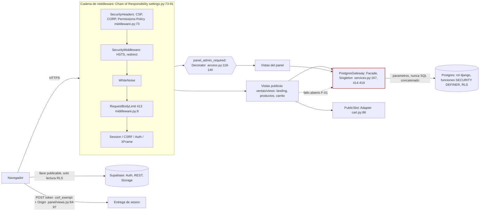
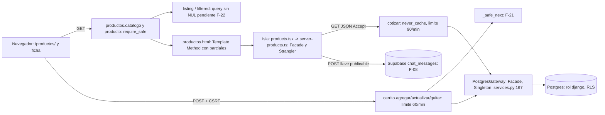
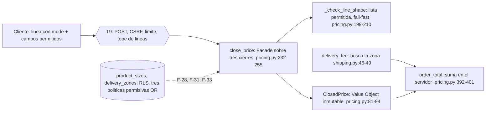
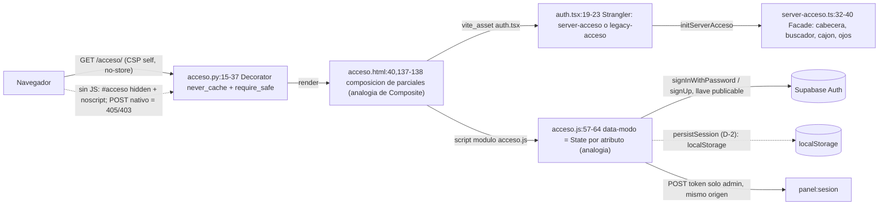
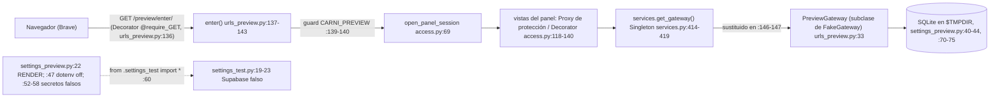
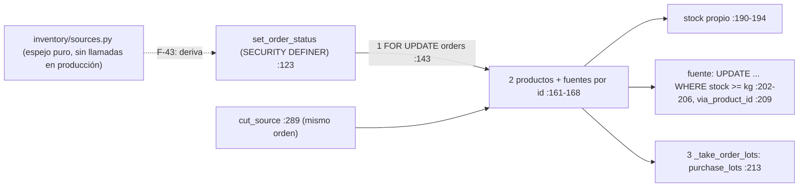
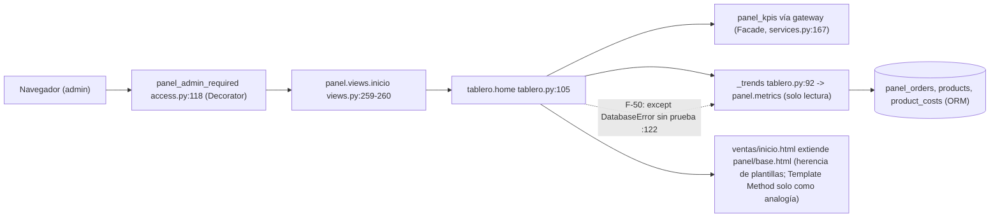
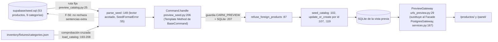
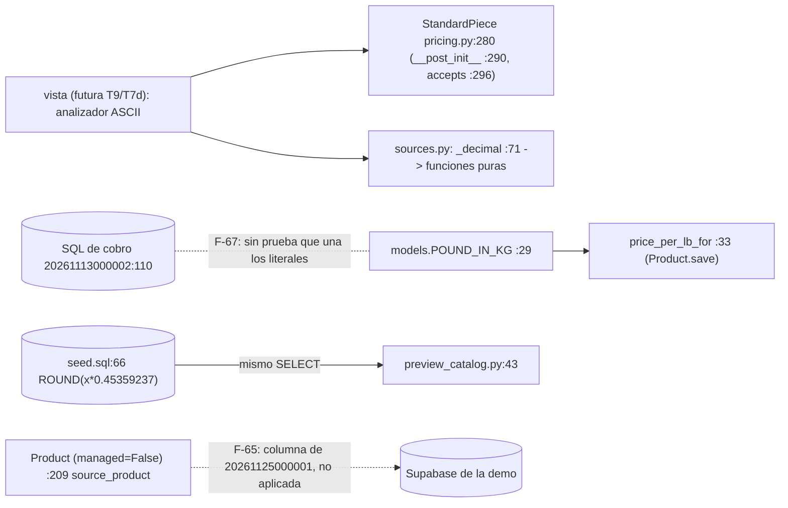

# Auditoría de seguridad del rediseño (TA), rebanada 1

Auditor: teammate `auditor` (rol security-guardian). Fecha: 2026-11-23. Rama `claude/stack-carney-mvp-244236`, HEAD `0e91976c`.
Specs cubiertas: S2 (Django sirve las páginas), S6 (productos, carrito, cotizador) y S7 (componentes compartidos: header, carrito, CSP), según `odd/tasks/rediseno-moderno.md`.
Alcance de la rebanada 1: los commits `cefc87fa` (T3 A, `/` servida por Django) y `11ff7c41` (T3 B, movimiento con scroll) y el código público de la tienda sobre el que se apoyan. Se audita **HEAD**, no el árbol de trabajo sin commitear de los teammates (en el momento de la auditoría `backend-datos` tenía cambios sin commitear en `ventas/views/carrito.py`, `comun.py`, `productos.py`, `catalog.py`, `domain.py` y `context_processors.py`; `frontend` tenía `ventas/templates/ventas/productos.html` sin seguimiento). Las líneas citadas son de HEAD.
Corrección de ruta: la CSP no vive en `backend/ventas/middleware.py` (no existe) sino en `backend/config/middleware.py:35-54`.

Este informe no modifica código. Los hallazgos van al dueño por mensaje con el mismo archivo:línea. Convención: **confirmado** = reproducido con una prueba, un comando o la lectura exacta del código; **por validar** = hipótesis con base en el código cuyo dato decisivo está fuera del repositorio, sin severidad hasta que se valide.

## 1. Hallazgos

| id | severidad | estado | archivo:línea (HEAD) | dueño | resumen |
|---|---|---|---|---|---|
| F-01 | media | confirmado en HEAD; **corregido en el árbol sin commit** (sección 6) | `backend/ventas/views/carrito.py:263-274` | backend-datos | El respaldo `create_order_staff` del pedido de invitado quita el tope de 3 pendientes por teléfono y la validación de 7 dígitos |
| F-02 | media | confirmado en HEAD; **corregido en el árbol sin commit** (sección 6) | `backend/ventas/views/carrito.py:177`, `:184`, `:194` | backend-datos | `agregar`, `actualizar` y `quitar` no tienen límite y cada POST hace una llamada RPC y escribe una sesión |
| F-03 | baja | confirmado | `backend/config/settings.py` (sin `SESSION_ENGINE`), `render.yaml:31` | main | Nada ejecuta `clearsessions`: la tabla de sesiones solo crece |
| F-04 | sin severidad | por validar | `backend/ventas/throttle.py:13-20`, `settings.py:343-349` | backend-datos | Con más de un salto de proxy, todos los clientes comparten contador de límite |
| F-05 | baja | confirmado | `.gitignore:12-23` | main | `.env.*` y `secrets/` no están ignorados, contra la regla global 4 |
| F-06 | baja | confirmado | `backend/static/tienda/vendor/supabase-js.mjs`, `backend/README.md:343-349`, `backend/ventas/tests/test_acceso.py:213,226` | frontend | El módulo que maneja la contraseña es un binario minificado sin hash registrado ni prueba de contenido |
| F-07 | sin severidad | por validar (aviso previo a T4b) | `js/modules/core/cart.js:228-262`, `src/entry/products.tsx` | frontend | El carrito heredado arma HTML con datos sin escapar y atributos en línea que la CSP bloquea; calcula totales en el navegador |
| F-08 | baja | confirmado | `supabase/migrations/20260911_chat_messages.sql` (política `chat_messages_insert_anon`) | backend-datos | Inserción anónima con `WITH CHECK (true)` y sin tope de longitud |
| F-09 | sin severidad | por validar | `backend/config/urls.py:22`, `backend/panel/access.py:51` | main | `/admin/login/` es público y sin bloqueo por intentos; depende de si existe un superusuario con contraseña |
| F-10 | baja (alcance) | confirmado | `package.json:32,37,38`, `package-lock.json` | main | `npm audit --omit=dev`: 9 vulnerabilidades (1 crítica, 5 altas, 3 moderadas); fuera del camino de Django salvo axios; plazo ASVS 15.1.1 vencido |
| F-11 | baja | confirmado | `server/app.ts:11-16`, `server/routes/buildads.ts:7-15,34` | main | Servidor Node de desarrollo: API de BuildAds sin autenticación y `express.static` sobre la raíz del repo |
| F-12 | info | confirmado | `backend/config/settings.py:221`, `backend/inventory/storage.py:130-140` | backend-datos | La clave `service_role` vive en el entorno del proceso de Django (solo para fotos) |
| F-13 | info | confirmado | `backend/pyproject.toml:6` | backend-datos | El límite inferior `django>=5.2,<5.3` no se subió a `>=5.2.19`; el lock sí está en 5.2.19 |
| F-14 | info | confirmado | `backend/templates/base.html:7`, `backend/ventas/templates/ventas/tienda/landing.html:11`, `backend/static/tienda/vendor/gsap/` | main (T8) | Superficie muerta de la tienda paralela que WhiteNoise sigue sirviendo |
| F-15 | info | confirmado | `backend/config/middleware.py:39-51` | main | La CSP no tiene `report-to`: una violación en producción no se ve |
| F-16 | sin severidad | por validar | `supabase/migrations/202604100002_rls_policies.sql:23-26` | backend-datos | `profiles_insert_own` no fija `role = 'customer'`; hoy lo cubre el disparador de alta |
| F-17 | baja | confirmado; **IPv6 corregido en el árbol (verificado)**, caché de 300 entradas pendiente del lead | `backend/ventas/throttle.py:13-35`, `backend/config/settings.py` (sin `CACHES`) | backend-datos / main | Los límites por IP usan la dirección completa (un /64 de IPv6 da 2^64 llaves) y viven en una caché `LocMemCache` de 300 entradas que se vacía con ruido de llaves |
| F-18 | info | confirmado; **corregido en el árbol (verificado)** | `backend/ventas/forms.py:59-61`, `backend/ventas/views/carrito.py` (`StoreOrderForm`) | backend-datos | El formulario del pedido acepta "-------" como teléfono; solo el SQL lo rechaza |
| F-19 | baja | confirmado; `backend-datos` propone aceptarlo (decisión del lead o de Eduardo) | `backend/ventas/views/productos.py` (`cotizar`, campo `avisos`), `supabase/migrations/20261113000002_comercio_v1_cotizacion_y_pedidos.sql:205-209` | backend-datos | La cotización pública ahora devuelve `low_stock`, que depende de la cantidad pedida: sirve para calcular el stock exacto |
| F-20 | info | confirmado; **contrato y 3 pruebas añadidos (verificado)** | `backend/ventas/views/carrito.py` (escrituras en modo JSON), `docs/datos/contrato-productos.md:19-33` | backend-datos / frontend | La cookie CSRF solo existe en páginas que pintan un token; el 403 de CSRF es HTML |

### F-01 (media, confirmado): el respaldo del pedido de invitado pierde controles
- Código: `carrito.py:263-274` captura `GatewayFunctionMissing` de `create_order_web` y llama `create_order_staff(items=lines, staff_ref=None, channel="whatsapp", **values)`. El registro es un `logger.warning` (`:266-271`).
- SQL: `create_order_staff` (`supabase/migrations/20261113000002_comercio_v1_cotizacion_y_pedidos.sql:456-495`) no cuenta pendientes y del teléfono solo valida `char_length(v_phone) > 20` (`:482`). `create_order_web` (`20261117000002_create_order_web.sql:62-80`) exige teléfono (`:62`), 7 dígitos (`:66-68`) y no más de 3 pendientes por los mismos dígitos (`:73-80`, con bloqueo advisory).
- Privilegio: **ninguna escalada en la base**. Las dos funciones son `SECURITY DEFINER`, las ejecuta el mismo rol `django` (`20261117000002:92-93`, `20261113000002:658-667`) y comparten `_create_order`. Cambia el control: el pedido nace con canal `whatsapp` y `staff_ref` NULL, es decir, un pedido anónimo de la web se ve como uno del personal.
- Escenario: una base sin la migración `20261117000002` (restaurada de un respaldo, base nueva de una rama, la demo de Render con su propio proyecto, `render.yaml:9`) deja a un anónimo crear pedidos pendientes sin tope por teléfono. Solo lo frena el límite de 5 intentos por hora por IP y por sesión (`settings.py:343-348`, `carrito.py:242-253`). El regex `forms.py:59-61` (`^\+?[0-9 ()\-]{7,20}$`) acepta "-------", que solo `create_order_web` rechaza. Un pedido pendiente no descuenta stock (el stock se mueve en `set_order_status`), así que el daño es ruido en el tablero, tiempo del personal y estadísticas del canal WhatsApp contaminadas.
- Arreglo: fallar cerrado (que `GatewayFunctionMissing` termine en `GatewayUnavailable` y el mensaje de tienda no disponible) o replicar en Python el tope y los 7 dígitos antes del respaldo; una prueba que ejerza el respaldo con 3 pendientes; una comprobación de arranque o de salud que verifique que existe `create_order_web`.

### F-02 (media, confirmado): escrituras públicas del carrito sin límite
- `agregar` (`carrito.py:177`), `actualizar` (`:184`) y `quitar` (`:194`) no llaman a `throttle`. `agregar` y `actualizar` pasan por `_save_line` (`:159-173`) y `_quote_ok` (`:146-156`), o sea una llamada RPC `quote_cart` por POST, más la escritura de la sesión del carrito. Tienen límite solo `cotizar` (`productos.py:94`, 90 por minuto), `buscar` (`productos.py:126`, 120 por minuto) y `pedido` (`carrito.py:242`).
- Escenario: un script pide una página (recibe cookie y token CSRF: sin problema, es público) y repite `POST /carrito/agregar/<pk>/` con cookie nueva en cada vuelta. Cada vuelta es una consulta a la base y una fila nueva en `django_session`. La demo corre con un solo trabajador síncrono (`render.yaml:31`, `--workers 1`), así que saturarlo degrada toda la tienda; la base es de capa gratuita.
- Estado en el árbol de trabajo: `backend-datos` ya agregó `CART_WRITES_PER_MINUTE = 60` en `carrito.py`, todavía sin uso. Pendiente de cablear y probar.
- Arreglo: `throttle.too_many(request, "carrito", CART_WRITES_PER_MINUTE)` en las tres vistas, respuesta 429 y prueba. Las páginas de lectura (`/`, `/productos/`) tampoco tienen límite pero su costo es menor; es una decisión de capacidad, no un hallazgo.

### F-03 (baja, confirmado): sesiones que nunca se purgan
- `grep -rn clearsessions` sobre el repo: sin resultados. `SESSION_ENGINE` es la base de datos (`django.contrib.sessions.backends.db`, impreso con la configuración tipo producción). Con F-02, las filas de `django_session` crecen sin tope aunque expiren (`SESSION_COOKIE_AGE` 8 h, `settings.py:286`).
- Arreglo: `manage.py clearsessions` en el comando de arranque (`render.yaml:31`) o en el script de build (`scripts/render_build.sh`), o un cron de la plataforma.

### F-04 (por validar): IP del cliente detrás de más de un proxy
- `throttle.client_ip` (`throttle.py:13-20`) usa la **última** entrada de `X-Forwarded-For` cuando `DJANGO_BEHIND_PROXY` está activo (`settings.py:349`). Es correcto con exactamente un proxy. Si hay otro salto delante (por ejemplo un CDN delante de la plataforma), esa última entrada es la del intermediario: todos los clientes comparten contador y el pedido número 6 de la hora, de cualquiera, recibe 429 (`CHECKOUT_THROTTLE_LIMIT=5`, `settings.py:343-348`); `cotizar` y `buscar` se comparten igual.
- Dato que falta: cuántos saltos agrega el despliegue real. No se sondea el despliegue (regla de la auditoría). Plan: en la demo, registrar una sola vez el `X-Forwarded-For` de una petición propia, o leer la documentación de la plataforma. Arreglo: número de saltos confiables configurable y tomar `entradas[-saltos]`.

### F-05 (baja, confirmado): `.gitignore` incompleto frente a la regla global 4
- `.gitignore:12-23` cubre `.env`, `.env.local`, `.env.*.local`, `.env.bak-*` y `.env.example`; `backend/.gitignore:1` cubre `.env`. Prueba: `git check-ignore -v .env.production .env.staging secrets/x.txt` termina con código 1 y sin salida: ninguno está ignorado. Un `.env.production` se puede commitear por accidente.
- Arreglo: agregar `.env.*` y `secrets/` (la regla global pide `.env`, `.env.*`, `*.pem`, `*.key` y `secrets/`; `*.pem` y `*.key` ya están en `:76-77`).

### F-06 (baja, confirmado): módulo de la pantalla de contraseñas sin verificación de contenido
- `acceso.js:102` carga con `import()` el archivo `static/tienda/vendor/supabase-js.mjs` (189 KB minificados, sin cabecera ni licencia). `backend/README.md:343-349` documenta la procedencia (esbuild 0.27.7 desde `@supabase/supabase-js@2.103.0`, construido con `--ignore-scripts`) y la cadena "2.103.0" dentro del archivo coincide con `package-lock.json:5342`. Ninguna prueba compara el contenido: `test_acceso.py:213` y `:226` solo comprueban que existe y que se importa.
- sha256 actual: `55204258e5c6d08794e6dba3cbd831c23b9c8c2bcb1f57923f2a82c909abfa07`.
- Escenario: un cambio malicioso o accidental del archivo (minificado, ilegible en una revisión) vería correos y contraseñas. Está en git, así que el cambio sería visible en el diff, pero no revisable. No se reconstruyó el módulo (exigiría instalar paquetes).
- Arreglo: guardar el hash junto al comando de reconstrucción y una prueba que lo compare, o producirlo como entrada del build de Vite desde el lock (lo natural en T5).

### F-07 (por validar, aviso previo a T4b): el carrito heredado en la entrada de productos
- `src/entry/products.tsx` importa `js/modules/core/cart.js`. Ahí `row.innerHTML = ...` (`cart.js:228-262`) interpola `${it.name}` y `${it.img}` sin escapar y lleva `style="..."` y `onerror="..."` en línea. La CSP (`config/middleware.py:39-51`) no admite `'unsafe-inline'`: los atributos se bloquean (se rompe el diseño) y el nombre inyecta HTML, no script. Los totales se calculan en el navegador (`normalized.itemTotal`), contra la regla de que el precio sale del servidor (Engram #1091, punto 16a).
- Hoy no se sirve: la entrada solo la usa `backend/ventas/templates/ventas/productos.html:30`, que no está commiteada. Se revisa cuando `frontend` entregue T4b.
- Arreglo: que `/productos/` use el carrito de Django (`ventas.cart` y `quote_cart`); donde se conserve JS, `createElement` y `textContent` y clases en lugar de `style` y `onerror`.

### F-08 (baja, confirmado): `chat_messages` acepta inserciones anónimas sin tope
- `supabase/migrations/20260911_chat_messages.sql`: `CREATE POLICY "chat_messages_insert_anon" ... FOR INSERT WITH CHECK (true)`; `message`, `session_id` y `page_url` son `text` sin límite. El widget del chat se carga también en la landing de Django (`src/landing/server-store.tsx:129` importa `js/modules/chatbot.js`, que escribe con la llave publicable en `chatbot.js:151-163`). La llave publicable es pública por diseño; cualquiera puede insertar filas de tamaño arbitrario por la REST de Supabase (crecimiento de almacenamiento en capa gratuita). La lectura sí está limitada al administrador (`chat_messages_select_admin`, `public.is_admin()`), así que no hay fuga.
- El bundle commiteado se construyó sin `VITE_SUPABASE_*` (solo aparecen los nombres, ningún valor), por lo que en esa build el widget no persiste (`chatbot.js:149` sale temprano). El riesgo es por la API directa y por una futura reconstrucción con `.env`.
- Arreglo: migración nueva (solo escrita para revisión) con `CHECK (char_length(message) <= 1000 AND char_length(session_id) <= 64 AND char_length(page_url) <= 200)`; a mediano plazo, escribir por Django con límite.

### F-09 (por validar): `/admin/` público sin bloqueo por intentos
- `config/urls.py:22` publica `admin.site`. No hay `django-axes` ni límite en el login (`grep` de `axes|ratelimit` en `pyproject.toml` y `settings.py`: nada). Los usuarios del panel nacen con contraseña inutilizable (`panel/access.py:51`, `set_unusable_password`), así que el login solo sirve a un superusuario creado a mano. El roadmap pide "Max Retry and jail features in login" (`best-practices.md:100`).
- Dato que falta: si en la base real existe un superusuario con contraseña utilizable. Arreglo: desactivar `/admin/` en producción con una variable de entorno, o agregar bloqueo por intentos.

### F-10 (baja por alcance, confirmado): deuda de dependencias npm
`docker run ... npm audit --omit=dev --json`: **9** (1 crítica, 5 altas, 3 moderadas), las mismas de L8 y de Engram #1091 punto 12.

| paquete | severidad | directo | alcance en producción de Django |
|---|---|---|---|
| proxy-addr (≤2.0.7) | crítica | no | no: cadena de `express` en `server/app.ts` (solo `npm run api:dev`, `package.json:16`) |
| axios (1.0.0-1.19.0) | alta | sí (`package.json:32`) | **sí, en el navegador**: `backend/static/vite/assets/globalStyles-Cc1az5Oc.js` contiene `AxiosError`; lo usa `src/redux/slices/busquedaSlice.ts:17,186`. Los avisos son de adaptador de Node, `NO_PROXY` y contaminación de prototipos: alcance bajo en el navegador |
| body-parser, ws, form-data, ip-address | alta | no | no: cadena de `express`/dev |
| express-rate-limit | moderada | sí (`package.json:38`) | no: solo `server/routes/buildads.ts` |
| follow-redirects, qs | moderada | no | no |

`render.yaml` despliega solo Django, así que el camino de producción no incluye la cadena de `express`. El plazo de OWASP ASVS 15.1.1 (crítico y alto en 7 días) venció: el hallazgo viene del 2026-11-03. Arreglo: previsualizar sin `--force` (axios 1.20.0, proxy-addr 2.0.8, ws 8.21.0, etc., según #1091 punto 12) y probar cada salto en Docker. Python: `backend/uv.lock` fija Django **5.2.19** (commit `5af793fb`), psycopg 3.3.5, PyJWT 2.15.1, cryptography 50.0.2, gunicorn 26.2.0, whitenoise 6.12.0: sin hallazgos conocidos en #1570. No se corrió un escáner de Python con red (ver sección 4).

### F-11 (baja, confirmado): servidor Node de desarrollo
- `server/app.ts:11-16`: `app.use('/api/buildads', ...)` y `app.use(express.static(workspaceRoot))` con `workspaceRoot` igual a la **raíz del repo** (`:5-8`); `app.listen(port)` escucha en todas las interfaces. Las rutas `/predis` y `/elevenlabs` (`server/routes/buildads.ts:17,83`) no tienen autenticación; solo un límite de 20 por minuto por IP (`:7-15`), y reenvían a APIs de terceros con claves del servidor (`process.env.PREDIS_API_KEY`, `:34`). Mientras corre `npm run api:dev` en una red compartida, cualquiera lee fuentes, migraciones y código del backend (los archivos con punto, como `.env`, los ignora `express.static` por defecto según la documentación de serve-static; no se verificó en esta sesión) y gasta cuota de pago.
- No se despliega (`render.yaml`). El navegador llama a esas rutas desde `src/modules/buildads/BuildAdsOrchestrator.tsx:39-48` con POST sin cabecera CSRF; Django no tiene esas rutas (la página `/panel/buildads/` es solo lectura, `panel/views.py:294`). Es una decisión para T7: cuando BuildAds pase a Django hará falta `@panel_admin_required`, CSRF, límite y la aprobación de Eduardo para enviar datos a terceros (Predis, ElevenLabs).
- Arreglo: `express.static` solo sobre una carpeta pública, escuchar en `127.0.0.1`, autenticación antes de gastar cuota.

### F-12 (info, confirmado): `service_role` en el proceso de Django
- `settings.py:221` lee `SUPABASE_SERVICE_ROLE_KEY` (opcional; `render.yaml:70` la declara). Solo la usa `inventory/storage.py:130-140` para subir fotos. La regla de AGENTS.md ("nunca `service_role` fuera del entorno local") se cumple en la conexión de Postgres (`POSTGRES_USER` es `django.<ref>`, `backend/README.md:536`), pero la clave existe en el entorno del mismo proceso: un RCE o una lectura del entorno en Django daría control total del proyecto de Supabase, con RLS omitida. No hay vía de explotación en esta rebanada; es concentración de privilegio. Alternativa: subir con URL firmada generada por una función mínima, o un rol de almacenamiento dedicado.

### F-13 (info, confirmado)
`backend/pyproject.toml:6` conserva `django>=5.2,<5.3`. El lock está en 5.2.19, que es la versión de seguridad del 2026-11-03, pero una instalación sin lock podría resolver una versión anterior. Subir el límite a `>=5.2.19` (Engram #1091 punto 14).

### F-14 (info, confirmado): superficie muerta de la tienda paralela
`backend/templates/base.html:7` lleva un `<style>` en línea (la CSP lo bloquearía; nadie extiende esa plantilla), y `ventas/tienda/landing.html:11` y `static/tienda/vendor/gsap/gsap.min.js` quedaron sin uso desde T3. `/static/tienda/**` sigue publicado por WhiteNoise. T8 los borra; hasta entonces son superficie sin dueño.

### F-15 (info, confirmado): sin informe de violaciones de CSP
`config/middleware.py:39-51` no define `report-to` ni `Reporting-Endpoints`. La guía de `modern-web-guidance` (id `security`, fase 2) recomienda el reporte para ver regresiones de CSP (por ejemplo un `onerror` en línea nuevo) antes de que las vean los clientes. Se leyó la guía solo por coincidencias de `grep` (ver sección 4).

### F-16 (por validar): `profiles_insert_own` sin `role = 'customer'`
`202604100002_rls_policies.sql:23-26`: `WITH CHECK (auth.uid() = id)` no fija `role` ni `points`. El disparador `protect_profile_system_fields` (`202604100003_functions.sql:53-75`) es solo `BEFORE UPDATE`, y `handle_new_user` (`:8-35`) crea el perfil al alta con rol `customer`. Si existiera un usuario de `auth.users` sin fila en `profiles` (alta fallida, fila borrada a mano), un cliente podría insertar su propio perfil con `role = 'admin'`, y `Profile.is_admin` de Django (`panel/views.py:87`) le daría el panel. Dato que falta: ese estado en la base real (solo lectura, sin acceso en esta sesión). Arreglo: `WITH CHECK (auth.uid() = id AND role = 'customer' AND points = 0)`.

## 2. Revisado y limpio (con evidencia)

| control | resultado | evidencia |
|---|---|---|
| CSP `'self'` en vigor | limpio | `backend/config/middleware.py:35-54`; el middleware es el primero de `MIDDLEWARE` (`settings.py:76`). Cabecera real de `GET /` con el cliente de pruebas: `default-src 'self'; script-src 'self'; style-src 'self'; img-src 'self' data: <supabase>; font-src 'self'; media-src 'self'; connect-src 'self' <supabase>; object-src 'none'; frame-ancestors 'none'; base-uri 'self'; form-action 'self'`. Solo `/admin/` admite estilos en línea (`:38`) |
| Plantilla de la landing sin estilos, scripts ni manejadores en línea ni CDN | limpio | `grep -nE "style=|`, categoría y nota igual, `q` igual: 0 fragmentos crudos en el catálogo y en la ficha; `meta description` y `value=""` escapados por el autoescape |
| Cajón (`_bolsa.html`) | limpio | `next` es `request.get_full_path` más `#bolsa` y la vista lo revalida (`carrito.py:144-149`); el borrado es un POST con `` (`_bolsa.html:35`); sin precios |
| Paginación (`_catalogo.html:43,45`) | limpio | `q` con `urlencode`, `category` solo dígitos (`catalog.py:56-66`, tope de 9) |
| Validación en el servidor del cotizador y del carrito | limpio | `CartLineForm` (`forms.py:19-26`): `amount` 10 dígitos y 3 decimales, `thickness_in` 4 y 2, `note` 200, `mode` y `unit` por lista; sin campo de precio; `StoreOrderForm` (`carrito.py:70-112`) con largos; el precio sale de `quote_cart`; `cotizar` es `require_safe`, `never_cache`, 404 en JSON idéntico para inactivo e inexistente |
| CSRF en todo `fetch` | limpio | un solo `fetch` hacia Django (`configurador.ts:111`, GET); el POST de `chatbot.js:151` va a Supabase con la llave publicable y sin cookie de sesión, así que CSRF no aplica (su riesgo es F-08). Escrituras de Django: `agregar`, `actualizar`, `quitar` y `pedido` bajo `CsrfViewMiddleware` sin `csrf_exempt`; 403 sin token en modo JSON (`test_contract_carrito.py:164`) |
| Caso positivo de CSRF en JSON con `Origin` ajeno | **ya existe** (el pendiente de L16 y L17 está cumplido) | `test_contract_carrito.py:404` (token de la cookie en `X-CSRFToken` → 200) y `:412` (mismo token con `Origin: https://evil.example` → 403, carrito vacío), dentro de `CsrfForScriptsTests` (`:381`) |
| Límites por IP | limpio | sonda E: 95 `cotizar` de un cliente → 90 con 200 y 5 con 429, el primero en la 91; `test_contract_carrito.py:469-526` (`WriteLimitTests`) |
| Costo privado | limpio en comportamiento; prueba débil (F-24) | sonda C |
| Métodos y producto inexistente | limpio | sonda G: `POST /productos/` → 405; ficha de un producto que no existe → 404 |

### Diagrama anotado con patrones (rebanada 3)
Patrones que el código usa de verdad en HEAD; lo demás es analogía. Referencia: `~/agentic-global/claude/fichas/refactoring-guru.md`, sección "Patrones aplicados a Carni-mvp".

- Template Method (de Django): `productos.html` con `` de `parciales/` (`productos.html:39-64`).
- Facade: `src/products/server-products.ts:15-26` (una función que monta cuatro comportamientos) y `ventas/services.py:167` (`PostgresGateway`).
- Strangler (en sentido amplio): `src/entry/products.tsx:25-29` ramifica por `data-server-store` y deja la isla heredada en su propio chunk.
- Decorator: `@require_safe`, `@never_cache`, `@cache_control` apilados en `productos.py:42,88-89,131-132`.
- Analogía, no patrón: `_safe_next` recuerda a una lista blanca (Guard), pero no es una clase ni un objeto.
- **Archify**: la skill existe en `.claude/skills/archify`; no se generó el HTML por la superficie de escritura de este teammate (solo este archivo). Lo debe generar quien tenga la superficie, con este Mermaid como entrada (ver F-25, ítem 4).

### Lo que no se verificó en esta rebanada
- Navegador real: la CSP en ejecución, el LCP y el CLS se toman del recibo #3360 (Brave a 375, 768 y 1440 px, 0 violaciones); no se repitieron.
- Base de datos viva: F-22 contra Postgres, el estado de RLS y la migración `20261117000002` (el MCP de Supabase dio timeout en el recibo #3360). Ninguna escritura a una base real.
- Despliegue real: `X-Forwarded-For` de Render (F-04); no se sondea.
- `supply-chain-risk-auditor`: se cargó, pero los commits no tocan `package.json`, `package-lock.json`, `pyproject.toml`, `uv.lock` ni `.npmrc` (diff vacío), así que no hay dependencia nueva que medir.
- `security-review` (comando integrado de Claude Code): un subagente no puede invocarlo; queda para el lead (ver "Needs skill" en el mensaje).

### Pruebas y escaneos de esta rebanada
- `dj.sh ventas.tests.test_products_page ventas.tests.test_contract_carrito ventas.tests.test_contract_productos ventas.tests.test_contract_throttle ventas.tests.test_public_cart ventas.tests.test_catalog ventas.tests.test_producto ventas.tests.test_header ventas.tests.test_styles config.test_security_headers config.test_cache config.test_request_size` → **261 pruebas, OK** (2.9 s).
- Sondas propias (`probe_t4b.py`, fuera del repo): 8 sondas A a G; dos hallazgos (D, F).
- `gitleaks git --redact --no-banner --log-opts="4f1e0c86~3..HEAD"` (gitleaks 8.30.1) → "4 commits scanned … no leaks found".

## 8. Seguimiento de la rebanada 3: `unsafe-inline` en la CSP (2026-11-23)

Origen: aviso del lead, que cita la guía de Todo de IA `protege-tu-app` ("el CSP de Carni permite `unsafe-inline`"). Se verificó contra el código y contra la cabecera real. La guía no se tomó como prueba.

| id | severidad | estado | archivo:línea (HEAD) | dueño | resumen |
|---|---|---|---|---|---|
| F-26 | baja | confirmado; **la afirmación de la guía es parcialmente falsa** | `backend/config/middleware.py:38`, `backend/config/test_security_headers.py:90-95` | main (config del lead) | `'unsafe-inline'` existe solo en `style-src` y solo para rutas bajo `/admin/`. `script-src` es `'self'` en todas partes: ni `unsafe-inline` ni `unsafe-eval` |

### F-26 (baja, confirmado): la excepción de estilos en línea de `/admin/`
- Código: `middleware.py:38` pone `'self' 'unsafe-inline'` en `style-src` solo si `path.startswith(reverse("admin:index"))`; `:41` fija `script-src 'self'` sin condición. `grep -rn "unsafe-inline\|unsafe-eval"` sobre `backend` (sin `static/vite`) → solo `middleware.py:38` y las pruebas. La prueba `test_the_admin_keeps_its_inline_styles_and_nothing_more` (`test_security_headers.py:90-95`) fija ambos valores.
- Cabecera real (cliente de pruebas, ajustes sintéticos), `style-src` y `script-src` por ruta: `/`, `/productos/`, `/acceso/`, `/carrito/`, `/panel/` y `/panel/acceso/` → `'self'` y `'self'`; `/admin/` y `/admin/login/` → `'self' 'unsafe-inline'` y `'self'`; `/Admin/login/` (404) y cualquier otra ruta → `'self'`. Ninguna respuesta lleva `unsafe-eval`. Ninguna vista fija su propia CSP (`grep` de `Content-Security-Policy`: solo el middleware y pruebas).
- Plantillas: las únicas marcas en línea que quedan son el `<style>` de `backend/templates/base.html:7`, que nadie extiende (F-14); `ventas/templates` y `panel/templates` no tienen `ZQX&admin=ZQX` en los dos: 200, el marcador no aparece en el cuerpo y no hay `alert(7)`; con `salir=1` sale el texto fijo "Cerraste tu sesión." (la rama `elif` hace que `salir` gane a `admin`, `acceso.html:70`; es de diseño). `{{ negocio.nombre }}` (`:26`, `:27`) pasa por el autoescape.
5. **`server-acceso.ts`**: sin `.value`, sin `fetch`, sin `localStorage`/`sessionStorage`, sin `innerHTML` (`:1-40`); solo cambia `type` y `aria-label` de los botones de ver contraseña (`:22-28`). El chunk construido (`server-acceso-CODRFmd1.js`, 705 bytes) coincide con la fuente y no contiene `fetch(`, `XMLHttpRequest`, `eval(`, `innerHTML`, `sendBeacon` ni URL alguna; igual los otros tres chunks nuevos (`legacy-acceso`, `auth`, `menu-drawer`, 838 a 1 248 bytes). `legacy-acceso.tsx:1-42` es el código viejo movido tal cual: texto fijo en React, sin `dangerouslySetInnerHTML`; solo corre si el `<body>` no trae `data-server-store` (`auth.tsx:19-23`), es decir, en el `accessweb.html` de la raíz, que Django ya redirige con 301.
6. **Bundles**: `grep -rlE "service_role|sb_secret_|sk_live_|sk_test_|AKIA[0-9A-Z]{12}|-----BEGIN" backend/static/vite` -> vacío. `sb_publishable_` -> 0 coincidencias. Los chunks `shared-CqOXKDrN.js` y `chatbot-BD-E1OUE.js` nombran `VITE_SUPABASE_URL` y `VITE_SUPABASE_ANON_KEY`, pero están commiteados desde antes (no son de T5) y no llevan valor (el mensaje "Supabase configuration missing" lo confirma).
7. **Dependencias**: `git diff --cached --stat -- package.json package-lock.json backend/pyproject.toml backend/uv.lock .npmrc` -> vacío. `backend/uv.lock` ya fija django 5.2.19 (ítem 14 de #1091 cerrado en esta rama); la deuda del lock de npm (#1091 ítem 12: axios 1.15.0 y proxy-addr 2.0.7) no es de T5 y **no la volví a medir**.
8. **`autocomplete`, `spellcheck`, `aria-describedby`**: `username` en el correo del ingreso y del registro (`:76`, `:97`) es la pista estándar para que el gestor de contraseñas guarde el par; no abre nada. `spellcheck="false" autocapitalize="none" autocorrect="off"` en las tres contraseñas (`:80`, `:105`, `:109`) **cierra** una fuga: cuando el botón ojo pasa el campo a `type="text"`, sin `spellcheck="false"` algunos navegadores mandan el texto al corrector. `aria-describedby` apunta a `ingresar-error` y `registro-error`, que existen (`:82`, `:114`) y están fijados por `test_acceso_page.py:211-222`. Ninguno de los tres es entrada de datos ni cambia a dónde viaja algo.
9. **Credenciales por defecto** (el caso de `admin`/`123456` del video, `3spCFnMSGIY` 2:11:20 y 2:12:05): `grep` por `admin123`, `123456`, `password = "..."`, `passwd` y `secret` sobre la plantilla, los `.ts/.tsx` y el CSS -> sin coincidencias.
10. **CSS**: `acceso-page.css` no tiene `url(` ni `@import`; el CSS construido (`auth-D3ybOBvO.css`) solo trae `data:image/svg+xml` (los `http://www.w3.org/2000/svg` son el namespace del SVG, no se descargan) y la fuente de Bootstrap Icons en `/static/vite/assets/`, ambos permitidos por `img-src 'self' data:` y `font-src 'self'`.
11. **Pruebas: ninguna aserción de seguridad se debilitó.** `test_acceso.py` tenía 21 pruebas en HEAD y tiene 21 en el índice. Cambios: el nombre de la plantilla; `autocomplete` `email` -> `username`; "todo `<script>` empieza por `/static/tienda/`" pasó a dos expresiones regulares exactas (`sources[0]` es `acceso(.hash).js` y `sources[1]` es `auth-*.js`, más "solo uno de `/static/tienda/`"), con `assertNotIn("<style")` y "ningún atributo `style`" intactos; "solo el script de cabecera" pasó a "solo la entrada de Vite" cuando falta la llave (503). `test_header.py` quitó `ventas:acceso` de `PAGES` porque su cobertura se movió a `AccesoHeaderTests` (`test_acceso_page.py:350-446`, 9 pruebas: mismos controles en el mismo orden, paneles, búsqueda GET, pie, script de cabecera). `test_styles.py` agregó `acceso.html` a las plantillas de Vite (así sale de la regla de Tailwind del panel). `test_catalog.py` cambió una plantilla esperada (el nombre de la prueba sigue diciendo "store frame": cosmético).
12. **Lo que ya tenía la página vieja** (para separar regresión de herencia): `git show HEAD:.../ventas/tienda/acceso.html` ya traía `method="post"` y `action` iguales (`:45`, `:64`) y los mismos `name`; T5 no abre nada nuevo y agrega `spellcheck`/`autocapitalize` y la guarda de `sin_bolsa`.
13. **`sin_bolsa`** (`_cabecera.html:29`): solo quita `aria-controls="bolsa"` cuando la página no tiene el cajón; es una variable booleana de la plantilla, no entra del cliente.
14. **`acceso.js` conserva su contrato con la plantilla** (leído línea a línea): los ids `acceso`, `acceso-aviso`, `form-ingresar`, `form-registro`; `[data-error]` (uno por formulario), `[data-accion]`, `button[type="submit"]`, el primer `input` de cada formulario; los `data-supabase-url/-key/-js`, `data-sesion-url`, `data-panel-url`, `data-tienda-url`, `data-modo`; y los `name` `email`, `password`, `full_name`, `phone`, `password_confirm`, `terms`, `newsletter`. Todos están en `acceso.html:62-117`.

### Diagrama anotado con patrones (rebanada 5)
`archify` está instalado (`~/.agents/skills/archify`) pero este agente no tiene la herramienta Skill: lo doy como Mermaid. El Archify del dueño (`docs/diagramas/t5-acceso.html`, 760 KB) **no lo abrí**; solo busqué en él referencias remotas: 0 `src`/`href` externos, 3 `<script` en línea, y `docs/` no está en `STATICFILES_DIRS` (`settings.py:175`, solo `backend/static`), así que Django no lo sirve.

Patrones que el código **sí** usa, con `rama:archivo:línea` (rama `claude/stack-carney-mvp-244236`): **Decorator** de función (`backend/ventas/views/acceso.py:15-16`, mismo patrón que la ficha da para `panel/views.py:64-68`); **Facade** acotado (`src/acceso/server-acceso.ts:32-40`: una llamada oculta cuatro conexiones). **Analogías, no el patrón**: Strangler (`src/entry/auth.tsx:19-23`; es un patrón de migración, no de GoF: la página vieja y la nueva conviven y cada una carga su propio chunk); State por atributo (`acceso.js:57-64` y `acceso-page.css:160-161`: `data-modo` decide qué formulario se ve); composición de parciales (`acceso.html:40`, `:137-138`). **No hay Template Method**: la página vieja era `extends ventas/tienda/base.html` y la nueva es una plantilla propia con `include`; si T4d lo anota para productos, aquí no aplica.

### Lo que no se pudo verificar
- **Configuración de Supabase Auth** (límite de intentos, longitud y fortaleza de la contraseña, protección contra contraseñas filtradas, confirmación de correo) y la **RLS de `profiles`** que lee `esAdmin` (`acceso.js:127-130`): es remoto y no tengo autorización; D-3.
- **Que los bundles salgan de esta fuente**: no reconstruí (`npm` solo corre en Docker). Comprobé que los cuatro chunks nuevos coinciden con la fuente y no traen sumideros, no que el build sea reproducible; el lead dijo que `build:django` no deja diff.
- **Jest, `node --test` y `tsc`**: no los corrí; el lead reportó 279/279, 40/40 y 0. **`tests/visual/acceso-page.test.cjs`**: lo leí por red y entorno (solo `node:*`, sin `.env` ni red) y no lo ejecuté.
- **Un navegador real**: la sonda usa el cliente de pruebas de Django; el 403 de CSRF y la CSP las vi en cabeceras, no pintadas.
- **`security-review`** (comando integrado): un subagente no puede invocarlo. Needs skill: security-review - `git diff --cached` de T5 acotado a las rutas de arriba (sin los bundles ni el diagrama).

### Pruebas y escaneos de esta rebanada
- `dj.sh ventas.tests.test_acceso ventas.tests.test_acceso_page ventas.tests.test_header ventas.tests.test_styles ventas.tests.test_catalog` -> **109 pruebas, OK** (0.380 s).
- Sonda propia (fuera del repo, en el scratchpad de la sesión: `probe_t5/probe_t5.py`, una prueba con el cliente de Django y `override_settings` de una llave sintética): reflejo `?salir`/`?admin` con `<script>`, POST (405 y 403 con CSRF forzado, sin eco), cabeceras (`no-store`, `script-src 'self'`, sin `unsafe-inline`) y llave publicable en el HTML. Sin `.env`, sin base real.
- `gitleaks git --staged --redact --no-banner` -> "no leaks found" (1.44 MB escaneados).
- `grep` de secretos y de `sb_publishable_` sobre `backend/static/vite`; `grep` de `url(`, `@import` y de sumideros (`fetch`, `eval`, `innerHTML`, `localStorage`, `sendBeacon`) en el CSS y los chunks nuevos; `git diff --cached --stat` de los manifiestos de dependencias -> vacío.
- Transcripciones leídas con los minutos pedidos: `0DhghJpWwVQ` en 0:10:46 ("lo más importante siempre es todo lo relacionado con autenticación, tokens, conexiones con otras bases de datos... muy bien testeado") y `3spCFnMSGIY` en 2:11:20 y 2:12:05 (el login generado con un prompt simple y la variable `password` con `admin123456`). El video **no** dice "auditar antes de subir"; lo que se aplicó aquí es solo la comprobación de credenciales por defecto (punto 9).
Riesgo de esta revisión: `Risk: none` (solo texto en este documento).

### Recibo de recursos de esta revisión (7 ítems MANDATORY del kit)
| # | ítem | estado | evidencia |
|---|---|---|---|
| 1 | Seguridad | usado | Kit y `RESOURCE-CONTRACT.md` sección 4 leídos; skill `security-and-hardening` (`SKILL.md:21-40` modelo de amenazas, `:44-46` y `:72` sesión en almacenamiento del cliente, `:94-98` cabeceras y CSP desde `default-src 'self'`); OWASP A01 (la vista solo lee, el POST se rechaza), A03 (autoescape, sin `|safe`, sin sumideros), A05 (CSP, cabeceras, `no-store`) y A07 (D-1 y D-2); Engram #1091 y #1159 leídos en esta revisión (la llave publicable en el README ya estaba anotada; esta rebanada no la agrega: `gitleaks --staged` limpio); #1161 y #1570 **no los releí** (los citó la rebanada 3); `supply-chain-risk-auditor` leída, **no ejecutada**: T5 no toca manifiestos (diff vacío) y el colector hace red; `security-review`: pendiente del lead (arriba) |
| 2 | REA | no aplica | Eduardo lo limita a S10 y al panel (encargo del lead); este agente no tiene herramientas `mcp__rea__*` |
| 3 | Diseño y animación | no aplica | Revisión de seguridad: del CSS solo leí `url()`, `@import` y `[hidden]`; el juicio de diseño es de `frontend-revision` |
| 4 | Patrones y diagramas | parcial | Ficha `refactoring-guru.md:58` leída; Mermaid anotado arriba con Decorator y Facade confirmados y tres analogías rotuladas; el Archify `t5-acceso.html` no lo abrí (solo `grep` de referencias remotas) y no pude invocar la skill `archify` sin la herramienta Skill |
| 5 | roadmap.sh | usado | `roadmap_search.py outline cyber-security` corrido (6 temas, 295 subtemas); `best-practices.md:100` (Max Retry y jail en el login -> D-3), `:111` (límites), `:142-147` (cabeceras y no devolver datos sensibles) y `:148` (códigos de respuesta -> 405/403 de la sonda) |
| 6 | Big School | usado | `temario.md:201` (seguridad por diseño, pp. 15-16: contraseñas fuertes y límite de intentos -> D-3; autorización en el servidor -> punto 1) y `:198` (TDD, p. 9): F-35 y F-36 vienen con la prueba que los fija |
| 7 | Videos | usado | Minutos verificados en `~/agentic-global/claude/raw/transcripts/` (`0DhghJpWwVQ.ts.txt` en [0:10:46], `3spCFnMSGIY.ts.txt` en [2:11:20] y [2:12:05]); enlaces: https://youtu.be/0DhghJpWwVQ?t=646 y https://youtu.be/3spCFnMSGIY?t=7880. No usé `youtube-scout` |
Por la regla de L18, "no usado" o "parcial" sin el OK de Eduardo rechaza la rebanada: aquí afecta al ítem 4 (el Archify del dueño no lo abrí). Needs skill: security-review - `git diff --cached` de T5 acotado a las rutas de arriba.

## 11. Rebanada 6: TP, vista previa con datos sintéticos (2026-11-24, sin seguimiento, sobre HEAD `56919839`)

Alcance: solo los archivos de TP (`backend/config/settings_preview.py`, `backend/config/urls_preview.py`, `backend/config/test_preview.py`, `backend/panel/management/commands/preview_seed.py`, `backend/panel/test_preview_seed.py`, `backend/scripts/preview.sh` y la sección "Local preview with synthetic data" de `backend/README.md`). El resto del árbol es trabajo en curso de `frontend` y no entra.

### Veredicto
- **TP se puede commitear desde el punto de vista de seguridad: no hay hallazgos bloqueantes.** Ninguna guardia deja datos reales ni llaves reales al alcance: la base es SQLite fuera del repo, `backend/.env` no se carga, y cada valor de Supabase, Postgres y `SECRET_KEY` se sobrescribe antes de importar `config.settings`. El peor caso de mala configuración (F-37) da un administrador **sintético** sobre datos **sintéticos**.
- Recomiendo cerrar F-37 y F-38 (bajas, pocas líneas cada una) en el mismo commit o justo después; F-39 a F-42 son pruebas que faltan o notas.
- **El candado de L18 no está cerrado** (ver "Estado del candado"): no lo decido yo.

### Hallazgos
| ID | Gravedad | Estado | Dónde | Dueño | Resumen |
|---|---|---|---|---|---|
| F-37 | baja | confirmado por lectura | `settings_preview.py:22`, `:67`; `README.md` (sección nueva, viñeta de `ALLOWED_HOSTS`) | backend-datos | La única barrera de red es el `127.0.0.1` de `scripts/preview.sh:23`. La guardia de `RENDER` solo cubre Render, y `ALLOWED_HOSTS` no es una barrera de red: valida la cabecera `Host`, que manda el cliente |
| F-38 | baja | confirmado por lectura | `urls_preview.py:136-143` | backend-datos | Entrada por GET sin comprobar el origen: login CSRF desde cualquier página, y la cookie `sessionid` de `127.0.0.1` se comparte entre puertos |
| F-39 | baja (prueba que falta) | confirmado con mutante | `settings_preview.py:47`; `test_preview.py:122-135` | backend-datos | Ninguna prueba fija que no se lee `backend/.env`: quitar la línea 47 deja las 26 pruebas en verde |
| F-40 | info (prueba que falta) | confirmado con mutantes | `preview_seed.py:226`; `urls_preview.py:146` | backend-datos | La guardia de SQLite de la siembra y la condición del cambio de gateway tampoco están fijadas: los dos mutantes pasan 26/26 |
| F-41 | info | confirmado por lectura | `settings_preview.py:42-44` | backend-datos | En Linux, `/tmp/carni-preview` se crea `755` y la base `644`, y se acepta un directorio que ya exista con otro dueño. En macOS no aplica: `$TMPDIR` es `700` y por usuario |
| F-42 | info | confirmado por lectura | `settings_preview.py:50-53` | backend-datos | El comentario dice que el secreto "never comes from the shell", pero `setdefault` acepta `CARNI_PREVIEW_SECRET_KEY` del shell |

#### F-37 (baja): fuera de Render, la vista previa solo es local por el bind
- **Qué pasa.** `settings_preview.py:22` rechaza `RENDER`. Si alguien pone `DJANGO_SETTINGS_MODULE=config.settings_preview` en otro proveedor (Fly, Railway, Heroku, un contenedor con `gunicorn --bind 0.0.0.0`, el mismo arranque de `render.yaml:31`) o corre `runserver 0.0.0.0:8000` en una red compartida, los ajustes cargan. `ALLOWED_HOSTS = ["127.0.0.1", "localhost"]` (`:67`) no lo impide: protege contra DNS rebinding, pero un atacante en la red manda la cabecera que quiera.
- **Cómo se reproduce (descrito, no ejecutado fuera de loopback).** Con el servidor en `0.0.0.0:8000`: `curl -i -H 'Host: localhost' http://<ip-de-la-máquina>:8000/preview/enter/` -> 302 a `/panel/` con `sessionid`, y con DEBUG en `True` las páginas de error muestran trazas y rutas. En vivo comprobé lo que sí protege: el servidor del lead escucha solo en `127.0.0.1:8000` (`lsof`) y `curl -H 'Host: evil.example' http://127.0.0.1:8000/` -> **400**.
- **Impacto.** Administrador sintético sobre la SQLite sintética y DEBUG expuesto; sin datos ni llaves reales, porque todo lo sensible se sobrescribe (`settings_test.py:19-23`, `settings_preview.py:52-58`, `:70-75`).
- **Corrección propuesta.** Una guardia positiva en vez de una lista de proveedores: un middleware solo de `settings_preview` que responda 404 cuando `ipaddress.ip_address(request.META["REMOTE_ADDR"]).is_loopback` sea falso, con su prueba (`self.client.get("/preview/enter/", REMOTE_ADDR="203.0.113.5")` -> 404 y sin `panel_supabase_user_id` en la sesión). En el README, la viñeta debe decir que la barrera es el bind `127.0.0.1` más esa comprobación, no `ALLOWED_HOSTS`.

#### F-38 (baja): login CSRF por GET y cookies compartidas entre puertos
- **Qué pasa.** `enter` (`urls_preview.py:136-143`) abre una sesión de administrador con un GET sin comprobar de dónde viene. Una página cualquiera que el desarrollador visite puede navegar en primer plano a `http://127.0.0.1:8000/preview/enter/` (las navegaciones de primer nivel no las frena Private Network Access) y deja al navegador con la sesión sintética. Las cookies no se separan por puerto: `sessionid` y `csrftoken` de `127.0.0.1:8000` pisan las de otro Django local en `127.0.0.1` (por ejemplo, el de `rama-backend` con la base local), que cierra esa sesión.
- **Impacto.** Molestia en el entorno de desarrollo; no hay escalada, porque cada base tiene sus propias sesiones y la firma usa otro secreto.
- **Corrección propuesta.** (a) En `enter`, aceptar solo `Sec-Fetch-Site` igual a `none` o `same-origin` (escribir la URL o un marcador da `none`; Brave lo envía) y responder 403 en otro caso, con prueba (`HTTP_SEC_FETCH_SITE="cross-site"` -> 403). (b) En `settings_preview.py`, `SESSION_COOKIE_NAME = "carni_preview_sessionid"` y `CSRF_COOKIE_NAME = "carni_preview_csrftoken"`, con prueba en el informe del proceso hijo.

#### F-39 (baja, prueba que falta): `PYTHON_DOTENV_DISABLED` sin prueba
- **Lo verificado.** `python-dotenv` 1.2.3 (`pyproject.toml` exige `>=1.2.3`) respeta la variable: `dotenv/main.py:22-29` y `:415-421` del venv de `rama-backend`; `settings_preview.py:47` la pone antes de `from .settings_test import *` (`:60`), que es lo que llega a `load_dotenv(BASE_DIR / ".env")` en `settings.py:31`. Lo que no se sobrescribe y sí podría venir de `.env` o del shell son ajustes no secretos (`DJANGO_SSL_REDIRECT`, `MAX_REQUEST_BODY_BYTES`, `CHECKOUT_THROTTLE_*`); no hay otras lecturas de `os.environ` en `backend/` fuera de los ajustes y `manage.py`.
- **Reproducción.** Copia del backend en el scratchpad, borrada la línea 47 -> `Ran 26 tests ... OK`.
- **Corrección propuesta.** En el `REPORT` del proceso hijo (`test_preview.py:27-44`), añadir `"dotenv_loads": __import__("dotenv").load_dotenv(stream=__import__("io").StringIO("CARNI_DOTENV_PROBE=1"))` y afirmar `False` (la API pública devuelve `False` cuando la carga está desactivada).

#### F-40 (info, pruebas que faltan): otras dos guardias sin fijar
- `preview_seed.py:226`, `connection.vendor != "sqlite"`: quitada, 26/26 en verde. Prueba: `@override_settings(CARNI_PREVIEW=True)` con `mock.patch.object(connection, "vendor", "postgresql")` -> `CommandError` y `Product.objects.count() == 0`.
- `urls_preview.py:146`, la condición del cambio de gateway: con `if True:`, 26/26 en verde; en una corrida completa, importar `config.urls_preview` dejaría `services._gateway` como `PreviewGateway` para el resto de la suite. Prueba: tras importar `config.urls_preview` con `settings_test`, `assertNotIsInstance(services._gateway, PreviewGateway)`.
- Sobre la pregunta 3: fuera de la vista previa el doble no se activa. `config.urls` no importa `urls_preview`, `ROOT_URLCONF` solo apunta ahí desde `settings_preview.py:68` y desde `override_settings` en pruebas, y `FakeGateway` solo se importa en pruebas y en `urls_preview.py:28`. Lo único que se cuela es acoplamiento: `ventas/tests/support.py` importa `django.test` y `panel.tests` y lee `supabase/tests/cotizacion-casos.json` al importarse, así que la vista previa depende de archivos de pruebas (no es un riesgo de seguridad).

#### F-41 (info): directorio por defecto en un `/tmp` compartido
- En Linux, `tempfile.gettempdir()` es `/tmp` (`1777`). `mkdir(parents=True, exist_ok=True)` (`:44`) acepta un `/tmp/carni-preview` creado antes por otro usuario, y la base queda `644`: otro usuario local puede leer la tabla de sesiones. En esta Mac: `$TMPDIR` `700`, `carni-preview` `755`, `preview.sqlite3` `644`, sin exposición.
- **Corrección propuesta.** `mkdir(mode=0o700)` y rechazar el directorio si `stat().st_uid != os.getuid()`.

#### F-42 (info): comentario inexacto sobre el secreto
- `settings_preview.py:50-51` dice que el secreto nunca viene del shell; `:52` usa `setdefault`, así que un `CARNI_PREVIEW_SECRET_KEY` exportado gana. Sin impacto (firma sesiones de datos sintéticos). Corregir el comentario o fijar el valor del shell como "solo para el autoreloader" en el texto.

### Respuesta a cada pregunta del encargo
1. **Alcance fuera de la máquina:** solo si alguien cambia el bind; entonces `ALLOWED_HOSTS` no lo frena (F-37). La guardia de `RENDER` está probada (`test_preview.py:73-77`), la base fuera del repo y las rutas relativas o `:memory:` también (`:79-105`), y el 404 sin la bandera (`:178-183`) y con las rutas reales (`:139-146`).
2. **`.env` y llaves reales:** verificado que no se cargan (F-39 da el detalle); falta la prueba.
3. **`FakeGateway` y `services._gateway`:** no se activan fuera de la vista previa (F-40).
4. **Login CSRF por GET en loopback:** importa poco, pero se corrige barato (F-38).
5. **Datos sembrados:** sintéticos. Nombres con sufijo "Test", teléfonos `+52 444 000 01xx`, "Calle Ficticia 123", `admin@preview.test` (TLD reservado), UUID fijos inventados; `gitleaks dir --redact` sin fugas en los 7 archivos. No comprobé la serie `444 000` contra el plan de numeración del IFT. La prueba de `test_preview_seed.py:83-89` fija solo el prefijo del teléfono, no los nombres.
6. **¿Las pruebas fijan cada guardia?** `RENDER`, ruta de la base, hosts, DEBUG y bandera, secretos del shell, POST 405 y 404 sin bandera, sí. Sin fijar: `.env` (F-39), SQLite de la siembra y condición del gateway (F-40). Mutantes en `scratchpad/auditor-tp/m1..m3`, los tres 26/26 en verde.
7. **Candado:** abajo.

Nota funcional, no de seguridad: `PreviewGateway` no aplica los descuentos sembrados (decisión abierta de L26). Si una vista se aprueba sobre la vista previa, los totales con descuento no son los de producción.

### Estado del candado (L18, recibo de TP en L26)
- **Ítem 2 (REA): "no aplica", requiere el OK de Eduardo.** Sin ese OK, por L18, el candado no se cierra.
- **Ítem 3 (Diseño): "no aplica", requiere el OK de Eduardo.** Igual.
- **Ítem 4 (Patrones y diagramas): L26 lo da como pendiente.** En disco ya existe `docs/diagramas/tp-vista-previa.html` (sin seguimiento, 18:10) con referencias a `settings_preview.py:22`, `:28`, `:47`, `:60`, `urls_preview.py:33`, `:137` y `access.py:69`, `:118`; no lo abrí ni validé sus patrones. Lo cierra el lead al comprobarlo.
- No decido ninguno de los tres.
- **Actualización (2026-11-25, L27).** Eduardo dio su OK: "en TP, que es solo la vista previa, REA y diseño no aplican, con mi OK. Commitea TP en cuanto pase el auditor." Con eso, los ítems 2 y 3 quedan cerrados. Ítem 4: `docs/diagramas/tp-vista-previa.html` existe (760 475 bytes, 2026-11-24 18:10, sin seguimiento). Lo leí por su texto, no en el navegador. Anota "Settings inheritance" (`settings_preview.py:60`), "Test double as gateway" (`urls_preview.py:33, 147`), "Idempotent seed by natural keys" (`preview_seed.py:103`), "Decorator guard reused" (`access.py:69, 118`) y las guardias `:22`, `:28`, `:47` y `preview_seed.py:226`. Una imprecisión menor: `access.py:69` es `open_panel_session`, una función normal; el decorador es `:118`. **Veredicto final: TP pasa. La única condición del commit es que `docs/diagramas/tp-vista-previa.html` entre en el mismo commit**, porque hoy está sin seguimiento. F-37 y F-38 siguen recomendados, no bloquean.

### Patrones (Mermaid; la skill `archify` no está disponible en este agente)

Confirmados: **Singleton** (`services.py:411-419`, la vista previa reemplaza la instancia única en `urls_preview.py:146-147`), **Decorator** (`@require_GET`, `urls_preview.py:136`) y **Proxy de protección** de la ficha (`access.py:118-140`), que la vista previa no esquiva: la entrada solo crea la sesión y cada vista sigue pasando por `is_panel_admin`. `PreviewGateway` sustituye al **Facade** `PostgresGateway` (ficha, `services.py:167`) con la misma interfaz; llamarlo Strategy sería **solo una analogía**: no se elige en tiempo de ejecución, se reemplaza por configuración. La herencia de ajustes por `import *` es una capa de configuración, no un patrón GoF.

### Pruebas y escaneos de esta revisión
- `manage.py test config.test_preview panel.test_preview_seed --settings=config.settings_test` (venv de `rama-backend`, valores ficticios en la línea de comando) -> **Ran 26 tests, OK** (2.8 s).
- Tres mutantes sobre una copia del backend en el scratchpad (`auditor-tp/m1`: sin la línea 47; `m2`: sin `connection.vendor`; `m3`: `if True:` en `urls_preview.py:146`) -> los tres **Ran 26 tests, OK**.
- `gitleaks dir <archivo> --redact` en los 7 archivos -> "no leaks found" en cada uno.
- En vivo, solo lectura: `lsof` -> escucha en `127.0.0.1:8000`; `curl -H 'Host: evil.example' http://127.0.0.1:8000/` -> 400; `curl http://127.0.0.1:8000/` -> 200. No llamé a `/preview/enter/` para no escribir sesiones.
- No corrí la suite completa (roja por el RED de `frontend`), ni `ruff`, ni semgrep o trivy (`cyber-neo` no está instalado, la skill lo dice en `SKILL.md:14-17`).
- Ningún `.env` leído; `backend/.env` no existe en este worktree (comprobado con `test -e`, sin abrirlo).
Riesgo de esta revisión: `Risk: none` (solo texto en este documento).

### Recibo de recursos de esta revisión (7 ítems MANDATORY del kit)
| # | ítem | estado | evidencia |
|---|---|---|---|
| 1 | Seguridad | usado | Kit y `RESOURCE-CONTRACT.md` sección 4 leídos (control de acceso en el servidor, seguridad por defecto); `security-and-hardening` (`SKILL.md:21-36`, modelo de amenazas: elevación de privilegios -> F-37 y F-38; `:117`, objetivo bajo raíz permitida con prueba de dueño -> F-41); `cyber-neo-auditoria` leída (no instalada: solo gitleaks); OWASP A01 (F-37, F-38), A05 (DEBUG y cookies), A07 (login CSRF); `gitleaks` 7/7 limpio. Engram #1161, #1570, #1159 y #1091 **no releídos** en esta revisión (los citan las secciones 7 y 10; TP no toca dependencias ni el README raíz). `supply-chain-risk-auditor`: no ejecutada, TP no cambia manifiestos (`git status` sin `pyproject.toml` ni `uv.lock`). `security-review`: pendiente del lead (abajo) |
| 2 | REA | no aplica | Infraestructura local sin flujo de competencia que estudiar; requiere el OK de Eduardo (igual que el recibo de TP) |
| 3 | Diseño y animación | no aplica | TP no cambia interfaz; requiere el OK de Eduardo |
| 4 | Patrones y diagramas | parcial | Ficha `refactoring-guru.md:58-75` leída; Mermaid anotado arriba con patrones confirmados y una analogía rotulada; el Archify `tp-vista-previa.html` no lo abrí |
| 5 | roadmap.sh | usado | `best-practices.md:138` ("debug mode is off in production" -> F-37: DEBUG en `True` es aceptable solo si el bind es loopback) y `:120` (estado contra CSRF -> F-38) |
| 6 | Big School | usado | `temario.md:201` (seguridad por diseño, pp. 15-16: páginas internas sin sesión = control de acceso roto -> la entrada debe quedar acotada a loopback, F-37) y `:198` (TDD, p. 9 -> F-39 y F-40 vienen con la prueba que los fija) |
| 7 | Videos | no usado | No consulté `youtube-scout` ni transcripciones en esta revisión; el recibo de TP (L26) ya cita https://youtu.be/0DhghJpWwVQ?t=646. Requiere el OK de Eduardo o un paso de `youtube-scout` |
Por la regla de L18, los ítems 2, 3, 4 (parcial) y 7 de esta revisión dejan el candado abierto hasta el OK de Eduardo. Needs skill: security-review - diff de los 7 archivos de TP (sin `frontend`). Engram: búsquedas `carni-mvp` y global sin resultados para la vista previa.

## 12. Rebanada 7: T7b y T7c, inventario por fuente (2026-11-25, sin seguimiento, sobre HEAD `5842d5bd`; verificador independiente, Risk items 1 y 4)

Alcance: `supabase/migrations/20261125000001_inventario_por_fuente.sql` (escrita, NO aplicada), `supabase/tests/inventario_por_fuente.sql`, `backend/inventory/sources.py`, los cambios de `backend/inventory/models.py` y `pricing.py`, `backend/inventory/migrations/0006_product_source_and_piece_tolerance.py`, las tres pruebas nuevas de `inventory` y `docs/contratos/inventario-por-fuente.md`. `git status` no muestra cambios en `panel/views_compras.py`, `ventas/cart.py` ni `ventas/models.py`, así que no hay nada que revisar ahí. Lo de `frontend` y lo de TP quedan fuera.

### Veredicto
- **T7b y T7c se pueden commitear como "migración escrita, no aplicada": no hay hallazgos bloqueantes para el commit.**
- **Condición para APLICAR la migración (no para el commit):** antes, `supabase/tests/inventario_por_fuente.sql` tiene que correr en verde contra Postgres, con las aserciones de F-45 añadidas. Conviene cerrar F-44 antes de aplicarla. El SQL es lo único que hace cumplir las reglas en producción, y aquí no se pudo ejecutar (F-43).

### Respuestas
1. **Comportamiento anterior (lectura línea a línea contra `20261119000003_lote_al_confirmar.sql:184-269`).** Los productos sin fuente conservan las mismas comprobaciones, el mismo mensaje `insufficient_stock: % needs %, only % in stock` y los mismos movimientos `sale` (migración `:184-194`). El filtro sigue siendo `track_stock` cuando no hay fuente (`:178`). Los lotes por pieza siguen pasando por `_take_order_lots` sin cambios (`:213`), y el costo congelado es idéntico (`:215-230`). Antes se validaba todo y luego se descontaba; ahora se valida y descuenta fila a fila. Como cualquier `RAISE` revierte la función entera, el efecto neto es el mismo.
   - **Gramos exactos (S14.4 a S14.6).** Primero el stock propio (`least(greatest(stock,0), need)`, `:184`); el resto sale de la fuente. En kg, `quantity_kg`; por pieza, `piezas x avg_piece_weight_kg` redondeado a 3 decimales (`:200-201`). El factor de rendimiento no entra.
   - **Nunca negativo.** `UPDATE ... WHERE stock >= v_rest_kg` con `IF NOT FOUND` (`:202-206`), además de `products_stock_non_negative` (`20261113000001:114`).
   - **Cancelación.** Agrupa por `(product_id, via_product_id)` y devuelve lo mismo a la misma fila (`:240-251`). Los movimientos anteriores a la migración tienen `via` nulo y se devuelven como antes.
2. **Orden de bloqueo: no encontré ningún deadlock posible.** Todas las rutas toman los bloqueos en este orden: la fila de `orders` (`:143`), luego los productos y sus fuentes en una sola sentencia ordenada por id (`:161-168`), luego `purchase_lots` (`_take_order_lots`, `lote_al_confirmar:80-83`). `cut_lot` sigue el mismo orden, productos y después lote (`despiece:113-114`); `cut_source` también ordena por id (`:311-315`); `record_shrink` y `record_stock_count` bloquean una sola fila. No hay inversión productos/lotes. No hay Postgres para provocarlo en vivo. El único hueco de concurrencia está en el trigger de la fuente (F-44).
3. **Funciones y permisos.** Las seis funciones nuevas son `SECURITY DEFINER` con `search_path = ''`. Se revoca `EXECUTE` a `PUBLIC`, `anon` y `authenticated` y se concede a `django` (`:495-505`). `set_order_status` usa `CREATE OR REPLACE`, que conserva su ACL. RLS activado en `inventory_settings` y `stock_counts`, con políticas solo para `django` (`:109-120`). Se revoca la secuencia `stock_counts_id_seq` (`:113`): la lección de F-28 está aplicada. Las dos vistas se revocan y solo `django` lee (`:506-509`).
4. **Entradas (por lectura, sin ejecutar el SQL).** En Postgres, `NaN` es mayor que cualquier número: `record_shrink` y `cut_source` lo rechazan con `insufficient_stock` (`:378`, `:333`), y `record_stock_count` lo rechaza por el tope `> 1000000` (`:404`). Los negativos y el cero se rechazan. `piece_tolerance_kg >= 0` (`:67`). Del lado de Python, ver F-47.
5. **Pruebas.**
   - `manage.py test inventory` -> **Ran 343 tests, OK**.
   - **8 mutantes de Python, 8 muertos:** propio negativo, `>` por `>=` en la fuente, umbral de nota, merma sobre el stock, fuente de sí misma, `x quantity` de la pieza, `<=` de la tolerancia y la condición de pieza fija.
   - Pero esas pruebas fijan el espejo en Python, no el SQL (F-43). Las 37 aserciones del SQL las leí, no las corrí: cubren los ejemplos literales (10 -> 9 -> 8.700 -> cortes de 3 + 3 -> 1.700, nunca negativo, cancelación de 1 kg, merma, conteo -6.67 %) y los permisos de `anon` y `authenticated` sobre dos funciones. Lo que falta está en F-45.
6. **Candado:** abajo.

### Hallazgos
| ID | Gravedad | Estado | Dónde | Dueño | Resumen |
|---|---|---|---|---|---|
| F-43 | media (verificación) | confirmado | `backend/inventory/sources.py` (sin llamadas fuera de pruebas: `grep` vacío); migración `:416-417` frente a `sources.py:175-177` | backend-datos | Las reglas viven en dos sitios. Solo el SQL corre en producción, y no se ha ejecutado. Ya hay una diferencia: el SQL compara el porcentaje sin redondear y Python lo redondea a centésimas, así que con 5.004 % el SQL exige nota y Python no |
| F-44 | baja | por lectura | migración `:40-61` | backend-datos | El trigger de un solo nivel tiene una carrera en READ COMMITTED: si una transacción hace `A.source = S` y otra hace `S.source = B` a la vez, las dos pasan y queda una cadena de dos niveles (el bloqueo de clave foránea es `KEY SHARE` y no choca con ese `UPDATE`). Además no se dispara con `UPDATE OF stock_unit`: una fuente puede pasar a `piece` con hijos colgando |
| F-45 | baja (pruebas que faltan) | por lectura | `supabase/tests/inventario_por_fuente.sql` | backend-datos | Faltan: cancelar la venta por pieza desde la fuente (9605) y la mixta propio + fuente (9603); un producto sin fuente que confirma y cancela en verde en este archivo; `relrowsecurity` de las dos tablas; privilegios de `stock_counts_id_seq` e `inventory_settings` para `anon` y `authenticated` (F-28); que `django` no pueda hacer `INSERT` directo en `stock_counts`. Usa `no_plan()`, así que nadie fija el "37": usar `plan(n)` |
| F-46 | info (requisito de T9) | confirmado | `pricing.py:264` (antes de `_check_product_sells`, `:265`) | backend-datos | La ruta de pieza fija se salta `sale_modes` y el aviso `low_stock`. Hoy `close_price` no tiene ninguna llamada en producción; cuando T9 lo conecte, que compruebe `"pieces" in sale_modes` y el stock en piezas |
| F-47 | info | sonda | `sources.py:69-70`, `pricing.py:280` | backend-datos | Con `NaN` o `Infinity`, el espejo lanza `decimal.InvalidOperation` en lugar de `InventoryError`, acepta dígitos Unicode (`Decimal('٣')` = 3) y una tolerancia negativa (devuelve `False`). Solo importa si una vista llega a pasarle texto del usuario: parsear antes con el analizador ASCII de F-29 y F-31 |
| F-48 | info | por lectura | migración `:184`, `:183` | backend-datos | `least()` ignora `NULL`: una `need` nula descontaría todo el stock propio. Hoy no puede pasar, porque `order_items.quantity_kg` es `NOT NULL` (`202604100001_initial_schema.sql:74`) y las piezas van con `coalesce`. Defensa barata: `coalesce(need, 0)` |
| F-49 | info | por lectura | migración `:84-91`, `:115-118` | backend-datos | `django` puede subir `note_required_pct` hasta 999.99 (anula la nota obligatoria) y nada audita quién lo hizo: `updated_by` y `updated_at` no los fija un trigger. Que la vista de ajustes de T7d escriba quién lo cambió, o un trigger |

**Correcciones propuestas.**
- F-44: al inicio del trigger, `PERFORM pg_advisory_xact_lock(hashtext('public.products.source_link'))`; ampliar el trigger a `UPDATE OF source_product_id, stock_unit`, con un caso que rechace `stock_unit <> 'kg'` cuando hay hijos; y su aserción.
- F-43: correr el archivo SQL antes de aplicar la migración, añadir un caso de 5.004 % que fije qué regla manda y alinear Python con ella (o documentar que Python solo es una vista previa del cálculo).

### Estado del candado (recibo de T7b y T7c en L28)
- **1 Seguridad:** esta sección es la revisión del auditor. `gitleaks dir --redact` -> "no leaks found" en los 10 archivos (migración, prueba SQL, `sources.py`, `pricing.py`, `models.py`, migración 0006, tres pruebas, contrato). Sigue pendiente `security-review` (lo corre el lead).
- **2 REA:** citan #3387 y "hueco honesto" (los competidores no publican su inventario). No es un estudio de esta rebanada; si cuenta como usado o necesita el OK de Eduardo, lo decide él.
- **3 Diseño:** `data-architect` por el ítem 3 del kit ("data model through data-architect"). Coincide con el kit.
- **4 Diagrama:** `docs/diagramas/t7b-inventario-fuente.html` existe (767 680 bytes, 2026-11-24 18:19, sin seguimiento) y menciona "Singleton" y "pattern". No lo abrí ni validé sus patrones. Tiene que entrar en el mismo commit.
- **5 roadmap.sh y 6 Big School:** citados; no los verifiqué.
- **7 Videos:** `https://youtu.be/Umwj8gI7-pk?t=0` dice "minuto verificado", pero `t=0` es el inicio del video. Hace falta el minuto real o quitar "verificado".

### Patrones (Mermaid; sin `archify` en este agente)

Confirmados: el `PostgresGateway` de `services.py:167`, que llama a estas funciones, es el **Facade** de la ficha. El orden de bloqueo canónico no es un patrón GoF: es una disciplina de concurrencia. `sources.py` son **funciones puras** (núcleo funcional), no Strategy; llamarlo así sería solo una analogía.

### Pruebas y escaneos de esta revisión
- `manage.py test inventory --settings=config.settings_test` -> **Ran 343 tests, OK** (2.25 s).
- Mutantes sobre una copia en el scratchpad (`auditor-t7b/`, script `mut_t7b.py`): 8/8 con `FAILED`.
- Sonda de entradas (`NaN`, `Infinity`, dígito árabe, tolerancia negativa) sobre `sources.py` y `StandardPiece`: resultados en F-47.
- El SQL no se ejecutó (no hay Postgres local); todo lo de SQL es lectura.
- Ningún `.env` leído.
Riesgo de esta revisión: `Risk: none` (solo texto en este documento).

### Recibo de recursos de esta revisión
| # | ítem | estado | evidencia |
|---|---|---|---|
| 1 | Seguridad | usado | `security-and-hardening` (modelo de amenazas, privilegio mínimo -> pregunta 3); OWASP A01 (grants y RLS) y A04 (diseño: dos fuentes de verdad, F-43); gitleaks 10/10; Engram #1161, #1570, #1159 y #1091 no releídos (esta rebanada no toca dependencias); `security-review` pendiente del lead |
| 2 | REA | no aplica | revisión de seguridad de SQL |
| 3 | Diseño | no aplica | sin interfaz |
| 4 | Patrones y diagramas | parcial | Mermaid arriba; el Archify del dueño no lo abrí |
| 5 | roadmap.sh | no usado | sin consulta nueva en esta revisión |
| 6 | Big School | usado | `temario.md:198` (TDD, p. 9: mutantes y pruebas que faltan, F-45) |
| 7 | Videos | no usado | sin consulta |
Needs skill: security-review - diff de los archivos de T7b y T7c listados arriba.

## 13. Rebanada 8: T7d rebanada 1, marco del panel e Inicio (2026-11-25, sin commitear, sobre HEAD `ebf18c64`; revisión del `auditor-2`)

Alcance: `backend/panel/views.py`, `panel/urls.py`, `panel/metrics.py` (nuevo), `ventas/views/tablero.py`, `ventas/templates/ventas/inicio.html`, `templates/panel/base.html`, `templates/panel/mas.html`, `templates/panel/parciales/` (nuevos: `inicio_semanas.html`, `inicio_margen.html`, `inicio_stock.html`), las cuatro pruebas de `panel/` y `docs/diagramas/t7d-panel-inicio.html`. Lo de `inventory/` y `supabase/` es de T7b (sección 12) y no entra.

### Veredicto
**Se puede commitear.** Sin hallazgos bloqueantes: ningún texto de la base llega sin escapar, las dos rutas nuevas y el Inicio siguen detrás de `panel_admin_required`, no hay estilo ni script en línea ni recurso externo, y `metrics.py` es de solo lectura con `Decimal` de punta a punta. Un mutante sobrevive (F-50): se corrige con una prueba, sin tocar el código de producción. El commit depende además del candado (abajo), que decide Eduardo.

### Respuestas
1. **Escape.** `grep` de `|safe`, `mark_safe`, `format_html`, `autoescape`, ` style=`, `<script` y `on*=` en los archivos del alcance: 0 coincidencias. Los nombres de producto salen solo como `{{ row.name }}` en `inicio_margen.html:17` e `inicio_stock.html:16`, con el escape automático. El SVG (`inicio_semanas.html:13-23`) no lleva ningún texto de la base: solo números calculados en `tablero.py:68-89`, fechas con `|date` y `Decimal`. Prueba que lo fija: `test_inicio.py:199` (`<b>x</b>` sale como `&lt;b&gt;`).
2. **Rutas y métodos.** `entregas` y `inventario` (`panel/views.py:310-322`) llevan `@panel_admin_required` y `@require_safe`; `test_secciones.py` comprueba GET 200, POST 405 y anónimo redirigido a `panel:acceso`. `inicio` (`views.py:259-260`) queda como en HEAD: guardado y sin `require_safe` (F-51). Las pruebas generales `panel/tests.py:845` y `ventas/tests/test_access.py:54` exigen el guardia en toda ruta del panel. **Costo y margen:** solo los pinta `inicio_margen.html`, dentro de `/panel/`, y hoy solo entra quien pasa `is_panel_admin` (`access.py:118-141`); no hay otro rol en el panel todavía (F-52).
3. **CSP `'self'`.** Sin `<style>`, `style=`, `<script>`, manejadores `on*` ni URL externas en el alcance. Los atributos de presentación del SVG (`fill-opacity`, `font-size`, `text-anchor`) no son estilos en línea para la CSP. Prueba: `test_inicio.py:190`. El autor midió 0 violaciones en Brave (L29); no lo repetí.
4. **`metrics.py`.** Solo lecturas: `values_list` sobre `panel_orders`, `select_related("cost")` para el margen, un `count()` y una consulta de stock bajo: cuatro consultas fijas, sin N+1. Dinero en `Decimal` con `quantize(ROUND_HALF_UP)`; el único `float` es la geometría del SVG (`tablero.py:76`), no un monto. La tienda es una sola: no hay datos "de otros" que filtrar, y los permisos del rol `django` ya cubren las tres tablas (`GRANT SELECT` en `20261113000001_comercio_v1_esquema.sql:144`, `20260918235409_django_schema_role.sql:32`, `20261113000003_comercio_v1_panel.sql:343`; RLS de `product_costs` con política para `django`, `esquema.sql:141-148`).
5. **Pruebas.** Ver mutantes abajo: 16 de 17 muertos.

### Hallazgos
- **F-50 (baja), la caída por bloques del Inicio no tiene prueba.** `backend/ventas/views/tablero.py:120-123`. Reproducción: cambiar el segundo `except DatabaseError:` (línea 122) por `except ZeroDivisionError:` deja las 924 pruebas en OK. Si `product_costs` o `panel_orders` fallan, el Inicio entero respondería 500 en lugar de "No se pudieron cargar las tendencias" y sin perder las métricas de `panel_kpis`. Corrección: una prueba en `panel/test_inicio.py` que parchee `panel.metrics.weekly_sales` (o `price_margins`) para lanzar `DatabaseError` y compruebe 200, el aviso de tendencias y que los cuatro mosaicos de `panel_kpis` siguen ahí.
- **F-51 (info), `/panel/` responde 200 a un POST.** `backend/panel/views.py:259-260`; viene de HEAD y `test_inicio.py:74` lo fija a propósito ("los mismos métodos que en HEAD", L29). No escribe nada y el middleware CSRF rechaza un POST sin token, así que no es explotable. Si se quiere `require_safe`, es un cambio de comportamiento aparte que decide el lead.
- **F-52 (info), requisito para los roles de colaboradores (S16, siguiente entrega).** El margen y el costo por kilo (`inicio_margen.html`, `metrics.price_margins`) son secreto del negocio. Hoy los protege que el panel es solo de administradores; cuando entren los roles, ese bloque y toda lectura de `product_costs` necesitan su propio permiso, con prueba de que un colaborador no los ve.
- **F-53 (info), código muerto en el rendimiento.** `backend/panel/metrics.py:72-74`: `yield_pct or Decimal("100")` convierte un 0 en 100 %, y `if yield_share <= 0` nunca se cumple con 0. No hay daño: la base lo impide (`CHECK (yield_pct > 0 AND yield_pct <= 100)`, `esquema.sql:132`). Corrección opcional: quitar el `or` y la rama, o dejar un comentario que cite el CHECK.
- **F-54 (info), el SVG depende del separador decimal del idioma.** Los `x`, `y`, `width` y `height` salen de `float` pasados por la localización de Django. Con `LANGUAGE_CODE = "es-mx"` (`config/settings.py:157`) el separador es `.` y funciona; con `es` sería `,` y el dibujo se rompería sin error. Corrección: envolver el `<svg>` en ``.
- **F-55 (info), línea de riesgo.** L29 dice `Risk: none`. La rebanada agrega dos rutas guardadas y muestra costos en el panel; para mí cae en el ítem 2 (permisos y guardias) de forma acotada, y esta sección hace de verificación independiente. No cambia el veredicto.

### Mutantes (copia en el scratchpad, `auditor2-t7d/repo`, sin `.git` ni `.env`; script `auditor2-t7d/mut.py`)
Línea base de la copia: 924 pruebas OK. Muertos (16): quitar el guardia de `entregas`, `require_safe` de `inventario` o el guardia de `inicio`; contar los cancelados; día UTC en lugar de local; costo sin rendimiento; margen en orden inverso; productos inactivos en el margen o en el stock bajo; `<=` por `<` en el umbral; `is_out` con `<`; `|safe` en el nombre del margen y en el del stock; `style=` en el SVG; barras sin escala; ventana de 7 semanas. **Sobrevive (1):** `no-db-fallback` (F-50).

### Pruebas y escaneos de esta revisión
- `manage.py test panel ventas --settings=config.settings_test` -> **Ran 924 tests, OK** (5.3 s), en el worktree.
- `ruff check backend/panel backend/ventas/views` -> "All checks passed!".
- `gitleaks dir --redact` -> "no leaks found" en los 13 caminos del alcance.
- Diagrama: `docs/diagramas/t7d-panel-inicio.html` (4.9 KB), 0 rutas absolutas; sus citas `views.py:259-260`, `access.py:118`, `tablero.py:42` y `tablero.py:105` coinciden con el disco.
- Ningún `.env` leído; la vista previa del lead (127.0.0.1:8000) no se tocó.

### Estado del candado (recibo de T7d rebanada 1 en L29, tal cual)
- **1 Seguridad:** "revisión del `auditor-2` y pase de `security-review` (`revisor-seguridad`), en curso". La revisión del `auditor-2` es esta sección. `security-review` sigue pendiente.
- **2 REA:** "#3387 (L27); los paneles de la competencia son privados, así que las referencias del panel son las de diseño". No es un estudio nuevo de esta rebanada; si cuenta como usado, lo decide Eduardo.
- **3 Diseño:** "las 8 skills de arriba, con capturas y medidas en Brave". No lo verifiqué; L29 anota que axe y pa11y no se corrieron.
- **4 Diagrama:** "`docs/diagramas/t7d-panel-inicio.html` (patrones con archivo:línea, sin rutas absolutas; `finalize` pendiente)". Confirmado: existe, sin rutas absolutas y con citas correctas. `finalize` sigue pendiente. Sus dos patrones: **Decorator** (`panel_admin_required`, `access.py:118`) es real; **Template Method** está rotulado como "herencia de plantillas de Django", que es una analogía y así debe leerse.
- **5 roadmap.sh, 6 Big School, 7 Videos:** citados en L29 (`bi-analyst` y `frontend`; TDD p. 9; `?t=4926` y `?t=646`); no los verifiqué.

### Patrones (Mermaid; `archify` no está en este agente)

### Recibo de recursos de esta revisión
| # | ítem | estado | evidencia |
|---|---|---|---|
| 1 | Seguridad | usado | `security-and-hardening` (privilegio mínimo -> F-52; datos de la base como no confiables -> pregunta 1); OWASP A01 (guardias) y A03 (inyección en plantillas); 17 mutantes; gitleaks 13/13; Engram #1161, #1570, #1159 y #1091 no releídos (la rebanada no toca dependencias ni secretos); `security-review` pendiente del lead |
| 2 | REA | no aplica | revisión de seguridad |
| 3 | Diseño | no aplica | no se evalúa diseño aquí |
| 4 | Patrones y diagramas | usado | Mermaid arriba; citas del diagrama del autor comprobadas |
| 5 | roadmap.sh | no usado | sin consulta nueva |
| 6 | Big School | usado | TDD p. 9 (mutantes, F-50) |
| 7 | Videos | no usado | sin consulta |
Needs skill: security-review - diff de los archivos de T7d rebanada 1 listados arriba.

## 14. Rebanada 9: TF1, la vista previa con el catálogo real (2026-11-25, sin commitear, sobre HEAD `ebf18c64`; revisión del `auditor-3`)

Alcance: `backend/panel/preview_catalog.py` y `backend/panel/test_preview_catalog.py` (nuevos), y los cambios de `backend/panel/management/commands/preview_seed.py`, `backend/panel/test_preview_seed.py`, `backend/README.md`, `supabase/seed.sql` y `backend/config/urls_preview.py`. Este último es el delta que quita los lotes de 1.8 kg; ya estaba en el árbol al revisar y entra aquí. Lo demás que aparece modificado (T7b, T7c y T7d) no entra. Informe del autor: `scratchpad/tf1/backend-datos-3.md`.

### Veredicto
- **TF1 se puede commitear desde el punto de vista de seguridad: no hay hallazgos bloqueantes.** Las guardias de TP siguen iguales y probadas. El lector de `seed.sql` es de solo lectura, con ruta fija, y no ejecuta SQL. No hay variable de entorno nueva. Los únicos datos personales siguen siendo los sintéticos de TP.
- **S17, comprobado contra mi propia lectura de `seed.sql`, no contra el autor.** La base sembrada tiene los 53 productos de `seed.sql`, ni uno más. Ninguno de los 10 nombres inventados de HEAD aparece en la base ni en las páginas.
- Recomiendo cerrar F-56 (baja, pocas líneas) antes del commit o justo después. F-57 a F-60 son pruebas que faltan, notas y pendientes de otra superficie.

### Respuestas
1. **Guardias de TP.** `git diff --quiet HEAD -- backend/config/settings_preview.py backend/config/test_preview.py backend/scripts/preview.sh` no muestra cambios en ninguno de los tres. Siguen las guardias de `RENDER` (`settings_preview.py:22`), la ruta absoluta fuera del repo (`:28-37`), el directorio `0o700` con dueño (`:46-61`), `PYTHON_DOTENV_DISABLED` (`:64`), el secreto aleatorio (`:69`), el middleware de loopback primero (`:87`), las cookies propias (`:96-97`) y la invitación con POST y CSRF. La guardia de la siembra se movió de la línea 227 a `preview_seed.py:207` y ahora va **antes** de `load_catalog()` (`:211`), así que sin los ajustes de la vista previa ni siquiera se lee `seed.sql`. Prueba: el mutante `sqlite-guard-off` muere (abajo).
2. **El lector (`preview_catalog.py`).** La ruta es fija, derivada de `__file__` (`:24-26`), sin argumento de línea de comandos ni variable de entorno: `grep` de `environ|getenv|argv|execute|cursor|eval|exec(|subprocess` en `preview_catalog.py` da 0 coincidencias. El único `cursor.execute` de `preview_seed.py:196` es el `INSERT` parametrizado del administrador, que ya estaba en HEAD. Los valores se escriben por el ORM (`update_or_create`, `:107` y `:119`), así que no hay inyección. Los nombres salen con el escape automático, y una `image_url` como `javascript:` la neutraliza `store_image_url` (`inventory/models.py:92-110`) al pintarla, igual que en producción. Sondas (`scratchpad/auditoria/sonda_parser.py`, salida en `sonda_parser.txt`):
   - Rechaza con `SeedFormatError`: una cadena sin cerrar, `random()`, `2.89e2`, un número negativo y un archivo truncado.
   - Acepta bien: un `--` dentro de una cadena y 1 MB de comentario (0.00 s).
   - Acepta y no debería: dos casos, F-56 y F-58.
3. **Datos personales.** Clientes y pedidos son los de TP: nombres con "Test", `+52 444 000 01xx` y "Calle Ficticia 123" (`preview_seed.py:53-70`). `gitleaks dir --redact` dio "no leaks found" en los 7 archivos del alcance.
4. **Ningún producto inventado (S17).** Mi lectura independiente (`scratchpad/auditoria/verdad_seed.py` y `verdad_seed2.py`, con expresiones regulares propias) encuentra 53 productos. Las líneas de los 8 pedidos solo nombran productos reales, por peso y a su precio real (`preview_seed.py:53-70`), todas por encima de su mínimo.
   - **El delta de `seed.sql` solo agrega la unidad.** Los 7 valores anteriores de las 53 filas (slug, nombre, descripción, precio, imagen, stock y mínimo) son idénticos a los de `git show HEAD:supabase/seed.sql` (`assert` en `verdad_seed2.py`).
   - **La unidad sigue la regla de la migración** (`20261113000001_comercio_v1_esquema.sql:91-99`): 0 diferencias. Quedan 41 `kg`, 10 `piece` y 2 `package`.
   - **Mínimos y nombres:** los 12 productos que no son por kilo tienen mínimo 0, y no hay nombres duplicados.
5. **`supabase db reset` (por lectura; no hay Postgres, sigue como NEEDS-LIVE).** Creo que pasa, aunque no lo ejecuté:
   - **Columnas:** la migración `20261113000001:76-80` crea `price_unit text`, `stock_unit text` y `sale_modes text[]`. El `seed.sql` corre después de todas las migraciones.
   - **Tipos:** `'kg'` en el `VALUES` resuelve a `text`, y los dos `CASE` dan `text` y `text[]` (`ARRAY['money', 'weight']` y `ARRAY['pieces']`).
   - **CHECK** (`:114-123`): `price_unit_check` (41/10/2 dentro de kg, piece y package), `stock_unit_check` (kg o piece), `sale_modes_check` (subconjunto y cardinalidad 1 o más), `piece_price_needs_pieces` y `piece_stock_needs_pieces`. Lo que no es kg lleva `{pieces}` y `stock_unit = piece`, y lo kg lleva `{money,weight}`. También cumple `stock >= 0` y `min_quantity_kg >= 0` (`202608210001_precio_server_side.sql:50`).
   - **Disparadores:** `products_check_source_link` (`20261125000001:40-61`) sale enseguida porque `source_product_id` es nulo, y `products_log_price_change` es `AFTER UPDATE` (`20261113000001:289`).
   - **Verificaciones:** el bloque `DO $$` no cambia.
   - **Ninguna prueba ejecuta este SQL (ítem 6 de riesgo).** La consulta de `group by` que propone el autor es la comprobación correcta, y Eduardo la tiene que correr en su pila local.
6. **El rojo fue real, en las dos tandas.** Probado en exportaciones limpias de HEAD (`git archive HEAD | tar -x`) dentro de `scratchpad/auditoria/`:
   - **Tanda 1** (`red1.kyvo`): HEAD más **solo** `test_preview_catalog.py` da `Ran 29 tests`, `FAILED (failures=84, errors=10)` (`red1.txt`). Las fallas del contrato son aserciones, no importaciones. Por ejemplo: `test_database_products_are_exactly_the_seed_sql_catalogue`, `test_no_invented_name_is_in_the_database`, `/productos/` en 10 y 1 subpruebas, y el panel en 10 + 1 + 1 + 1 + 1. Los 10 errores son las pruebas del lector (no existe el módulo) y una búsqueda por nombre real.
   - **Tanda 2** (`red2.0SCl`): el código de TF1 con el `seed.sql` de HEAD da `Ran 35 tests`, `FAILED (failures=53, errors=17)` (`red2.txt`). Las 53 fallas son de `test_every_seed_sql_row_writes_the_unit_the_schema_rule_gives_it`, una por fila. Los 17 errores son el lector que rechaza el formato viejo ("Unexpected product columns"), y es lo esperado.
   - **Mis cifras no coinciden con las del autor**, que reporta 33 fallas y luego 67 más 2 errores. Él corrió conjuntos distintos (una versión anterior del lector y otras etiquetas). El sentido sí coincide: la prueba nueva falla contra la siembra de HEAD y contra el `seed.sql` de HEAD.
7. **Verde.** Corrí dos suites, una en el árbol y otra en una exportación limpia:
   - En el árbol, `manage.py test panel.test_preview_catalog panel.test_preview_seed config.test_preview` da **Ran 74 tests, OK**.
   - En una exportación limpia de HEAD más los 7 archivos de TF1 (`green.fuU4`), la suite completa da **Ran 1344 tests, OK** (14.7 s). Esa salida está en `green-full.txt`.
   - `ruff check` sobre los 5 archivos Python da "All checks passed!".
8. **Supuesto A7, lo que sigue siendo sintético** (comprobado en el código):
   - 4 zonas de entrega (`preview_seed.py`, `ZONES`).
   - 8 pedidos.
   - El perfil del administrador.
   - El tipo de cambio 18.50 (`urls_preview.py:26`).
   - Las compras de `/panel/compras/`: una por producto kg, con costo de 0.6 × el precio, y la página muestra 20.
   
   Los lotes abiertos quedan en 0: el delta quita `open_lots` y `_synthetic_open_lots`, y `test_no_lot_is_invented_seed_sql_has_no_lots_nor_piece_weights` lo fija (el mutante `lots-back` muere). Descuentos, tallas y pesos por pieza quedan en 0 (`test_nothing_that_changes_how_a_product_looks_is_invented`). **Lo que Eduardo debe confirmar por A7:** los costos al 60 % de `/panel/compras/`.

### Hallazgos
| ID | Gravedad | Estado | Dónde | Dueño | Resumen |
|---|---|---|---|---|---|
| F-56 | baja | confirmado con sonda | `backend/panel/preview_catalog.py:149-186` (frente a su docstring `:3-8`); `backend/panel/test_preview_catalog.py:73`, `:83` | backend-datos-3 | El lector acepta en silencio cualquier sentencia después de los dos `INSERT`. `seed.sql` con un `UPDATE products SET price_per_kg = 1 ...` o un segundo `INSERT INTO products` añadido al final da "ACCEPTED (53 products) price=289.00": la vista previa mostraría 289 y `supabase db reset` mostraría 1. Las pruebas de contrato leen solo hasta `DO $$`, así que tampoco lo ven. Es justo la divergencia de dos fuentes que S17 prohíbe, y contradice "raises `SeedFormatError` on anything else" |
| F-57 | info (pruebas que faltan) | confirmado con mutantes | `preview_seed.py:124`, `:127`, `:128` (descripción, stock, mínimo); `:91-94` (categorías en `refuse_foreign_products`); `test_preview_catalog.py:110-114` | backend-datos-3 | Sobreviven 4 de 15 mutantes: una descripción inventada ("(synthetic preview data)", la de HEAD), `stock` = 1, `min_quantity_kg` sin escribir y la mitad de categorías de la guardia de productos ajenos. Las tres primeras se ven en `/productos/<id>/` y en el carrito (el mínimo decide cuánto se puede pedir) |
| F-58 | info | sonda | `preview_catalog.py:49` (`\d`) | backend-datos-3 | `\d` acepta dígitos Unicode: un precio escrito con dígitos arábigos-índicos (`٢٨٩.00`) se lee como 289.00, mientras que Postgres rechazaría ese literal. Es la misma lección que F-47. Corrección: `[0-9]` o `re.ASCII` |
| F-59 | info (pendiente de S17 en el frontend) | confirmado por lectura | `src/data/semillaCatalogo.json`; `src/data/catalogo.ts:1`, `:69`, `:88`, `:116-117`, `:185-189`; `src/ui/presentacionProducto.ts:110-112`; `src/ui/Tarjeta.tsx:92`; `src/ui/CarruselCortes.tsx:42` | frontend | Quedan dos copias fuera de `seed.sql`. (a) **El catálogo:** `semillaCatalogo.json` (53 filas). Hoy coincide en nombre, categoría, precio e imagen con `seed.sql` (comprobado con un script), pero no trae la unidad. `cargarCatalogo()` lo usa cuando Supabase no responde en 2500 ms, y lo leen `useCatalogo` en `src/landing/Landing.tsx:27`, `src/ui/MenuHoja.tsx:62` y `src/ui/InsigniaDatos.tsx:4`. (b) **La regla de unidad:** `unidadDe(nombre)` solo distingue `kg` y `paquete` por el nombre, e ignora merch y otros. Además, `COLUMNAS_PRODUCTO` no pide `price_unit`. Después de TF1, la Gorra Bordada es `piece` en la base y sigue saliendo "/ kg" en `Tarjeta` y `CarruselCortes` |
| F-60 | info (documentación) | confirmado por lectura | `docs/diagramas/tp-vista-previa.html` (4 apariciones de `preview_seed.py:226`); `backend/README.md:124` | backend-datos-3 / diagramador-tp | El diagrama de TP cita líneas viejas y no dice de dónde salen los productos (el autor da el texto exacto en su informe). El README habla de "purchases and lots" inventados, y lotes ya no hay |

**Correcciones propuestas.**
- F-56: después del alias, exigir que el resto del texto sin comentarios sea exactamente el bloque `DO $$ ... END $$;` conocido, o rechazar cualquier palabra `INSERT`, `UPDATE`, `DELETE`, `ALTER` o `COPY` fuera de los dos tramos leídos. Una prueba que lo fije: `parse_seed(base + "\nUPDATE products SET price_per_kg = 1;\n")` debe lanzar `SeedFormatError`. Y en el contrato, leer el bloque de productos hasta `) AS v(` y comprobar que no hay otro `INSERT INTO products` ni ningún `UPDATE products` en todo el archivo.
- F-57: en `database_products()`, sumar `description`, `stock` y `min_quantity_kg` (y en `seed_sql_products()`, los mismos grupos que ya captura `PRODUCT_ROW`). Agregar una prueba que cree `Category(pk=1, slug="otra")` y espere `CommandError` sin escribir nada.

### Mutantes (exportación limpia `scratchpad/auditoria/green.fuU4`, script `mut_tf1.py`, salida `mut_tf1.txt`)
Línea base: 74 pruebas en OK.
- **Muertos (11):** la comprobación de unidad, la del `SELECT`, la del alias, la del fixture y la de la categoría del lector; `price_unit` sin escribir (15 fallas); imagen vacía (108); la guardia de productos ajenos apagada; el precio de la línea +1 (11); la guardia de SQLite; los lotes de 1.8 kg de vuelta.
- **Sobreviven (4):** `desc-invented`, `stock-invented`, `min-dropped` y `refuse-categories-off` (F-57).

### Estado del candado (recibo de la ronda en L31, para TF1)
- **1 Seguridad:** esta sección es la revisión del `auditor-3`, y `gitleaks` da 7/7 limpio. Siguen pendientes GGA en el commit y `security-review`, que corre el lead. Engram #1159, #1161, #1570 y #1091: los cito según el resumen del lead del 2026-11-25, no los releí. TF1 no toca `pyproject.toml`, `uv.lock`, `package.json` ni `package-lock.json` (`git status` del alcance), así que no se ejecutó `supply-chain-risk-auditor`.
- **2 REA:** "no aplica, requiere el OK de Eduardo" (L31). No lo decido yo, y sin ese OK el ítem queda abierto.
- **3 Diseño:** "no aplica, requiere el OK de Eduardo" (L31). Igual.
- **4 Patrones y diagramas: abierto.** `docs/diagramas/tp-vista-previa.html` no está actualizado (F-60), y el autor deja la regeneración a `diagramador-tp`. Para TF1, L31 pide actualizarlo porque el nodo de la siembra ahora describe el origen de los productos. Mermaid abajo.
- **5 roadmap.sh:** cubierto. El autor cita `roadmaps/django/content/fixtures@3CnuISrkDffQgys-x0AP4.md`, y el archivo existe (comprobado con `ls`). La decisión de usar `categories.json` como comprobación cruzada y no con `loaddata` es coherente con S17.
- **6 Big School:** cubierto. TDD, p. 9 (`temario.md:198`): comprobé el rojo de las dos tandas en exportaciones limpias (respuesta 6).
- **7 Videos: sin evidencia en el informe de TF1.** L31 asigna `scout-youtube-3`. No vi su salida, así que el ítem queda abierto hasta que el lead la adjunte o Eduardo dé su OK.

### Patrones (Mermaid; la skill `archify` no está en este agente)

**Confirmados:**
- **Template Method:** `BaseCommand.execute` es el algoritmo fijo y `handle` es el paso que llena la subclase (`preview_seed.py:203`, `:206`).
- **Facade, el `PostgresGateway`:** `services.py:167`. Su instancia vive en `_gateway` (`:411`), detrás de `get_gateway()` (`:414`), y la vista previa la reemplaza con la misma interfaz.

**Analogías, no patrones del código:**
- **El reemplazo como Strategy:** el autor lo llama así, pero lo sigo leyendo como en la sección 11. Se cambia por configuración, no en tiempo de ejecución.
- **El lector como Adapter:** tampoco lo es. Es un traductor de formato con validación estricta.

### Pruebas y escaneos de esta revisión
- **Pruebas:**
  - En el árbol: `manage.py test panel.test_preview_catalog panel.test_preview_seed config.test_preview` da **Ran 74 tests, OK**.
  - En la exportación limpia con TF1: la suite completa da **Ran 1344 tests, OK**.
  - Rojo: tanda 1 con `failures=84, errors=10`, tanda 2 con `failures=53, errors=17`.
  - Mutantes: 11 de 15 muertos.
- **Sondas del lector:** 12 casos en `sonda_parser.txt`. La lectura independiente de `seed.sql` (contra HEAD y la regla de la migración) está en `verdad_seed2.py`.
- **Escaneos:** `gitleaks dir --redact` da 7/7 "no leaks found", y `ruff check` da "All checks passed!".
- **No ejecutado:** el SQL (no hay Postgres) ni las pruebas del frontend.
- **Seguridad del proceso:** ningún `.env` leído, y la vista previa viva (127.0.0.1:8000) no se tocó.
- **Scratch:** todo queda en `/private/tmp/claude-501/-Users-felipeeduardotorresaguilar-Desktop-Carni-mvp/c2a785f1-cb79-4db1-b700-d25bfefbfb85/scratchpad/auditoria/` (`red1.kyvo/`, `red2.0SCl/`, `green.fuU4/`, `seed.head.sql` y los `.txt` y `.py` citados). No lo borro.

Riesgo de esta revisión: `Risk: none` (solo texto en este documento). Sobre TF1: el autor declara `Risk: none` en datos de producción, pero `supabase/seed.sql` es un archivo que otros consumen y ningún test ejecuta. Para mí cae en los ítems 3 y 6, de forma acotada, y esta sección hace de verificación independiente. No cambia el veredicto.

### Recibo de recursos de esta revisión
| # | ítem | estado | evidencia |
|---|---|---|---|
| 1 | Seguridad | usado | `security-and-hardening` leída (`SKILL.md:21-36`: modelo de amenazas, con el límite de confianza en `seed.sql` -> sondas y F-56; integridad -> F-58). OWASP A03 (inyección: valores por el ORM, `cursor.execute` parametrizado `preview_seed.py:196`) y A04 (diseño: dos fuentes, F-56 y F-59). gitleaks 7/7. `supply-chain-risk-auditor` leída, no ejecutada: sin cambios de manifiestos. Engram #1159, #1161, #1570 y #1091 según el resumen del lead, no releídos. `security-review` pendiente del lead |
| 2 | REA | no aplica | revisión de seguridad de datos propios |
| 3 | Diseño | no aplica | sin interfaz |
| 4 | Patrones y diagramas | parcial | Mermaid arriba con patrones confirmados y analogías rotuladas; el Archify de TP está desactualizado (F-60) |
| 5 | roadmap.sh | usado | `roadmaps/django/content/fixtures@3CnuISrkDffQgys-x0AP4.md` (comprobé que existe y su relación con la decisión del fixture) |
| 6 | Big School | usado | `temario.md:198` (TDD, p. 9: rojo comprobado en dos exportaciones limpias; mutantes -> F-57) |
| 7 | Videos | no usado | sin consulta en esta revisión |

Needs skill: security-review - diff de TF1: `backend/panel/preview_catalog.py`, `backend/panel/test_preview_catalog.py`, `backend/panel/management/commands/preview_seed.py`, `backend/panel/test_preview_seed.py`, `backend/config/urls_preview.py`, `backend/README.md`, `supabase/seed.sql`.

### 14.1 Recheck de la corrección de TF1 (2026-11-25, limitado a F-56, F-57, F-58 y la parte del README de F-60)

Archivos que cambiaron desde la revisión de la sección 14 (`cmp` contra `scratchpad/auditoria/green.fuU4`): `backend/panel/preview_catalog.py`, `backend/panel/test_preview_catalog.py`, `backend/panel/test_preview_seed.py` y `backend/README.md`. `seed.sql`, `preview_seed.py` y `urls_preview.py` no cambiaron.

| ID | Estado | Evidencia |
|---|---|---|
| F-56 | **cerrado** para lo reportado; queda un residuo, F-61 (info) | `WRITE_STATEMENT` (`preview_catalog.py:55-59`) y `_refuse_other_writes` (`:156`, llamada en `:199`) revisan el texto fuera de los dos `INSERT` leídos, también dentro de `DO`. Mis sondas (`scratchpad/auditoria/sonda_f56.py`, salida `sonda_f56.txt`) dan **refused** para un `UPDATE` al final, un segundo `INSERT`, `UPDATE public.products`, `update` en minúsculas, `DELETE FROM ONLY`, un `UPDATE` dentro de `DO` y un `INSERT` señuelo dentro de `/* */`. Un `UPDATE orders` se sigue aceptando, como debe. Pruebas que lo fijan: `test_preview_catalog.py:295` (8 sentencias, antes y después: 16 subpruebas), `:313` (las lecturas del bloque `DO` siguen aceptadas) y `:151`, que revisa todo el `seed.sql` real y ya no se queda en `DO $$`. **Rojo real:** las pruebas corregidas contra el lector de la sección 14 dan `Ran 33 tests, FAILED (failures=17)`: 16 de `test_it_refuses_any_other_statement_that_writes_the_catalogue` y 1 de F-58 (`red-f56.txt`) |
| F-57 | **cerrado** | `database_products()` (`test_preview_catalog.py:123`) y su lectura independiente ahora incluyen descripción, stock y mínimo, y hay una prueba nueva para la categoría ajena (`test_preview_seed.py:162`). Mis 15 mutantes sobre el código corregido (`green2.7lW6`, salida `mut_tf1_recheck.txt`): **15 de 15 muertos**, incluidos los 4 que antes sobrevivían (`desc-invented`, `stock-invented`, `min-dropped` y `refuse-categories-off`) |
| F-58 | **cerrado** | `TOKEN` usa `[0-9]` (`preview_catalog.py:50`). Sonda con dígitos arábigos-índicos: "refused: Unexpected value in a VALUES row: '٢'". Prueba: `test_preview_catalog.py:320`, que falla contra el lector anterior |
| F-60 (README) | **cerrado** | `backend/README.md:124-126` ahora dice que las compras se inventan a partir de los productos por kilo y que "there are no open lots". En `:130-131` agrega el rechazo de las escrituras fuera de los dos `INSERT`. La parte del diagrama de F-60 sigue abierta y la cierra `diagramador-tf1` (ítem 4) |

**F-61 (info, nuevo; queda como seguimiento y no abre otra corrección).** `WRITE_STATEMENT` es una lista de lo prohibido, y algunas formas de escribir el catálogo la esquivan. Mis sondas aceptan:
- `UPDATE "products" ...` y `UPDATE public."products" ...` (identificador entre comillas);
- `UPDATE /* x */ products ...` (comentario de bloque en medio);
- un vaciado de la tabla con `TRUNCATE` después de los `INSERT`;
- `MERGE INTO products ...`;
- SQL dinámico armado con concatenación dentro de `DO` (`EXECUTE 'UPD' || 'ATE products ...'`).

Ninguna aparece hoy en `seed.sql`, que vive en el repo y pasa por revisión. El riesgo es que una edición futura vuelva a separar la vista previa de lo que construye `supabase db reset`.

Corrección propuesta, para una tanda futura: una lista de lo permitido en lugar de una de lo prohibido. Fuera de los dos `INSERT`, el texto sin comentarios (los de bloque incluidos) solo puede ser el vaciado inicial y el bloque `DO $$ ... END $$;` de verificaciones. Se puede comparar contra su texto normalizado o su hash, de modo que cualquier otra sentencia lance `SeedFormatError`.

**Pruebas de este recheck**
- En la exportación limpia de HEAD más los 7 archivos corregidos (`scratchpad/auditoria/green2.7lW6`):
  - suite completa: **Ran 1349 tests, OK** (13.9 s), salida en `green2-full.txt`;
  - los tres módulos de la vista previa: **Ran 79 tests, OK**;
  - `ruff check`: "All checks passed!".
- Las "129 enfocadas" del autor salen de etiquetas distintas a las mías; no lo comprobé.
- `gitleaks dir --redact` da "no leaks found" en los 4 archivos que cambiaron.
- Ningún `.env` leído.

**Candado de TF1 después del recheck**
- **Ítem 7 (Videos):** queda cubierto con la evidencia del lead para el recibo de L32. Verifiqué dos citas contra la transcripción local `~/agentic-global/claude/raw/transcripts/3spCFnMSGIY.txt`:
  - línea 122, [1:32:59]: "esta tabla no existe, estos campos no existen";
  - línea 126, [1:36:01]: "Otra cosa importante aquí también es las fuentes de verdad".
  
  La tercera (`?t=4926`) la cito como verificada en L21, no por mí.
- **Ítem 1:** siguen pendientes GGA en el commit y `security-review` sobre el diff final, que corre un revisor aparte.
- **Ítems 2 y 3:** "no aplica", requieren el OK de Eduardo.
- **Ítem 4:** abierto hasta que termine `diagramador-tf1`.
- **Ítems 5 y 6:** sin cambios, cubiertos.

Riesgo de este recheck: `Risk: none` (solo texto en este documento).

**Actualización: ítem 4 y comentarios de TP (2026-11-25).**
- **Ítem 4, cerrado.** `docs/diagramas/tp-vista-previa.html` (784 520 bytes, 09:50) tiene 0 rutas absolutas (`grep -c "/Users/"` = 0) y `gitleaks` lo da limpio.
  - **Citas:** extraje sus 51 citas distintas `archivo:línea` y comparé cada una con el disco. Todas apuntan a lo que el diagrama nombra:
    - la siembra: `preview_seed.py` `:87` `refuse_foreign_products`, `:102` `seed_catalog`, `:107`/`:119` `update_or_create`, `:150` `seed_orders`, `:203`/`:206` `Command`/`handle` y `:207`/`:213` las guardias;
    - el lector: `preview_catalog.py` `:26` `SEED_SQL`, `:55` `WRITE_STATEMENT`, `:62` `SeedFormatError`, `:156` `_refuse_other_writes`, `:171` `parse_seed`, `:218` `load_catalog` y `:231` el cruce con el fixture;
    - el gateway y el middleware: `urls_preview.py` `:29` `PreviewGateway`, `:42` `quote_cart`, `:61` `_synthetic_purchases`, `:125`/`:136` `LoopbackOnlyMiddleware` y `:141` `install_preview_gateway`;
    - los ajustes: `settings_preview.py` `:22`, `:28`, `:46`, `:64`, `:69` y `:76`;
    - el resto: `ventas/services.py:414` `get_gateway`, `panel/access.py:118`, `panel/models.py:87` y `:177`, `ventas/catalog.py:47`, `ventas/views/productos.py:43` y `:113`, `preview.sh:13`, `:31` y `:32`, y `seed.sql:38` y `:57`.
  - **Las de `panel/views.py`** (`:127`, `:136`, `:143`, `:151`, `:162` y `:179`) coinciden en el árbol y en `HEAD`. Esto importa porque `views.py` tiene cambios de T7d sin commitear que no entran en TF1.
  - **Dos matices, sin efecto sobre el cierre:**
    - (1) "Synthetic lots from the real kg products" (`urls_preview.py:61`) se refiere a los lotes de **compra** de `/panel/compras/`, no a lotes abiertos, que ya no hay. La palabra puede confundir.
    - (2) El diagrama rotula **Strategy** el reemplazo de `PostgresGateway` por `PreviewGateway`. Yo lo leo como el Facade de `services.py:167` sustituido por configuración (secciones 11 y 14). Es una diferencia de nombre: la evidencia `archivo:línea` es correcta.
  - **El "finalize en verde con Brave, 0 diagnósticos"** lo reporta `diagramador-tf1`; no lo repetí.
- **Comentarios de TP: no tocan ninguna guardia.** `git diff -U0` de `backend/config/settings_preview.py` y `backend/scripts/preview.sh` solo cambia líneas de docstring y de comentario: el filtro de líneas que no empiezan por `#` ni `"""` da 0. `bash -n` pasa.
  - **Guardias en su sitio:** `RENDER` (`:22`), la ruta (`:28`), el directorio `0o700` (`:46`), `PYTHON_DOTENV_DISABLED` (`:64`), el secreto aleatorio (`:69`), el `127.0.0.1` de `preview.sh` y `set -euo pipefail` (`:13`).
  - **Pruebas:** `config.test_preview`, `panel.test_preview_seed` y `panel.test_preview_catalog` dan **Ran 79 tests, OK**.
- **Candado de TF1 tras esta actualización:**
  - 4, 5, 6 y 7: cubiertos.
  - 1: siguen pendientes GGA en el commit y `security-review` sobre el diff final.
  - 2 y 3: "no aplica", requieren el OK de Eduardo.

## 15. Rebanada 10: T7m, maqueta navegable del panel, versión 1 (2026-11-25, sin seguimiento; revisión del `auditor-3`)

Alcance: `docs/design/maquetas/panel/` completo:
- `index.html`;
- `css/panel.css` y `css/fonts.css`;
- `js/app.js`, `catalog.js`, `data.js`, `fire.js`, `icons.js` y `productos.js`;
- `img/` (36 webp) y `fonts/` (2 woff2), cada uno con su licencia.

Es una maqueta de diseño que se abre por `file://`, no código de producto. Informe del autor: `scratchpad/t7m/frontend-3.md`.

**Versión revisada.** Mientras revisaba, la carpeta siguió cambiando: `app.js` y `productos.js` a las 09:49, y `catalog.js` a las 09:47. Por eso esta sección vale para la instantánea `scratchpad/auditoria/t7m-v1/panel/` de las 09:51, con los SHA-256 de los HTML, CSS y JS en `t7m-v1/sha256.txt`. Volví a correr todos los escaneos sobre esa copia. El delta de la iteración de diseño irá en 15.1.

### Veredicto
**La maqueta se puede abrir para Eduardo y entrar al repo como documento de diseño: no hay hallazgos bloqueantes.** No hace peticiones externas, no trae secretos ni datos reales de clientes, y no usa servidor. Tiene respaldo sin WebGL y respeta `prefers-reduced-motion`. Su catálogo coincide campo por campo con `supabase/seed.sql`. Los hallazgos son notas para la implementación (F-63) y dos avisos (F-62, F-64).

### Respuestas
1. **Sin peticiones externas.**
   - **URLs:** `grep` de `https?://` en `index.html`, `css/panel.css` y `js/*.js` solo encuentra el espacio de nombres `http://www.w3.org/2000/svg` (`app.js:5`, `icons.js:3`), que no es una petición. `css/fonts.css` tiene 0 URLs `http`, solo 2 `url(data:font/woff2;base64,...)`.
   - **Red y almacenamiento:** 0 coincidencias de `fetch(`, `XMLHttpRequest`, `WebSocket`, `sendBeacon`, `EventSource`, `import(`, `new Worker`, `localStorage`, `sessionStorage` y `document.cookie` en los 7 archivos.
   - **Scripts:** los seis `<script>` llevan `src` local (`index.html:375-380`). `fire.js` no carga texturas: 0 coincidencias de `texImage2D`, `new Image` y `createImageBitmap`.
   - **CSP:** la meta de `index.html:6` es `default-src 'self'; img-src 'self' data: blob:; style-src 'self'; script-src 'self'; font-src 'self' data:`, así que el navegador bloquearía cualquier origen externo. Los informes del autor (`scratchpad/t7m/final/*-report.json`) registran `console: []` y `exceptions: []` en las 7 corridas, y una violación de CSP habría aparecido como error en consola. No hice una corrida propia con registro de red: la conclusión es por lectura más esos informes.
   - **Imágenes:** las 36 de `img/` son byte a byte las de `public/img/products/` (`cmp`, 0 diferencias).
2. **Secretos y datos personales.**
   - `gitleaks dir docs/design/maquetas/panel --redact` da "no leaks found" (2.01 MB escaneados).
   - Los clientes de `js/data.js:32-38` no tienen teléfono, correo ni dirección: solo nombre. Ninguno de los cuatro que busqué aparece en otra parte del repo (`grep -rl` vacío), y la interfaz los rotula como "Pedidos de muestra" (`index.html:37`, `:50`). Ver F-62.
3. **Servidor.** No hay: se abre por `file://` y no existe ningún script de servidor en la carpeta. No aplica el requisito de `127.0.0.1`.
4. **Respaldo sin WebGL y movimiento reducido.**
   - **Sin WebGL:** `fire.js:15` (sin contexto), `:66` (error al compilar) y `:121` (`webglcontextlost`) pasan a `fire--static`. El anillo CSS de respaldo está en `panel.css:119`.
   - **Movimiento reducido:** `fire.js:80` usa `matchMedia("(prefers-reduced-motion: reduce)")` y pinta un solo cuadro. `panel.css:236`, `:237`, `:288` y `:291` cubren la entrada y los diálogos.
   - **Ahorro:** el fuego se pausa con `IntersectionObserver` (`fire.js:117`) y `visibilitychange` (`:118`).
   - **Evidencia del autor**, comprobada en sus JSON: `C-nowebgl-report.json` da `"a0": "hero fire--static"` y 0 errores en 1440 y 390, y `B-reduced-report.json` da 0 errores.
5. **`js/catalog.js` contra `supabase/seed.sql` del árbol** (mi lectura independiente, `scratchpad/auditoria/verdad_catalog_js.py`, salida en `verdad_catalog_js.txt`):
   - 53 de 53 productos con los mismos nombres;
   - 0 diferencias en categoría, descripción, precio, imagen, stock, mínimo, unidad y modos de venta (`kg` da `money, weight`; `piece` y `package` dan `pieces`, la regla de `seed.sql:72-73`);
   - las 9 categorías iguales (nombre, slug, imagen y orden);
   - cada campo `line` apunta a la línea de `seed.sql` que contiene ese nombre (0 fallos);
   - ids de 1 a 53 en el orden de `seed.sql`.
   
   La comprobación la corrí sobre el `catalog.js` de las 09:47, el último en disco a las 09:51.

### Hallazgos
| ID | Gravedad | Estado | Dónde | Dueño | Resumen |
|---|---|---|---|---|---|
| F-62 | info | confirmado por lectura | `docs/design/maquetas/panel/js/data.js:32-38` | frontend-3 | Los 24 clientes de muestra tienen nombres creíbles de personas y negocios de San Luis Potosí ("Restaurante La Huasteca", "Taquería El Güero"), sin la marca de sintético que usa la vista previa ("Test", `+52 444 000 01xx`, `preview_seed.py:53-70`). No llevan teléfono ni dirección, y la pantalla dice "Pedidos de muestra". Aun así, un nombre de negocio puede coincidir con uno real de la ciudad, y en una captura que circule parecerían clientes reales. Corrección: nombres que no puedan confundirse con reales (por ejemplo, con el sufijo "(muestra)") |
| F-63 | info (notas para la implementación con CSP `'self'`) | confirmado por lectura | ver la lista de abajo | frontend (T7d) | La maqueta cumple su propia CSP sin `unsafe-inline`: 0 `<style>`, `style=`, `on*=` y `<script>` en línea en `index.html`. Hay cinco patrones que deben cambiar o mantenerse al pasar a Django (lista abajo) |
| F-64 | info (requisito de implementación) | confirmado por lectura | `js/data.js:12` (`COST_RATIO`); vistas de margen y ganancia de `app.js` | frontend (T7d) | La maqueta muestra costo, margen y ganancia con proporciones de muestra. Al implementarlo con datos reales aplica F-52: el costo es secreto del negocio, y cuando entren los roles de colaboradores (S16) necesita su propio permiso, con una prueba de que un colaborador no lo ve |

**F-63, patrones y qué hacer al implementar:**
- **(a) Sprite de íconos.** `icons.js:3` mete en el DOM, con `innerHTML`, un SVG que es una cadena fija, sin datos del usuario, así que hoy no hay inyección. En Django conviene servir el sprite como un archivo `.svg` estático y usar `<use href="/static/.../icons.svg#i-...">`, o incluirlo en la plantilla. Así no queda ningún `innerHTML` y el panel queda listo para Trusted Types.
- **(b) Estilos desde JS.** `app.js:46` (posición del tooltip), `:480` y `productos.js:226` (`transform` de las barras) escriben estilos por CSSOM (`el.style.x = ...`). CSP `style-src 'self'` lo permite, porque CSSOM no lo regula. Al pasarlo a plantillas, **no** convertirlo en atributos `style=""`: eso exigiría `unsafe-inline` (ver la sección 8). Mantenerlo por CSSOM o usar atributos de SVG.
- **(c) La política misma.** La meta amplía `img-src` con `data:` y `blob:`, y `font-src` con `data:` (`fonts.css` incrusta 128 KB en base64 que duplican `fonts/*.woff2`). En el panel real hay que servir los `.woff2` como archivos estáticos y quitar `data:` de `font-src`. Tampoco hace falta `blob:` en `img-src`: el CSV usa `blob:` en un `<a download>`, que no es una imagen. Además, sumar `object-src 'none'`, `base-uri 'self'`, `form-action 'self'` y, en cabecera, `frame-ancestors 'none'`. Una meta no puede fijar este último.
- **(d) Exportación CSV.** `app.js:521` pone comillas a las celdas, pero no neutraliza fórmulas. Hoy solo exporta fechas, números y la etiqueta de la serie. Si la implementación exporta nombres de productos o de clientes, cualquier celda que empiece con `=`, `+`, `-` o `@` debe llevar `'` delante (OWASP, CSV injection), con una prueba.
- **(e) Lo que hay que conservar.**
  - Todo el DOM se arma con `textContent` y `createElement` (`app.js:25-26`). En Django eso equivale al escape automático, sin `|safe`.
  - El parámetro `q` de la ruta por hash solo llega a `input.value` (`productos.js:339`), así que es seguro. En el panel real, el filtro se valida en el servidor.
  - El editor de producto (`index.html:212`, `<form ... novalidate>`) no envía nada en la maqueta. Implementado, necesita CSRF, validación en el servidor y `panel_admin_required`.

**Notas de proceso (no son de seguridad).**
- `catalog.js` es una copia del catálogo **generada** desde `seed.sql`, y su generador vive en el scratch del autor (`scratchpad/t7m/tools/gen_catalog.py`), no en el repo. Para una maqueta de diseño es aceptable, pero con el tiempo se desfasará. La implementación (S17) debe leer los productos de la base, nunca de `catalog.js`.
- La carpeta suma 1.7 MB de imágenes que ya están en `public/img/products/`. Si entra al repo, conviene apuntar a `../../../../public/img/products/` y no duplicarlas, siempre que la CSP de `file://` lo permita. Eso lo decide quien haga el commit.

### Estado del candado de T7m (7 ítems del kit)
- **1 Seguridad:** cubierto por esta sección; `gitleaks` limpio. La maqueta no cambia código de producto ni dependencias: no trae `package.json`, lucide va como sprite SVG con su licencia ISC (`js/LICENSE-lucide`) y las fuentes van con su OFL (`fonts/LICENSE-*`). Por eso no se ejecutó `supply-chain-risk-auditor`. GGA corre en el commit. Si `security-review` aplica a un documento de diseño, lo decide el lead.
- **2 REA:** "no aplica, requiere el OK de Eduardo" (L31: T7m estudia páginas públicas de diseño, no flujos de la competencia). Abierto hasta ese OK.
- **3 Diseño: parcial, con decisiones de Eduardo pendientes.**
  - **Usadas:** el informe nombra 9 skills invocadas, cada una con lo que cambió en la maqueta: `design-references`, `modern-web-guidance`, `high-end-visual-design`, `design-taste-frontend`, `ui-ux-pro-max`, `dataviz`, `animate` + `emil-design-eng`, `impeccable` y `hallmark`. Están en `frontend-3.md:29-38`. Esa evidencia es del autor; no repetí sus invocaciones.
  - **Del kit, marcadas "no usada" con razón, para el OK de Eduardo:** `gsap-*`, `awwwards-animations`, `animated-component-libraries`, `apple-design` y `awesome-design-md` (`frontend-3.md:39`). Por la regla del kit, sin ese OK el ítem no se cierra.
  - **Huecos que el propio informe declara:** no estudió Kemi Ferretería (`frontend-3.md:50`), y S18 pide superarla. Tampoco cita `postmortem-carni-diseno.md`, que el recibo de L31 lista para T7m (`grep` vacío en el informe). Ambos van al lead.
- **4 Patrones y diagramas: no aplica a la maqueta según L31** ("la maqueta no es código y su diagrama llega con la implementación"). Queda pendiente para T7d.
- **5 roadmap.sh: cubierto (actualizado con las rutas que dio el lead).** Los 10 archivos existen en `~/Desktop/recursos-agentes/kamranahmedse/developer-roadmap/roadmaps/` (`ls` y su título):
  - de `bi-analyst/content/`: `dashboard-design@KXhNou5nlekbSTfLYPs_8.md`, `metrics-and-kpis@c0ywBrs9u7MciWAXSgVVg.md`, `lineplot@BVDaFmDat48nN3hj5NE71.md`, `heatmap@SNkYi2VZsCRG31v63v8_x.md` y `misleading-charts@qGVDuU9RA9Y5g5vlPd-xq.md`;
  - de `design-system/content/`: `input-switch@NISeaJUlDtQ0kSuyxmrOT.md`, `modal@IjNitkG25vNo30rB4ckNV.md`, `tabs@1vYR1EMyZhJA-znxnFBBb.md`, `dark-mode@kxUnqpydDwB73IwrCPZM0.md` y `buttons@s6oqvHgwK4Cwyx-JENBbY.md`.
  
  La sección "Frontend Performance Best Practices (40 items)" está en `~/agentic-global/shared/skills/roadmap-sh/references/best-practices.md:235`. La "Ronda 2" del informe del autor (`frontend-3.md`, "Checklist de roadmap.sh (por número)") aplica cada uno por número con su cambio en la maqueta. Ejemplos: meta por KPI (2), eje Y desde $0 (5) y switch con estado en texto (6). Comprobé que las rutas existen y que el informe las aplica; no volví a evaluar cada punto en la maqueta.
- **6 Big School: cubierto (evidencia del lead).** `~/agentic-global/shared/skills/desarrollo-con-ia-criterio/references/temario.md:199` (pp. 11-12) dice: "fuentes de verdad ('la base está en /context/database.sql')… Sin él, la IA inventa tablas y estilo". Se aplica en que `js/catalog.js` se genera desde `supabase/seed.sql`, y yo lo verifiqué con 53 de 53 productos y 0 diferencias (respuesta 5).
- **Actualización del ítem 3 (evidencia del lead).** La "Ronda 2" del informe sí estudia Kemi (captura 2.58.22 a.m.: precio tachado y estado del switch en texto) y el Figma Make (2.42.28 p.m. y 2.48.00 p.m.: precio de compra con margen). Siguen pendientes:
  - el OK de Eduardo para las 5 skills marcadas "no usada";
  - el estudio de las `vista*.png` y la cita de `postmortem-carni-diseno.md`, que el lead asigna a `frontend-4` junto con la corrección de F-62.
  
  Lo reviso en 15.1. El campo nuevo "Precio de compra" de la Ronda 2 cae dentro de F-64.
- **7 Videos: cubierto.** Verifiqué las tres citas contra las transcripciones locales:
  - `https://youtu.be/3vOqsRTmRaE?t=762`: `3vOqsRTmRaE.ts.txt:17`, [0:12:42], "variables del design system, patrón container presentacional … requerimientos no funcionales, tiene que tener accesibilidad".
  - `?t=1383`: `:30`, [0:23:03], "estábamos utilizando grafana y estábamos viendo todos los estatus".
  - `https://youtu.be/Qik3jCutIrI?t=3545`: `Qik3jCutIrI.ts.txt:78`, [0:59:05], "lo primero que haces es recoger requerimientos, hablar con el cliente, entender sus necesidades, definir qué es lo que tienes que construir".
  
  Los tres empiezan en el segundo exacto que se cita.

### Patrones
La maqueta no es código de producto y L31 deja su diagrama para la implementación. Lo que la maqueta sí usa, sin rotularlo como patrón GoF:
- **Módulos IIFE** que publican un único objeto en `window`: `CARNI_CATALOG` en `catalog.js:5` y `CARNI_PRODUCTS` en `productos.js:336`.
- **Ruteo por hash** (`app.js:91-105`).

Ninguno es un patrón del catálogo de refactoring.guru. Llamar Facade al objeto global sería solo una analogía.

### Pruebas y escaneos de esta revisión
- Escaneos estáticos sobre la instantánea `t7m-v1` (09:51): URLs, red, sumideros de código (`eval`, `innerHTML` y similares), código en línea y estilos por JS. Resultados arriba.
- `gitleaks dir --redact`: "no leaks found".
- Catálogo: `verdad_catalog_js.py`, con 0 diferencias.
- Imágenes: `cmp` contra `public/img/products/`, con 0 diferencias.
- **No ejecutado:** una corrida propia en Brave con registro de red, y lectores de pantalla.
- Ningún `.env` leído.

Riesgo de esta revisión: `Risk: none` (solo texto en este documento).

### Recibo de recursos de esta revisión
| # | ítem | estado | evidencia |
|---|---|---|---|
| 1 | Seguridad | usado | `security-and-hardening` (datos no confiables -> sumideros del DOM, F-63 (a) y (e)); OWASP A03 (XSS: `textContent`, sin `innerHTML` con datos), A05 (CSP, F-63 (c)) y CSV injection (F-63 (d)); gitleaks limpio |
| 2 | REA | no aplica | revisión de seguridad de una maqueta |
| 3 | Diseño | no aplica | no evalúo el diseño; solo listo la evidencia del autor para el candado |
| 4 | Patrones y diagramas | parcial | sin diagrama, por L31; patrones observados arriba, sin forzar GoF |
| 5 | roadmap.sh | no usado | sin consulta propia |
| 6 | Big School | no usado | sin consulta propia |
| 7 | Videos | usado | 3 citas del lead verificadas contra `~/agentic-global/claude/raw/transcripts/` (arriba) |

### 15.1 Delta de T7m: rondas 2 y 3 (2026-11-25, contra la instantánea v1 de las 09:51)

**Qué cambió.** Comparé los SHA-256 actuales (`scratchpad/auditoria/t7m-v2-sha.txt`) con `t7m-v1/sha256.txt`:
- cambiaron 4 archivos: `index.html`, `css/panel.css`, `js/data.js` y `js/productos.js`;
- quedaron iguales `js/app.js`, `js/catalog.js`, `js/fire.js`, `js/icons.js` y `css/fonts.css`;
- `diff -rq` no muestra cambios en `img/` ni en `fonts/`.

**Veredicto: la maqueta pasa. Se puede commitear y abrir para Eduardo.** F-62 queda cerrado y no hay hallazgos nuevos.

**Comprobaciones del delta:**
- **Sin peticiones externas nuevas.**
  - **URLs:** `grep` de `https?://` en los HTML, CSS y JS solo encuentra el espacio de nombres SVG.
  - **El motivo "picado de lámina":** son dos `mask: url("data:image/svg+xml,...")` en `panel.css:508-509`. Los decodifiqué: un SVG de 114 caracteres con un solo `<path>`, sin `href`, `<image>`, `<script>`, `<foreignObject>` ni manejadores `on*`. Los otros dos `url()` son referencias internas a gradientes (`#flowFill` y `#sparkFill`).
  - **Red y almacenamiento:** 0 coincidencias de `fetch`, XHR, WebSocket, `sendBeacon`, `import(`, Worker, almacenamiento o cookies.
  - **CSP:** la meta de `index.html:6` no cambió (`diff` contra v1).
  - **Scripts:** los seis llevan `src` local, ahora con `defer` (`index.html:400-405`). En `index.html` siguen 0 `<style>`, `style=`, `on*=` y scripts en línea. El único `innerHTML` sigue siendo el sprite fijo de `icons.js:3`.
  - **Escaneo de secretos:** `gitleaks dir docs/design/maquetas/panel --redact` da "no leaks found".
- **F-62: cerrado.** `js/data.js:32-40` trae 24 clientes visiblemente ficticios: nombre de pila más "Ejemplo" o "Muestra", y también "Taquería de Muestra" y "Restaurante de Ejemplo". No tienen teléfono ni dirección. `grep` de los nombres anteriores ("Huasteca", "Güero", "Don Chuy", "Martínez", "Hernández") en `js/` e `index.html` no encuentra nada.
- **`js/catalog.js` sigue igual que `seed.sql`.** El hash no cambió, y mi lectura independiente (`verdad_catalog_js.py`, contra el `seed.sql` actual, que desde la sección 16 solo cambió el factor de libra) da:
  - 53 de 53 productos;
  - 0 diferencias de campo;
  - 9 categorías iguales;
  - las referencias de línea correctas.
  
  `catalog.js` no guarda `price_per_lb`, y la maqueta no calcula libras (`grep` de `0.4536`, `0.45359` y `2.2046` vacío).
- **El código nuevo de `productos.js`** (orden con `aria-sort`, "Precio oferta" y SKU de maqueta) arma el DOM con `el(...)` y `textContent`, y escribe atributos fijos (`aria-sort`, `title` y `data-label`). No agrega sumideros: `grep` de `innerHTML`, `insertAdjacentHTML`, `eval` y `new Function` vacío.
  - El SKU es derivado y está rotulado "SKU de maqueta". La columna no existe en `seed.sql`, así que si se implementa necesita su propia decisión de esquema.
  - `productos.js:282` sigue escribiendo estilos por CSSOM, como en F-63 (b).

**Notas para la implementación (amplían F-63 (c)).** El motivo va como máscara con `data:` y por eso necesita `img-src data:`. En el panel real conviene un `.svg` estático en `/static/` para no ampliar la CSP.

**Candado de T7m después del delta:**
- **3 Diseño: queda abierto solo por el OK de Eduardo.**
  - **Estudio de las `vista*.png`:** cubierto. Los archivos existen: `~/Desktop/img/vistaadmincatalogo.png` (156 167 bytes), `~/Desktop/img/vistaagregarproducto.png` (189 098) y `~/Desktop/img/vistas-productos/vistaagregarproducto{detalle,media}.png`. El informe dice qué tomó de cada uno ("Ronda 3", 1d).
  - **`postmortem-carni-diseno.md`:** cubierto. Comprobé las líneas que cita: `:57` (E16, gráficas del panel), `:58` (E17, tabla con orden, búsqueda y paginación), `:100` (causa 1, sin ver el movimiento), `:101` (causa 2, "Near-zero motion"), `:102` (causa 3, sin inventario de comportamientos) y `:107` (causa 8, panel en HTML plano). El propio informe marca como no atendidas L102 y L103/L92, que pide migrar en el lugar, en `backend/templates/panel/`: quedan como requisito para T7d.
  - **Las 5 skills marcadas "no usada"** (`gsap-*`, `awwwards-animations`, `animated-component-libraries`, `apple-design` y `awesome-design-md`) siguen esperando el OK de Eduardo.
- **2 REA:** "no aplica, requiere el OK de Eduardo".
- **4 Patrones y diagramas:** no aplica a la maqueta según L31; llega con T7d.
- **5 roadmap.sh, 6 Big School y 7 Videos:** cubiertos (sección 15, actualizada).
- **1 Seguridad:** cubierto por esta sección y la 15.

**Pruebas y escaneos de este delta:** hashes y `diff` contra v1, los escaneos estáticos repetidos, la decodificación de los `data:` de `panel.css`, `verdad_catalog_js.py` y `gitleaks`. Las capturas del autor en `scratchpad/t7m/r3/` no las revisé. Ningún `.env` leído.

Riesgo de este delta: `Risk: none` (solo texto en este documento).

## 16. Rebanada 11: T7b y T7c, corrección de los 8 puntos de GGA (L30) (2026-11-25, sin commitear, sobre HEAD `2498696d`; verificador independiente, Risk ítems 2 y 3)

Alcance: los 13 archivos del informe `scratchpad/t7b/backend-datos-4.md`:
- `backend/inventory/models.py`, `pricing.py`, `sources.py`, `tests.py`, `test_reconciliation.py`, `test_sale_modes.py`, `test_sources.py` y `migrations/0006_product_source_and_piece_tolerance.py`;
- `docs/contratos/inventario-por-fuente.md`;
- el literal del factor de libra en `supabase/seed.sql`, `backend/panel/preview_catalog.py`, `backend/panel/test_preview_catalog.py` y `supabase/tests/ayudas.sql`.

La sección 12 ya revisó el SQL y la lógica (F-43 a F-49); aquí reviso el delta de la corrección.

### Veredicto
- **El commit local se puede hacer: no hay hallazgos que lo bloqueen.** Los tres puntos pedidos quedan bien y cada arreglo tiene una prueba que se pone roja si se revierte (12 de 12 mutantes muertos). TF1 no se rompe.
- **Pero el push sí queda condicionado (F-65, alta para el despliegue).** Este código hace que cada consulta de `Product` y `StoreCutSpec` lea columnas que solo existen después de aplicar `supabase/migrations/20261125000001_inventario_por_fuente.sql`. Render despliega solo con cada commit que llega a `practicas-ebac`. Por eso no se empuja hasta aplicar esa migración en el Supabase de la demo, y por la sección 12 aplicarla exige antes la prueba SQL en verde con F-45.

### Respuestas
1. **`store_image_url`** (`backend/inventory/models.py:92-114`; arreglo en `:109`). Sonda propia con 34 direcciones (`scratchpad/auditoria/sonda_img.py`, salida `sonda_img.txt`):
   - **Rechaza** (devuelve `""`): `/\evil.com`, `img\..\x`, `\\evil.com/x`, `//evil.com/x`, `///evil.com/x`, `java\tscript:`, `\x00javascript:`, `javascript:` (también en mayúsculas y con espacio delante), `data:`, `vbscript:`, `blob:`, `filesystem:`, `/img/../admin` y `/img/\x7f`.
   - **Normaliza:** `/img/x\r\n` queda en `/img/x`, porque `strip()` corre antes de la comprobación.
   - **Deja pasar, y no importa:** las direcciones absolutas `http(s)` vuelven tal cual (`:106-107`), incluso con tabulador (`ht\ttp://evil.com`) o con barras invertidas (`https:\\evil.com`). La política ya acepta cualquier host `http(s)`, así que eso no abre nada nuevo.
   - **Deja pasar, y sí debería rechazar:** los segmentos `..` codificados (F-66).
   
   Prueba que lo fija: `StoreImageUrlTests` (`backend/inventory/tests.py:1293`). El mutante que quita `:109` da 7 fallas.
2. **Un solo factor de libra** (`POUND_IN_KG = Decimal("0.45359237")`, `models.py:29`; se elimina `KG_TO_LB_PRICE_FACTOR`).
   - **Mismo valor en todo lo que fija precios:** `grep` en todo el repo encuentra `0.45359237` en `seed.sql:66`, `preview_catalog.py:43`, `test_preview_catalog.py:207`, `ayudas.sql:120`, el SQL de cobro (`20261113000002_comercio_v1_cotizacion_y_pedidos.sql:110` y `20261119000001_lotes_por_pieza.sql:251`) y `supabase/tests/cotizacion-casos.json:4`. Ya no queda ningún `0.4536` en código de backend ni en SQL de `supabase/`.
   - **Los diffs solo cambian el factor:** `git diff -U0` de `seed.sql`, `ayudas.sql`, `preview_catalog.py` y `test_preview_catalog.py` toca solo ese literal (y las dos líneas de comentario de `seed.sql:17-18`).
   - **TF1 no se rompe:** el lector exige el mismo `SELECT` que `seed.sql`. Los mutantes que devuelven `0.4536` en `seed.sql` o en el lector mueren (18 y 21 errores), y la suite completa pasa.
   - **Cero contra cero:** la migración Django `0006` solo cambia el estado de dos modelos `managed=False` (`AddField`, sin `RunSQL`), y `makemigrations --check` da "No changes detected".
   - **Datos guardados:** 12 de las 53 filas de `seed.sql` bajan 1 centavo de `price_per_lb` (lista en el informe del autor). En producción, cada fila cambia la próxima vez que se guarda: no hay migración de datos, y desde ese guardado el precio por libra que se ve es el que se cobra.
   - Las copias que quedan fuera de este alcance están en F-67.
3. **Decimal finito.**
   - **`sources._decimal`** (`backend/inventory/sources.py:71-74`) exige `isinstance(value, Decimal)` y `is_finite()`. Todas las entradas públicas pasan por él o por `_kg` (`:78`): `deduction_kg`, `grams_for_amount` (`:101`), `mxn_for_usd` (`:108`), `draw_stock` (`:115-124`), `cut_source` (`:129-134`), `apply_shrink` (`:149-154`), `reconcile` (`:161-171`) y `count_variance` (`:184-187`).
   - **`StandardPiece`** (`backend/inventory/pricing.py:280-304`) exige en `__post_init__` un peso finito mayor que cero y una tolerancia finita de cero o más, y `accepts` exige un `Decimal` finito.
   - **Lo que no cubre:** un `Decimal` construido desde texto con dígitos Unicode (F-47) sigue siendo responsabilidad del analizador ASCII de la vista, como dice el docstring (`:283-284`).
   - **Pruebas:** `DecimalOnlyTests` (`test_sources.py:89`) y las de `StandardPiece`. Los mutantes "acepta NaN", "acepta float", "tolerancia negativa", "peso cero" y "`accepts` con NaN" mueren.
4. **El rojo fue real (comprobado por reversión).** Sobre una exportación limpia de HEAD `2498696d` con los 13 archivos (`scratchpad/auditoria/t7bfix.1bxU`), devolví cada arreglo a su comportamiento anterior y corrí `inventory panel.test_preview_catalog panel.test_preview_seed` (script `mut_t7bfix.py`, salida `mut_t7bfix.txt`). **12 de 12 mueren:**

   | Arreglo revertido | Resultado |
   |---|---|
   | barra invertida y control | 7 fallas |
   | factor `0.4536` | 11 fallas |
   | descuento con `HALF_EVEN` | 1 falla |
   | precio por pieza con `HALF_EVEN` | 1 falla |
   | `_decimal` sin `is_finite` | 1 falla y 11 errores |
   | `_decimal` sin `isinstance` | 12 errores |
   | tolerancia negativa | 1 falla |
   | peso cero | 1 falla |
   | `accepts` con NaN | 2 errores |
   | leyenda siempre | 1 falla |
   | factor viejo en `seed.sql` | 18 errores |
   | factor viejo en el lector | 21 errores |
   
   No repetí el rojo del autor tal cual (sus "7 subtests", "3 fallas" y demás): revertir cada arreglo da la misma prueba con menos dependencia del orden en que trabajó.
5. **Verde.** En esa exportación, la suite completa da **Ran 1405 tests, OK** (14.5 s), salida en `t7bfix-full.txt`.
   - `ruff check inventory panel/preview_catalog.py panel/test_preview_catalog.py` da "All checks passed!".
   - `gitleaks dir --redact` da "no leaks found" en los 11 archivos de código, contrato y SQL.

### Hallazgos
| ID | Gravedad | Estado | Dónde | Dueño | Resumen |
|---|---|---|---|---|---|
| F-65 | **alta para el despliegue** (no bloquea el commit local) | confirmado: SQL generado y lectura | `backend/inventory/models.py:209` (`source_product`), `:582` (`piece_tolerance_kg`); `render.yaml:21-23`; `backend/scripts/render_build.sh:28-30` | lead / Eduardo | `str(Product.objects.all().query)` incluye `"products"."source_product_id"`, y la consulta de `StoreCutSpec` incluye `piece_tolerance_kg`. Esas columnas solo existen después de `20261125000001_inventario_por_fuente.sql`, que está commiteada pero **no aplicada**. Render despliega `practicas-ebac` con `autoDeployTrigger: commit`, y el build solo corre `migrate` de Django, que para estos modelos no emite SQL. Si el commit llega al remoto antes de aplicar la migración en el Supabase de la demo, la tienda y el panel fallan con "column does not exist" en cada lista de productos. Condición: el orden es aplicar la migración (con la prueba SQL en verde y F-45, sección 12), después hacer push. Otra opción es no empujar hasta entonces. Que el orden quede escrito en `odd/tasks/rediseno-moderno.md` |
| F-66 | info | sonda | `backend/inventory/models.py:110` | backend-datos-4 | `".." in address.split("/")` no ve los segmentos codificados: `/img/%2e%2e/%2e%2e/panel/` (también `%2E%2e` y `.%2e`) vuelve tal cual, y el navegador lo resuelve a `/panel/`. El impacto es bajo: es un GET del mismo origen desde un ``, y las vistas GET no escriben. Aun así contradice el docstring ("a path that climbs with `..`"). Corrección: rechazar `%` en las rutas relativas (ninguna imagen real lo usa) o comprobar los segmentos sobre `unquote(address)`, con su prueba |
| F-67 | info (seguimiento) | confirmado con `grep` | `backend/inventory/models.py:29`; `ventas/tests/support.py:35`; `supabase/migrations/20261113000002…:110`; fuera de alcance: `docs/cargar-catalogo-y-admin.sql:59`, `js/modules/core/quote.js:24`, `src/hooks/useUnidadInteligente.ts:50`, `:116`, `js/modules/core/__tests__/quote.test.js:34` | backend-datos-4; frontend; docs | (a) "Un solo factor" es una convención repetida en 7 sitios, y ninguna prueba compara `POUND_IN_KG` con `cotizacion-casos.json` (`meta.lb_kg`, que el doble ya lee en `support.py:35`) ni con el texto de la migración de cobro. Si alguien cambia uno, los demás no se enteran. Prueba propuesta: `POUND_IN_KG == Decimal(CASES["meta"]["lb_kg"])`. (b) Quedan aproximaciones fuera de esta rebanada: `docs/cargar-catalogo-y-admin.sql:59` (`0.4536`; es un script de carga del catálogo que se puede correr, y además es otra copia del catálogo, S17), y `2.20462` en `js/modules/core/quote.js:24` y en `src/hooks/useUnidadInteligente.ts`, cuyo inverso exacto es 2.2046226 |

### Estado del candado (recibo de T7b y T7c en L28, para este delta)
- **1 Seguridad:** cubierto por esta sección (verificador independiente para los ítems 2 y 3), con `gitleaks` limpio. Siguen pendientes GGA en el commit y `security-review`. La rebanada no cambia manifiestos, así que no se ejecutó `supply-chain-risk-auditor`.
- **2 REA y 3 Diseño:** como en la sección 12 (sin cambios por esta corrección).
- **4 Diagrama:** según el autor, `docs/diagramas/t7b-inventario-fuente.html` no cita archivos `.py`, así que no quedan citas viejas. No lo abrí.
- **5, 6 y 7:** sin evidencia nueva en el informe de este delta. Siguen como en L28 y en la sección 12, donde el minuto del video (`?t=0`) quedó observado.

### Patrones (Mermaid; sin `archify` en este agente)

Confirmado: `sources.py` y `StandardPiece` son **funciones puras y un objeto de valor** con validación al construirse. Eso es una técnica, no un patrón de refactoring.guru (como dijo la sección 12, llamarlos Strategy sería solo una analogía).

### Pruebas y escaneos de esta revisión
- **Pruebas:** suite completa en la exportación limpia con 1405 en OK, 12 de 12 mutantes muertos y `makemigrations --check` sin cambios.
- **Sondas:** 34 direcciones de imagen.
- **Lectura:** `grep` del factor en todo el repo y el SQL generado de `Product` y `StoreCutSpec`.
- **Escaneos:** `ruff` y `gitleaks` limpios.
- **No ejecutado:** `ayudas.sql` (no hay Postgres).
- Ningún `.env` leído.
- **Scratch:** `scratchpad/auditoria/` (`t7bfix.1bxU/`, `mut_t7bfix.py` y `.txt`, `sonda_img.py` y `.txt`, `t7bfix-full.txt`).

Riesgo de esta revisión: `Risk: none` (solo texto en este documento).

### Recibo de recursos de esta revisión
| # | ítem | estado | evidencia |
|---|---|---|---|
| 1 | Seguridad | usado | `security-and-hardening` (entradas no confiables -> sonda de URL, F-66; validación de tipos -> Decimal finito); OWASP A03 (URL en ``) y A05 (orden de despliegue, F-65); gitleaks limpio; `security-review` pendiente del lead |
| 2 | REA | no aplica | revisión de seguridad |
| 3 | Diseño | no aplica | sin interfaz |
| 4 | Patrones y diagramas | usado | Mermaid arriba, con la técnica rotulada sin forzar GoF |
| 5 | roadmap.sh | no usado | sin consulta nueva |
| 6 | Big School | usado | TDD p. 9 (`temario.md:198`): el rojo comprobado por reversión de cada arreglo |
| 7 | Videos | no usado | sin consulta |

Needs skill: security-review - diff de los 13 archivos de la corrección de T7b y T7c listados arriba.

### 16.1 Recheck de F-66 (2026-11-25, limitado a F-66)

Cambiaron dos archivos desde la sección 16 (`cmp` contra `scratchpad/auditoria/t7bfix.1bxU`): `backend/inventory/models.py` y `backend/inventory/tests.py`. Los otros 11 son idénticos.

| ID | Estado | Evidencia |
|---|---|---|
| F-66 | **cerrado** | Ver los cinco puntos debajo de la tabla |

**Evidencia de F-66:**
- **El arreglo.** `models.py:110` rechaza `%` en las rutas locales, junto con `\` y los caracteres de control, sin decodificar. El docstring lo explica (`:101-103`).
- **Mi sonda repetida** (`sonda_img.py`, salida `sonda_img2.txt`). Ahora rechaza `/img/%2e%2e/%2e%2e/panel/`, `/img/%2E%2e/x`, `/img/.%2e/x`, `/%5cevil.com`, `/img/%0aevil` y `%2F%2Fevil.com`. Los casos que ya se rechazaban antes siguen rechazados.
- **La prueba que lo fija.** `test_a_percent_encoded_path_is_refused` (`tests.py:1343`), con 6 subpruebas: `%2e%2e`, `%2E%2E`, `%2f`, `%5c`, `%00` y la doble codificación `%252e`. El mutante que quita `%` del conjunto da `Ran 363 tests, FAILED (failures=6)` en `inventory`, así que el rojo es real.
- **No rompe imágenes reales.**
  - **`seed.sql`:** sus 4 `%` son marcadores de `RAISE` del bloque `DO` (`:315`, `:320`, `:325`, `:328`), ninguno está en una imagen.
  - **`public/img`:** `find public/img -type f` no encuentra ningún nombre con `%`, espacio ni carácter fuera de ASCII.
  - **Otros datos del repo:** `grep` de rutas `/img/` con `%` en `supabase/`, `src/data/` y `backend/` (sin pruebas) no encuentra nada.
  - **Subidas:** las imágenes subidas son URLs `https` con nombre `uuid4().hex` (`backend/inventory/storage.py:142` y `:176`), y salen por la rama `http(s)` (`models.py:107-108`) antes de esta regla.
- **Suite y escaneos.** En la exportación limpia (HEAD `2498696d` más los 13 archivos), la suite completa da **Ran 1406 tests, OK** (salida en `t7bfix-full2.txt`), y `ruff check inventory` da "All checks passed!".

**Lo que sigue abierto:**
- **F-65 y F-67:** abiertos. El lead los registra como pendientes en el documento de feature.
- **Push:** la condición de F-65 se mantiene. No hay push hasta aplicar `20261125000001` en el Supabase de la demo, con la prueba SQL en verde.

Riesgo de este recheck: `Risk: none` (solo texto en este documento).
