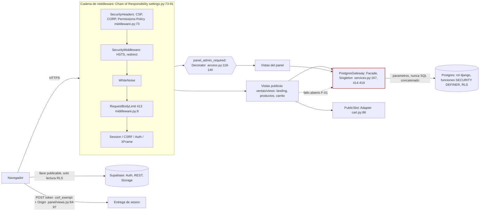
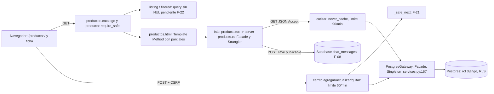
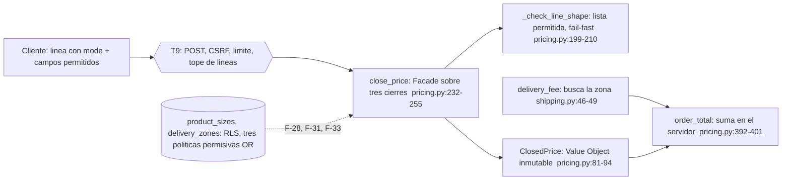
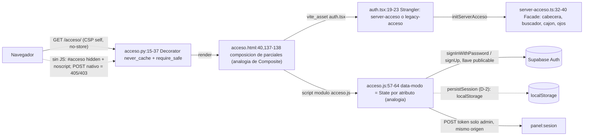

# Auditoría de seguridad del rediseño (TA), rebanada 1

Auditor: teammate `auditor` (rol security-guardian). Fecha: 2026-11-23. Rama `claude/stack-carney-mvp-244236`, HEAD `0e91976c`.
Specs cubiertas: S2 (Django sirve las páginas), S6 (productos, carrito, cotizador) y S7 (componentes compartidos: header, carrito, CSP), según `odd/tasks/rediseno-moderno.md`.
Alcance de la rebanada 1: los commits `cefc87fa` (T3 A, `/` servida por Django) y `11ff7c41` (T3 B, movimiento con scroll) y el código público de la tienda sobre el que se apoyan. Se audita **HEAD**, no el árbol de trabajo sin commitear de los teammates (en el momento de la auditoría `backend-datos` tenía cambios sin commitear en `ventas/views/carrito.py`, `comun.py`, `productos.py`, `catalog.py`, `domain.py` y `context_processors.py`; `frontend` tenía `ventas/templates/ventas/productos.html` sin seguimiento). Las líneas citadas son de HEAD.
Corrección de ruta: la CSP no vive en `backend/ventas/middleware.py` (no existe) sino en `backend/config/middleware.py:35-54`.

Este informe no modifica código. Los hallazgos van al dueño por mensaje con el mismo archivo:línea. Convención: **confirmado** = reproducido con una prueba, un comando o la lectura exacta del código; **por validar** = hipótesis con base en el código cuyo dato decisivo está fuera del repositorio, sin severidad hasta que se valide.

## 1. Hallazgos

| id | severidad | estado | archivo:línea (HEAD) | dueño | resumen |
|---|---|---|---|---|---|
| F-01 | media | confirmado en HEAD; **corregido en el árbol sin commit** (sección 6) | `backend/ventas/views/carrito.py:263-274` | backend-datos | El respaldo `create_order_staff` del pedido de invitado quita el tope de 3 pendientes por teléfono y la validación de 7 dígitos |
| F-02 | media | confirmado en HEAD; **corregido en el árbol sin commit** (sección 6) | `backend/ventas/views/carrito.py:177`, `:184`, `:194` | backend-datos | `agregar`, `actualizar` y `quitar` no tienen límite y cada POST hace una llamada RPC y escribe una sesión |
| F-03 | baja | confirmado | `backend/config/settings.py` (sin `SESSION_ENGINE`), `render.yaml:31` | main | Nada ejecuta `clearsessions`: la tabla de sesiones solo crece |
| F-04 | sin severidad | por validar | `backend/ventas/throttle.py:13-20`, `settings.py:343-349` | backend-datos | Con más de un salto de proxy, todos los clientes comparten contador de límite |
| F-05 | baja | confirmado | `.gitignore:12-23` | main | `.env.*` y `secrets/` no están ignorados, contra la regla global 4 |
| F-06 | baja | confirmado | `backend/static/tienda/vendor/supabase-js.mjs`, `backend/README.md:343-349`, `backend/ventas/tests/test_acceso.py:213,226` | frontend | El módulo que maneja la contraseña es un binario minificado sin hash registrado ni prueba de contenido |
| F-07 | sin severidad | por validar (aviso previo a T4b) | `js/modules/core/cart.js:228-262`, `src/entry/products.tsx` | frontend | El carrito heredado arma HTML con datos sin escapar y atributos en línea que la CSP bloquea; calcula totales en el navegador |
| F-08 | baja | confirmado | `supabase/migrations/20260911_chat_messages.sql` (política `chat_messages_insert_anon`) | backend-datos | Inserción anónima con `WITH CHECK (true)` y sin tope de longitud |
| F-09 | sin severidad | por validar | `backend/config/urls.py:22`, `backend/panel/access.py:51` | main | `/admin/login/` es público y sin bloqueo por intentos; depende de si existe un superusuario con contraseña |
| F-10 | baja (alcance) | confirmado | `package.json:32,37,38`, `package-lock.json` | main | `npm audit --omit=dev`: 9 vulnerabilidades (1 crítica, 5 altas, 3 moderadas); fuera del camino de Django salvo axios; plazo ASVS 15.1.1 vencido |
| F-11 | baja | confirmado | `server/app.ts:11-16`, `server/routes/buildads.ts:7-15,34` | main | Servidor Node de desarrollo: API de BuildAds sin autenticación y `express.static` sobre la raíz del repo |
| F-12 | info | confirmado | `backend/config/settings.py:221`, `backend/inventory/storage.py:130-140` | backend-datos | La clave `service_role` vive en el entorno del proceso de Django (solo para fotos) |
| F-13 | info | confirmado | `backend/pyproject.toml:6` | backend-datos | El límite inferior `django>=5.2,<5.3` no se subió a `>=5.2.19`; el lock sí está en 5.2.19 |
| F-14 | info | confirmado | `backend/templates/base.html:7`, `backend/ventas/templates/ventas/tienda/landing.html:11`, `backend/static/tienda/vendor/gsap/` | main (T8) | Superficie muerta de la tienda paralela que WhiteNoise sigue sirviendo |
| F-15 | info | confirmado | `backend/config/middleware.py:39-51` | main | La CSP no tiene `report-to`: una violación en producción no se ve |
| F-16 | sin severidad | por validar | `supabase/migrations/202604100002_rls_policies.sql:23-26` | backend-datos | `profiles_insert_own` no fija `role = 'customer'`; hoy lo cubre el disparador de alta |
| F-17 | baja | confirmado; **IPv6 corregido en el árbol (verificado)**, caché de 300 entradas pendiente del lead | `backend/ventas/throttle.py:13-35`, `backend/config/settings.py` (sin `CACHES`) | backend-datos / main | Los límites por IP usan la dirección completa (un /64 de IPv6 da 2^64 llaves) y viven en una caché `LocMemCache` de 300 entradas que se vacía con ruido de llaves |
| F-18 | info | confirmado; **corregido en el árbol (verificado)** | `backend/ventas/forms.py:59-61`, `backend/ventas/views/carrito.py` (`StoreOrderForm`) | backend-datos | El formulario del pedido acepta "-------" como teléfono; solo el SQL lo rechaza |
| F-19 | baja | confirmado; `backend-datos` propone aceptarlo (decisión del lead o de Eduardo) | `backend/ventas/views/productos.py` (`cotizar`, campo `avisos`), `supabase/migrations/20261113000002_comercio_v1_cotizacion_y_pedidos.sql:205-209` | backend-datos | La cotización pública ahora devuelve `low_stock`, que depende de la cantidad pedida: sirve para calcular el stock exacto |
| F-20 | info | confirmado; **contrato y 3 pruebas añadidos (verificado)** | `backend/ventas/views/carrito.py` (escrituras en modo JSON), `docs/datos/contrato-productos.md:19-33` | backend-datos / frontend | La cookie CSRF solo existe en páginas que pintan un token; el 403 de CSRF es HTML |

### F-01 (media, confirmado): el respaldo del pedido de invitado pierde controles
- Código: `carrito.py:263-274` captura `GatewayFunctionMissing` de `create_order_web` y llama `create_order_staff(items=lines, staff_ref=None, channel="whatsapp", **values)`. El registro es un `logger.warning` (`:266-271`).
- SQL: `create_order_staff` (`supabase/migrations/20261113000002_comercio_v1_cotizacion_y_pedidos.sql:456-495`) no cuenta pendientes y del teléfono solo valida `char_length(v_phone) > 20` (`:482`). `create_order_web` (`20261117000002_create_order_web.sql:62-80`) exige teléfono (`:62`), 7 dígitos (`:66-68`) y no más de 3 pendientes por los mismos dígitos (`:73-80`, con bloqueo advisory).
- Privilegio: **ninguna escalada en la base**. Las dos funciones son `SECURITY DEFINER`, las ejecuta el mismo rol `django` (`20261117000002:92-93`, `20261113000002:658-667`) y comparten `_create_order`. Cambia el control: el pedido nace con canal `whatsapp` y `staff_ref` NULL, es decir, un pedido anónimo de la web se ve como uno del personal.
- Escenario: una base sin la migración `20261117000002` (restaurada de un respaldo, base nueva de una rama, la demo de Render con su propio proyecto, `render.yaml:9`) deja a un anónimo crear pedidos pendientes sin tope por teléfono. Solo lo frena el límite de 5 intentos por hora por IP y por sesión (`settings.py:343-348`, `carrito.py:242-253`). El regex `forms.py:59-61` (`^\+?[0-9 ()\-]{7,20}$`) acepta "-------", que solo `create_order_web` rechaza. Un pedido pendiente no descuenta stock (el stock se mueve en `set_order_status`), así que el daño es ruido en el tablero, tiempo del personal y estadísticas del canal WhatsApp contaminadas.
- Arreglo: fallar cerrado (que `GatewayFunctionMissing` termine en `GatewayUnavailable` y el mensaje de tienda no disponible) o replicar en Python el tope y los 7 dígitos antes del respaldo; una prueba que ejerza el respaldo con 3 pendientes; una comprobación de arranque o de salud que verifique que existe `create_order_web`.

### F-02 (media, confirmado): escrituras públicas del carrito sin límite
- `agregar` (`carrito.py:177`), `actualizar` (`:184`) y `quitar` (`:194`) no llaman a `throttle`. `agregar` y `actualizar` pasan por `_save_line` (`:159-173`) y `_quote_ok` (`:146-156`), o sea una llamada RPC `quote_cart` por POST, más la escritura de la sesión del carrito. Tienen límite solo `cotizar` (`productos.py:94`, 90 por minuto), `buscar` (`productos.py:126`, 120 por minuto) y `pedido` (`carrito.py:242`).
- Escenario: un script pide una página (recibe cookie y token CSRF: sin problema, es público) y repite `POST /carrito/agregar/<pk>/` con cookie nueva en cada vuelta. Cada vuelta es una consulta a la base y una fila nueva en `django_session`. La demo corre con un solo trabajador síncrono (`render.yaml:31`, `--workers 1`), así que saturarlo degrada toda la tienda; la base es de capa gratuita.
- Estado en el árbol de trabajo: `backend-datos` ya agregó `CART_WRITES_PER_MINUTE = 60` en `carrito.py`, todavía sin uso. Pendiente de cablear y probar.
- Arreglo: `throttle.too_many(request, "carrito", CART_WRITES_PER_MINUTE)` en las tres vistas, respuesta 429 y prueba. Las páginas de lectura (`/`, `/productos/`) tampoco tienen límite pero su costo es menor; es una decisión de capacidad, no un hallazgo.

### F-03 (baja, confirmado): sesiones que nunca se purgan
- `grep -rn clearsessions` sobre el repo: sin resultados. `SESSION_ENGINE` es la base de datos (`django.contrib.sessions.backends.db`, impreso con la configuración tipo producción). Con F-02, las filas de `django_session` crecen sin tope aunque expiren (`SESSION_COOKIE_AGE` 8 h, `settings.py:286`).
- Arreglo: `manage.py clearsessions` en el comando de arranque (`render.yaml:31`) o en el script de build (`scripts/render_build.sh`), o un cron de la plataforma.

### F-04 (por validar): IP del cliente detrás de más de un proxy
- `throttle.client_ip` (`throttle.py:13-20`) usa la **última** entrada de `X-Forwarded-For` cuando `DJANGO_BEHIND_PROXY` está activo (`settings.py:349`). Es correcto con exactamente un proxy. Si hay otro salto delante (por ejemplo un CDN delante de la plataforma), esa última entrada es la del intermediario: todos los clientes comparten contador y el pedido número 6 de la hora, de cualquiera, recibe 429 (`CHECKOUT_THROTTLE_LIMIT=5`, `settings.py:343-348`); `cotizar` y `buscar` se comparten igual.
- Dato que falta: cuántos saltos agrega el despliegue real. No se sondea el despliegue (regla de la auditoría). Plan: en la demo, registrar una sola vez el `X-Forwarded-For` de una petición propia, o leer la documentación de la plataforma. Arreglo: número de saltos confiables configurable y tomar `entradas[-saltos]`.

### F-05 (baja, confirmado): `.gitignore` incompleto frente a la regla global 4
- `.gitignore:12-23` cubre `.env`, `.env.local`, `.env.*.local`, `.env.bak-*` y `.env.example`; `backend/.gitignore:1` cubre `.env`. Prueba: `git check-ignore -v .env.production .env.staging secrets/x.txt` termina con código 1 y sin salida: ninguno está ignorado. Un `.env.production` se puede commitear por accidente.
- Arreglo: agregar `.env.*` y `secrets/` (la regla global pide `.env`, `.env.*`, `*.pem`, `*.key` y `secrets/`; `*.pem` y `*.key` ya están en `:76-77`).

### F-06 (baja, confirmado): módulo de la pantalla de contraseñas sin verificación de contenido
- `acceso.js:102` carga con `import()` el archivo `static/tienda/vendor/supabase-js.mjs` (189 KB minificados, sin cabecera ni licencia). `backend/README.md:343-349` documenta la procedencia (esbuild 0.27.7 desde `@supabase/supabase-js@2.103.0`, construido con `--ignore-scripts`) y la cadena "2.103.0" dentro del archivo coincide con `package-lock.json:5342`. Ninguna prueba compara el contenido: `test_acceso.py:213` y `:226` solo comprueban que existe y que se importa.
- sha256 actual: `55204258e5c6d08794e6dba3cbd831c23b9c8c2bcb1f57923f2a82c909abfa07`.
- Escenario: un cambio malicioso o accidental del archivo (minificado, ilegible en una revisión) vería correos y contraseñas. Está en git, así que el cambio sería visible en el diff, pero no revisable. No se reconstruyó el módulo (exigiría instalar paquetes).
- Arreglo: guardar el hash junto al comando de reconstrucción y una prueba que lo compare, o producirlo como entrada del build de Vite desde el lock (lo natural en T5).

### F-07 (por validar, aviso previo a T4b): el carrito heredado en la entrada de productos
- `src/entry/products.tsx` importa `js/modules/core/cart.js`. Ahí `row.innerHTML = ...` (`cart.js:228-262`) interpola `${it.name}` y `${it.img}` sin escapar y lleva `style="..."` y `onerror="..."` en línea. La CSP (`config/middleware.py:39-51`) no admite `'unsafe-inline'`: los atributos se bloquean (se rompe el diseño) y el nombre inyecta HTML, no script. Los totales se calculan en el navegador (`normalized.itemTotal`), contra la regla de que el precio sale del servidor (Engram #1091, punto 16a).
- Hoy no se sirve: la entrada solo la usa `backend/ventas/templates/ventas/productos.html:30`, que no está commiteada. Se revisa cuando `frontend` entregue T4b.
- Arreglo: que `/productos/` use el carrito de Django (`ventas.cart` y `quote_cart`); donde se conserve JS, `createElement` y `textContent` y clases en lugar de `style` y `onerror`.

### F-08 (baja, confirmado): `chat_messages` acepta inserciones anónimas sin tope
- `supabase/migrations/20260911_chat_messages.sql`: `CREATE POLICY "chat_messages_insert_anon" ... FOR INSERT WITH CHECK (true)`; `message`, `session_id` y `page_url` son `text` sin límite. El widget del chat se carga también en la landing de Django (`src/landing/server-store.tsx:129` importa `js/modules/chatbot.js`, que escribe con la llave publicable en `chatbot.js:151-163`). La llave publicable es pública por diseño; cualquiera puede insertar filas de tamaño arbitrario por la REST de Supabase (crecimiento de almacenamiento en capa gratuita). La lectura sí está limitada al administrador (`chat_messages_select_admin`, `public.is_admin()`), así que no hay fuga.
- El bundle commiteado se construyó sin `VITE_SUPABASE_*` (solo aparecen los nombres, ningún valor), por lo que en esa build el widget no persiste (`chatbot.js:149` sale temprano). El riesgo es por la API directa y por una futura reconstrucción con `.env`.
- Arreglo: migración nueva (solo escrita para revisión) con `CHECK (char_length(message) <= 1000 AND char_length(session_id) <= 64 AND char_length(page_url) <= 200)`; a mediano plazo, escribir por Django con límite.

### F-09 (por validar): `/admin/` público sin bloqueo por intentos
- `config/urls.py:22` publica `admin.site`. No hay `django-axes` ni límite en el login (`grep` de `axes|ratelimit` en `pyproject.toml` y `settings.py`: nada). Los usuarios del panel nacen con contraseña inutilizable (`panel/access.py:51`, `set_unusable_password`), así que el login solo sirve a un superusuario creado a mano. El roadmap pide "Max Retry and jail features in login" (`best-practices.md:100`).
- Dato que falta: si en la base real existe un superusuario con contraseña utilizable. Arreglo: desactivar `/admin/` en producción con una variable de entorno, o agregar bloqueo por intentos.

### F-10 (baja por alcance, confirmado): deuda de dependencias npm
`docker run ... npm audit --omit=dev --json`: **9** (1 crítica, 5 altas, 3 moderadas), las mismas de L8 y de Engram #1091 punto 12.

| paquete | severidad | directo | alcance en producción de Django |
|---|---|---|---|
| proxy-addr (≤2.0.7) | crítica | no | no: cadena de `express` en `server/app.ts` (solo `npm run api:dev`, `package.json:16`) |
| axios (1.0.0-1.19.0) | alta | sí (`package.json:32`) | **sí, en el navegador**: `backend/static/vite/assets/globalStyles-Cc1az5Oc.js` contiene `AxiosError`; lo usa `src/redux/slices/busquedaSlice.ts:17,186`. Los avisos son de adaptador de Node, `NO_PROXY` y contaminación de prototipos: alcance bajo en el navegador |
| body-parser, ws, form-data, ip-address | alta | no | no: cadena de `express`/dev |
| express-rate-limit | moderada | sí (`package.json:38`) | no: solo `server/routes/buildads.ts` |
| follow-redirects, qs | moderada | no | no |

`render.yaml` despliega solo Django, así que el camino de producción no incluye la cadena de `express`. El plazo de OWASP ASVS 15.1.1 (crítico y alto en 7 días) venció: el hallazgo viene del 2026-11-03. Arreglo: previsualizar sin `--force` (axios 1.20.0, proxy-addr 2.0.8, ws 8.21.0, etc., según #1091 punto 12) y probar cada salto en Docker. Python: `backend/uv.lock` fija Django **5.2.19** (commit `5af793fb`), psycopg 3.3.5, PyJWT 2.15.1, cryptography 50.0.2, gunicorn 26.2.0, whitenoise 6.12.0: sin hallazgos conocidos en #1570. No se corrió un escáner de Python con red (ver sección 4).

### F-11 (baja, confirmado): servidor Node de desarrollo
- `server/app.ts:11-16`: `app.use('/api/buildads', ...)` y `app.use(express.static(workspaceRoot))` con `workspaceRoot` igual a la **raíz del repo** (`:5-8`); `app.listen(port)` escucha en todas las interfaces. Las rutas `/predis` y `/elevenlabs` (`server/routes/buildads.ts:17,83`) no tienen autenticación; solo un límite de 20 por minuto por IP (`:7-15`), y reenvían a APIs de terceros con claves del servidor (`process.env.PREDIS_API_KEY`, `:34`). Mientras corre `npm run api:dev` en una red compartida, cualquiera lee fuentes, migraciones y código del backend (los archivos con punto, como `.env`, los ignora `express.static` por defecto según la documentación de serve-static; no se verificó en esta sesión) y gasta cuota de pago.
- No se despliega (`render.yaml`). El navegador llama a esas rutas desde `src/modules/buildads/BuildAdsOrchestrator.tsx:39-48` con POST sin cabecera CSRF; Django no tiene esas rutas (la página `/panel/buildads/` es solo lectura, `panel/views.py:294`). Es una decisión para T7: cuando BuildAds pase a Django hará falta `@panel_admin_required`, CSRF, límite y la aprobación de Eduardo para enviar datos a terceros (Predis, ElevenLabs).
- Arreglo: `express.static` solo sobre una carpeta pública, escuchar en `127.0.0.1`, autenticación antes de gastar cuota.

### F-12 (info, confirmado): `service_role` en el proceso de Django
- `settings.py:221` lee `SUPABASE_SERVICE_ROLE_KEY` (opcional; `render.yaml:70` la declara). Solo la usa `inventory/storage.py:130-140` para subir fotos. La regla de AGENTS.md ("nunca `service_role` fuera del entorno local") se cumple en la conexión de Postgres (`POSTGRES_USER` es `django.<ref>`, `backend/README.md:536`), pero la clave existe en el entorno del mismo proceso: un RCE o una lectura del entorno en Django daría control total del proyecto de Supabase, con RLS omitida. No hay vía de explotación en esta rebanada; es concentración de privilegio. Alternativa: subir con URL firmada generada por una función mínima, o un rol de almacenamiento dedicado.

### F-13 (info, confirmado)
`backend/pyproject.toml:6` conserva `django>=5.2,<5.3`. El lock está en 5.2.19, que es la versión de seguridad del 2026-11-03, pero una instalación sin lock podría resolver una versión anterior. Subir el límite a `>=5.2.19` (Engram #1091 punto 14).

### F-14 (info, confirmado): superficie muerta de la tienda paralela
`backend/templates/base.html:7` lleva un `<style>` en línea (la CSP lo bloquearía; nadie extiende esa plantilla), y `ventas/tienda/landing.html:11` y `static/tienda/vendor/gsap/gsap.min.js` quedaron sin uso desde T3. `/static/tienda/**` sigue publicado por WhiteNoise. T8 los borra; hasta entonces son superficie sin dueño.

### F-15 (info, confirmado): sin informe de violaciones de CSP
`config/middleware.py:39-51` no define `report-to` ni `Reporting-Endpoints`. La guía de `modern-web-guidance` (id `security`, fase 2) recomienda el reporte para ver regresiones de CSP (por ejemplo un `onerror` en línea nuevo) antes de que las vean los clientes. Se leyó la guía solo por coincidencias de `grep` (ver sección 4).

### F-16 (por validar): `profiles_insert_own` sin `role = 'customer'`
`202604100002_rls_policies.sql:23-26`: `WITH CHECK (auth.uid() = id)` no fija `role` ni `points`. El disparador `protect_profile_system_fields` (`202604100003_functions.sql:53-75`) es solo `BEFORE UPDATE`, y `handle_new_user` (`:8-35`) crea el perfil al alta con rol `customer`. Si existiera un usuario de `auth.users` sin fila en `profiles` (alta fallida, fila borrada a mano), un cliente podría insertar su propio perfil con `role = 'admin'`, y `Profile.is_admin` de Django (`panel/views.py:87`) le daría el panel. Dato que falta: ese estado en la base real (solo lectura, sin acceso en esta sesión). Arreglo: `WITH CHECK (auth.uid() = id AND role = 'customer' AND points = 0)`.

## 2. Revisado y limpio (con evidencia)

| control | resultado | evidencia |
|---|---|---|
| CSP `'self'` en vigor | limpio | `backend/config/middleware.py:35-54`; el middleware es el primero de `MIDDLEWARE` (`settings.py:76`). Cabecera real de `GET /` con el cliente de pruebas: `default-src 'self'; script-src 'self'; style-src 'self'; img-src 'self' data: <supabase>; font-src 'self'; media-src 'self'; connect-src 'self' <supabase>; object-src 'none'; frame-ancestors 'none'; base-uri 'self'; form-action 'self'`. Solo `/admin/` admite estilos en línea (`:38`) |
| Plantilla de la landing sin estilos, scripts ni manejadores en línea ni CDN | limpio | `grep -nE "style=|`, categoría y nota igual, `q` igual: 0 fragmentos crudos en el catálogo y en la ficha; `meta description` y `value=""` escapados por el autoescape |
| Cajón (`_bolsa.html`) | limpio | `next` es `request.get_full_path` más `#bolsa` y la vista lo revalida (`carrito.py:144-149`); el borrado es un POST con `` (`_bolsa.html:35`); sin precios |
| Paginación (`_catalogo.html:43,45`) | limpio | `q` con `urlencode`, `category` solo dígitos (`catalog.py:56-66`, tope de 9) |
| Validación en el servidor del cotizador y del carrito | limpio | `CartLineForm` (`forms.py:19-26`): `amount` 10 dígitos y 3 decimales, `thickness_in` 4 y 2, `note` 200, `mode` y `unit` por lista; sin campo de precio; `StoreOrderForm` (`carrito.py:70-112`) con largos; el precio sale de `quote_cart`; `cotizar` es `require_safe`, `never_cache`, 404 en JSON idéntico para inactivo e inexistente |
| CSRF en todo `fetch` | limpio | un solo `fetch` hacia Django (`configurador.ts:111`, GET); el POST de `chatbot.js:151` va a Supabase con la llave publicable y sin cookie de sesión, así que CSRF no aplica (su riesgo es F-08). Escrituras de Django: `agregar`, `actualizar`, `quitar` y `pedido` bajo `CsrfViewMiddleware` sin `csrf_exempt`; 403 sin token en modo JSON (`test_contract_carrito.py:164`) |
| Caso positivo de CSRF en JSON con `Origin` ajeno | **ya existe** (el pendiente de L16 y L17 está cumplido) | `test_contract_carrito.py:404` (token de la cookie en `X-CSRFToken` → 200) y `:412` (mismo token con `Origin: https://evil.example` → 403, carrito vacío), dentro de `CsrfForScriptsTests` (`:381`) |
| Límites por IP | limpio | sonda E: 95 `cotizar` de un cliente → 90 con 200 y 5 con 429, el primero en la 91; `test_contract_carrito.py:469-526` (`WriteLimitTests`) |
| Costo privado | limpio en comportamiento; prueba débil (F-24) | sonda C |
| Métodos y producto inexistente | limpio | sonda G: `POST /productos/` → 405; ficha de un producto que no existe → 404 |

### Diagrama anotado con patrones (rebanada 3)
Patrones que el código usa de verdad en HEAD; lo demás es analogía. Referencia: `~/agentic-global/claude/fichas/refactoring-guru.md`, sección "Patrones aplicados a Carni-mvp".

- Template Method (de Django): `productos.html` con `` de `parciales/` (`productos.html:39-64`).
- Facade: `src/products/server-products.ts:15-26` (una función que monta cuatro comportamientos) y `ventas/services.py:167` (`PostgresGateway`).
- Strangler (en sentido amplio): `src/entry/products.tsx:25-29` ramifica por `data-server-store` y deja la isla heredada en su propio chunk.
- Decorator: `@require_safe`, `@never_cache`, `@cache_control` apilados en `productos.py:42,88-89,131-132`.
- Analogía, no patrón: `_safe_next` recuerda a una lista blanca (Guard), pero no es una clase ni un objeto.
- **Archify**: la skill existe en `.claude/skills/archify`; no se generó el HTML por la superficie de escritura de este teammate (solo este archivo). Lo debe generar quien tenga la superficie, con este Mermaid como entrada (ver F-25, ítem 4).

### Lo que no se verificó en esta rebanada
- Navegador real: la CSP en ejecución, el LCP y el CLS se toman del recibo #3360 (Brave a 375, 768 y 1440 px, 0 violaciones); no se repitieron.
- Base de datos viva: F-22 contra Postgres, el estado de RLS y la migración `20261117000002` (el MCP de Supabase dio timeout en el recibo #3360). Ninguna escritura a una base real.
- Despliegue real: `X-Forwarded-For` de Render (F-04); no se sondea.
- `supply-chain-risk-auditor`: se cargó, pero los commits no tocan `package.json`, `package-lock.json`, `pyproject.toml`, `uv.lock` ni `.npmrc` (diff vacío), así que no hay dependencia nueva que medir.
- `security-review` (comando integrado de Claude Code): un subagente no puede invocarlo; queda para el lead (ver "Needs skill" en el mensaje).

### Pruebas y escaneos de esta rebanada
- `dj.sh ventas.tests.test_products_page ventas.tests.test_contract_carrito ventas.tests.test_contract_productos ventas.tests.test_contract_throttle ventas.tests.test_public_cart ventas.tests.test_catalog ventas.tests.test_producto ventas.tests.test_header ventas.tests.test_styles config.test_security_headers config.test_cache config.test_request_size` → **261 pruebas, OK** (2.9 s).
- Sondas propias (`probe_t4b.py`, fuera del repo): 8 sondas A a G; dos hallazgos (D, F).
- `gitleaks git --redact --no-banner --log-opts="4f1e0c86~3..HEAD"` (gitleaks 8.30.1) → "4 commits scanned … no leaks found".

## 8. Seguimiento de la rebanada 3: `unsafe-inline` en la CSP (2026-11-23)

Origen: aviso del lead, que cita la guía de Todo de IA `protege-tu-app` ("el CSP de Carni permite `unsafe-inline`"). Se verificó contra el código y contra la cabecera real. La guía no se tomó como prueba.

| id | severidad | estado | archivo:línea (HEAD) | dueño | resumen |
|---|---|---|---|---|---|
| F-26 | baja | confirmado; **la afirmación de la guía es parcialmente falsa** | `backend/config/middleware.py:38`, `backend/config/test_security_headers.py:90-95` | main (config del lead) | `'unsafe-inline'` existe solo en `style-src` y solo para rutas bajo `/admin/`. `script-src` es `'self'` en todas partes: ni `unsafe-inline` ni `unsafe-eval` |

### F-26 (baja, confirmado): la excepción de estilos en línea de `/admin/`
- Código: `middleware.py:38` pone `'self' 'unsafe-inline'` en `style-src` solo si `path.startswith(reverse("admin:index"))`; `:41` fija `script-src 'self'` sin condición. `grep -rn "unsafe-inline\|unsafe-eval"` sobre `backend` (sin `static/vite`) → solo `middleware.py:38` y las pruebas. La prueba `test_the_admin_keeps_its_inline_styles_and_nothing_more` (`test_security_headers.py:90-95`) fija ambos valores.
- Cabecera real (cliente de pruebas, ajustes sintéticos), `style-src` y `script-src` por ruta: `/`, `/productos/`, `/acceso/`, `/carrito/`, `/panel/` y `/panel/acceso/` → `'self'` y `'self'`; `/admin/` y `/admin/login/` → `'self' 'unsafe-inline'` y `'self'`; `/Admin/login/` (404) y cualquier otra ruta → `'self'`. Ninguna respuesta lleva `unsafe-eval`. Ninguna vista fija su propia CSP (`grep` de `Content-Security-Policy`: solo el middleware y pruebas).
- Plantillas: las únicas marcas en línea que quedan son el `<style>` de `backend/templates/base.html:7`, que nadie extiende (F-14); `ventas/templates` y `panel/templates` no tienen `ZQX&admin=ZQX` en los dos: 200, el marcador no aparece en el cuerpo y no hay `alert(7)`; con `salir=1` sale el texto fijo "Cerraste tu sesión." (la rama `elif` hace que `salir` gane a `admin`, `acceso.html:70`; es de diseño). `{{ negocio.nombre }}` (`:26`, `:27`) pasa por el autoescape.
5. **`server-acceso.ts`**: sin `.value`, sin `fetch`, sin `localStorage`/`sessionStorage`, sin `innerHTML` (`:1-40`); solo cambia `type` y `aria-label` de los botones de ver contraseña (`:22-28`). El chunk construido (`server-acceso-CODRFmd1.js`, 705 bytes) coincide con la fuente y no contiene `fetch(`, `XMLHttpRequest`, `eval(`, `innerHTML`, `sendBeacon` ni URL alguna; igual los otros tres chunks nuevos (`legacy-acceso`, `auth`, `menu-drawer`, 838 a 1 248 bytes). `legacy-acceso.tsx:1-42` es el código viejo movido tal cual: texto fijo en React, sin `dangerouslySetInnerHTML`; solo corre si el `<body>` no trae `data-server-store` (`auth.tsx:19-23`), es decir, en el `accessweb.html` de la raíz, que Django ya redirige con 301.
6. **Bundles**: `grep -rlE "service_role|sb_secret_|sk_live_|sk_test_|AKIA[0-9A-Z]{12}|-----BEGIN" backend/static/vite` -> vacío. `sb_publishable_` -> 0 coincidencias. Los chunks `shared-CqOXKDrN.js` y `chatbot-BD-E1OUE.js` nombran `VITE_SUPABASE_URL` y `VITE_SUPABASE_ANON_KEY`, pero están commiteados desde antes (no son de T5) y no llevan valor (el mensaje "Supabase configuration missing" lo confirma).
7. **Dependencias**: `git diff --cached --stat -- package.json package-lock.json backend/pyproject.toml backend/uv.lock .npmrc` -> vacío. `backend/uv.lock` ya fija django 5.2.19 (ítem 14 de #1091 cerrado en esta rama); la deuda del lock de npm (#1091 ítem 12: axios 1.15.0 y proxy-addr 2.0.7) no es de T5 y **no la volví a medir**.
8. **`autocomplete`, `spellcheck`, `aria-describedby`**: `username` en el correo del ingreso y del registro (`:76`, `:97`) es la pista estándar para que el gestor de contraseñas guarde el par; no abre nada. `spellcheck="false" autocapitalize="none" autocorrect="off"` en las tres contraseñas (`:80`, `:105`, `:109`) **cierra** una fuga: cuando el botón ojo pasa el campo a `type="text"`, sin `spellcheck="false"` algunos navegadores mandan el texto al corrector. `aria-describedby` apunta a `ingresar-error` y `registro-error`, que existen (`:82`, `:114`) y están fijados por `test_acceso_page.py:211-222`. Ninguno de los tres es entrada de datos ni cambia a dónde viaja algo.
9. **Credenciales por defecto** (el caso de `admin`/`123456` del video, `3spCFnMSGIY` 2:11:20 y 2:12:05): `grep` por `admin123`, `123456`, `password = "..."`, `passwd` y `secret` sobre la plantilla, los `.ts/.tsx` y el CSS -> sin coincidencias.
10. **CSS**: `acceso-page.css` no tiene `url(` ni `@import`; el CSS construido (`auth-D3ybOBvO.css`) solo trae `data:image/svg+xml` (los `http://www.w3.org/2000/svg` son el namespace del SVG, no se descargan) y la fuente de Bootstrap Icons en `/static/vite/assets/`, ambos permitidos por `img-src 'self' data:` y `font-src 'self'`.
11. **Pruebas: ninguna aserción de seguridad se debilitó.** `test_acceso.py` tenía 21 pruebas en HEAD y tiene 21 en el índice. Cambios: el nombre de la plantilla; `autocomplete` `email` -> `username`; "todo `<script>` empieza por `/static/tienda/`" pasó a dos expresiones regulares exactas (`sources[0]` es `acceso(.hash).js` y `sources[1]` es `auth-*.js`, más "solo uno de `/static/tienda/`"), con `assertNotIn("<style")` y "ningún atributo `style`" intactos; "solo el script de cabecera" pasó a "solo la entrada de Vite" cuando falta la llave (503). `test_header.py` quitó `ventas:acceso` de `PAGES` porque su cobertura se movió a `AccesoHeaderTests` (`test_acceso_page.py:350-446`, 9 pruebas: mismos controles en el mismo orden, paneles, búsqueda GET, pie, script de cabecera). `test_styles.py` agregó `acceso.html` a las plantillas de Vite (así sale de la regla de Tailwind del panel). `test_catalog.py` cambió una plantilla esperada (el nombre de la prueba sigue diciendo "store frame": cosmético).
12. **Lo que ya tenía la página vieja** (para separar regresión de herencia): `git show HEAD:.../ventas/tienda/acceso.html` ya traía `method="post"` y `action` iguales (`:45`, `:64`) y los mismos `name`; T5 no abre nada nuevo y agrega `spellcheck`/`autocapitalize` y la guarda de `sin_bolsa`.
13. **`sin_bolsa`** (`_cabecera.html:29`): solo quita `aria-controls="bolsa"` cuando la página no tiene el cajón; es una variable booleana de la plantilla, no entra del cliente.
14. **`acceso.js` conserva su contrato con la plantilla** (leído línea a línea): los ids `acceso`, `acceso-aviso`, `form-ingresar`, `form-registro`; `[data-error]` (uno por formulario), `[data-accion]`, `button[type="submit"]`, el primer `input` de cada formulario; los `data-supabase-url/-key/-js`, `data-sesion-url`, `data-panel-url`, `data-tienda-url`, `data-modo`; y los `name` `email`, `password`, `full_name`, `phone`, `password_confirm`, `terms`, `newsletter`. Todos están en `acceso.html:62-117`.

### Diagrama anotado con patrones (rebanada 5)
`archify` está instalado (`~/.agents/skills/archify`) pero este agente no tiene la herramienta Skill: lo doy como Mermaid. El Archify del dueño (`docs/diagramas/t5-acceso.html`, 760 KB) **no lo abrí**; solo busqué en él referencias remotas: 0 `src`/`href` externos, 3 `<script` en línea, y `docs/` no está en `STATICFILES_DIRS` (`settings.py:175`, solo `backend/static`), así que Django no lo sirve.

Patrones que el código **sí** usa, con `rama:archivo:línea` (rama `claude/stack-carney-mvp-244236`): **Decorator** de función (`backend/ventas/views/acceso.py:15-16`, mismo patrón que la ficha da para `panel/views.py:64-68`); **Facade** acotado (`src/acceso/server-acceso.ts:32-40`: una llamada oculta cuatro conexiones). **Analogías, no el patrón**: Strangler (`src/entry/auth.tsx:19-23`; es un patrón de migración, no de GoF: la página vieja y la nueva conviven y cada una carga su propio chunk); State por atributo (`acceso.js:57-64` y `acceso-page.css:160-161`: `data-modo` decide qué formulario se ve); composición de parciales (`acceso.html:40`, `:137-138`). **No hay Template Method**: la página vieja era `extends ventas/tienda/base.html` y la nueva es una plantilla propia con `include`; si T4d lo anota para productos, aquí no aplica.

### Lo que no se pudo verificar
- **Configuración de Supabase Auth** (límite de intentos, longitud y fortaleza de la contraseña, protección contra contraseñas filtradas, confirmación de correo) y la **RLS de `profiles`** que lee `esAdmin` (`acceso.js:127-130`): es remoto y no tengo autorización; D-3.
- **Que los bundles salgan de esta fuente**: no reconstruí (`npm` solo corre en Docker). Comprobé que los cuatro chunks nuevos coinciden con la fuente y no traen sumideros, no que el build sea reproducible; el lead dijo que `build:django` no deja diff.
- **Jest, `node --test` y `tsc`**: no los corrí; el lead reportó 279/279, 40/40 y 0. **`tests/visual/acceso-page.test.cjs`**: lo leí por red y entorno (solo `node:*`, sin `.env` ni red) y no lo ejecuté.
- **Un navegador real**: la sonda usa el cliente de pruebas de Django; el 403 de CSRF y la CSP las vi en cabeceras, no pintadas.
- **`security-review`** (comando integrado): un subagente no puede invocarlo. Needs skill: security-review - `git diff --cached` de T5 acotado a las rutas de arriba (sin los bundles ni el diagrama).

### Pruebas y escaneos de esta rebanada
- `dj.sh ventas.tests.test_acceso ventas.tests.test_acceso_page ventas.tests.test_header ventas.tests.test_styles ventas.tests.test_catalog` -> **109 pruebas, OK** (0.380 s).
- Sonda propia (fuera del repo, en el scratchpad de la sesión: `probe_t5/probe_t5.py`, una prueba con el cliente de Django y `override_settings` de una llave sintética): reflejo `?salir`/`?admin` con `<script>`, POST (405 y 403 con CSRF forzado, sin eco), cabeceras (`no-store`, `script-src 'self'`, sin `unsafe-inline`) y llave publicable en el HTML. Sin `.env`, sin base real.
- `gitleaks git --staged --redact --no-banner` -> "no leaks found" (1.44 MB escaneados).
- `grep` de secretos y de `sb_publishable_` sobre `backend/static/vite`; `grep` de `url(`, `@import` y de sumideros (`fetch`, `eval`, `innerHTML`, `localStorage`, `sendBeacon`) en el CSS y los chunks nuevos; `git diff --cached --stat` de los manifiestos de dependencias -> vacío.
- Transcripciones leídas con los minutos pedidos: `0DhghJpWwVQ` en 0:10:46 ("lo más importante siempre es todo lo relacionado con autenticación, tokens, conexiones con otras bases de datos... muy bien testeado") y `3spCFnMSGIY` en 2:11:20 y 2:12:05 (el login generado con un prompt simple y la variable `password` con `admin123456`). El video **no** dice "auditar antes de subir"; lo que se aplicó aquí es solo la comprobación de credenciales por defecto (punto 9).
Riesgo de esta revisión: `Risk: none` (solo texto en este documento).

### Recibo de recursos de esta revisión (7 ítems MANDATORY del kit)
| # | ítem | estado | evidencia |
|---|---|---|---|
| 1 | Seguridad | usado | Kit y `RESOURCE-CONTRACT.md` sección 4 leídos; skill `security-and-hardening` (`SKILL.md:21-40` modelo de amenazas, `:44-46` y `:72` sesión en almacenamiento del cliente, `:94-98` cabeceras y CSP desde `default-src 'self'`); OWASP A01 (la vista solo lee, el POST se rechaza), A03 (autoescape, sin `|safe`, sin sumideros), A05 (CSP, cabeceras, `no-store`) y A07 (D-1 y D-2); Engram #1091 y #1159 leídos en esta revisión (la llave publicable en el README ya estaba anotada; esta rebanada no la agrega: `gitleaks --staged` limpio); #1161 y #1570 **no los releí** (los citó la rebanada 3); `supply-chain-risk-auditor` leída, **no ejecutada**: T5 no toca manifiestos (diff vacío) y el colector hace red; `security-review`: pendiente del lead (arriba) |
| 2 | REA | no aplica | Eduardo lo limita a S10 y al panel (encargo del lead); este agente no tiene herramientas `mcp__rea__*` |
| 3 | Diseño y animación | no aplica | Revisión de seguridad: del CSS solo leí `url()`, `@import` y `[hidden]`; el juicio de diseño es de `frontend-revision` |
| 4 | Patrones y diagramas | parcial | Ficha `refactoring-guru.md:58` leída; Mermaid anotado arriba con Decorator y Facade confirmados y tres analogías rotuladas; el Archify `t5-acceso.html` no lo abrí (solo `grep` de referencias remotas) y no pude invocar la skill `archify` sin la herramienta Skill |
| 5 | roadmap.sh | usado | `roadmap_search.py outline cyber-security` corrido (6 temas, 295 subtemas); `best-practices.md:100` (Max Retry y jail en el login -> D-3), `:111` (límites), `:142-147` (cabeceras y no devolver datos sensibles) y `:148` (códigos de respuesta -> 405/403 de la sonda) |
| 6 | Big School | usado | `temario.md:201` (seguridad por diseño, pp. 15-16: contraseñas fuertes y límite de intentos -> D-3; autorización en el servidor -> punto 1) y `:198` (TDD, p. 9): F-35 y F-36 vienen con la prueba que los fija |
| 7 | Videos | usado | Minutos verificados en `~/agentic-global/claude/raw/transcripts/` (`0DhghJpWwVQ.ts.txt` en [0:10:46], `3spCFnMSGIY.ts.txt` en [2:11:20] y [2:12:05]); enlaces: https://youtu.be/0DhghJpWwVQ?t=646 y https://youtu.be/3spCFnMSGIY?t=7880. No usé `youtube-scout` |
Por la regla de L18, "no usado" o "parcial" sin el OK de Eduardo rechaza la rebanada: aquí afecta al ítem 4 (el Archify del dueño no lo abrí). Needs skill: security-review - `git diff --cached` de T5 acotado a las rutas de arriba.
