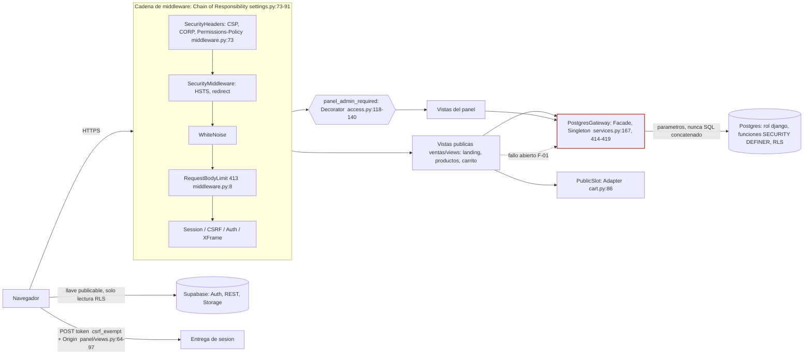

# Auditoría de seguridad del rediseño (TA), rebanada 1

Auditor: teammate `auditor` (rol security-guardian). Fecha: 2026-11-23. Rama `claude/stack-carney-mvp-244236`, HEAD `0e91976c`.
Specs cubiertas: S2 (Django sirve las páginas), S6 (productos, carrito, cotizador) y S7 (componentes compartidos: header, carrito, CSP), según `odd/tasks/rediseno-moderno.md`.
Alcance de la rebanada 1: los commits `cefc87fa` (T3 A, `/` servida por Django) y `11ff7c41` (T3 B, movimiento con scroll) y el código público de la tienda sobre el que se apoyan. Se audita **HEAD**, no el árbol de trabajo sin commitear de los teammates (en el momento de la auditoría `backend-datos` tenía cambios sin commitear en `ventas/views/carrito.py`, `comun.py`, `productos.py`, `catalog.py`, `domain.py` y `context_processors.py`; `frontend` tenía `ventas/templates/ventas/productos.html` sin seguimiento). Las líneas citadas son de HEAD.
Corrección de ruta: la CSP no vive en `backend/ventas/middleware.py` (no existe) sino en `backend/config/middleware.py:35-54`.

Este informe no modifica código. Los hallazgos van al dueño por mensaje con el mismo archivo:línea. Convención: **confirmado** = reproducido con una prueba, un comando o la lectura exacta del código; **por validar** = hipótesis con base en el código cuyo dato decisivo está fuera del repositorio, sin severidad hasta que se valide.

## 1. Hallazgos

| id | severidad | estado | archivo:línea (HEAD) | dueño | resumen |
|---|---|---|---|---|---|
| F-01 | media | confirmado | `backend/ventas/views/carrito.py:263-274` | backend-datos | El respaldo `create_order_staff` del pedido de invitado quita el tope de 3 pendientes por teléfono y la validación de 7 dígitos |
| F-02 | media | confirmado | `backend/ventas/views/carrito.py:177`, `:184`, `:194` | backend-datos | `agregar`, `actualizar` y `quitar` no tienen límite y cada POST hace una llamada RPC y escribe una sesión |
| F-03 | baja | confirmado | `backend/config/settings.py` (sin `SESSION_ENGINE`), `render.yaml:31` | main | Nada ejecuta `clearsessions`: la tabla de sesiones solo crece |
| F-04 | sin severidad | por validar | `backend/ventas/throttle.py:13-20`, `settings.py:343-349` | backend-datos | Con más de un salto de proxy, todos los clientes comparten contador de límite |
| F-05 | baja | confirmado | `.gitignore:12-23` | main | `.env.*` y `secrets/` no están ignorados, contra la regla global 4 |
| F-06 | baja | confirmado | `backend/static/tienda/vendor/supabase-js.mjs`, `backend/README.md:343-349`, `backend/ventas/tests/test_acceso.py:213,226` | frontend | El módulo que maneja la contraseña es un binario minificado sin hash registrado ni prueba de contenido |
| F-07 | sin severidad | por validar (aviso previo a T4b) | `js/modules/core/cart.js:228-262`, `src/entry/products.tsx` | frontend | El carrito heredado arma HTML con datos sin escapar y atributos en línea que la CSP bloquea; calcula totales en el navegador |
| F-08 | baja | confirmado | `supabase/migrations/20260911_chat_messages.sql` (política `chat_messages_insert_anon`) | backend-datos | Inserción anónima con `WITH CHECK (true)` y sin tope de longitud |
| F-09 | sin severidad | por validar | `backend/config/urls.py:22`, `backend/panel/access.py:51` | main | `/admin/login/` es público y sin bloqueo por intentos; depende de si existe un superusuario con contraseña |
| F-10 | baja (alcance) | confirmado | `package.json:32,37,38`, `package-lock.json` | main | `npm audit --omit=dev`: 9 vulnerabilidades (1 crítica, 5 altas, 3 moderadas); fuera del camino de Django salvo axios; plazo ASVS 15.1.1 vencido |
| F-11 | baja | confirmado | `server/app.ts:11-16`, `server/routes/buildads.ts:7-15,34` | main | Servidor Node de desarrollo: API de BuildAds sin autenticación y `express.static` sobre la raíz del repo |
| F-12 | info | confirmado | `backend/config/settings.py:221`, `backend/inventory/storage.py:130-140` | backend-datos | La clave `service_role` vive en el entorno del proceso de Django (solo para fotos) |
| F-13 | info | confirmado | `backend/pyproject.toml:6` | backend-datos | El límite inferior `django>=5.2,<5.3` no se subió a `>=5.2.19`; el lock sí está en 5.2.19 |
| F-14 | info | confirmado | `backend/templates/base.html:7`, `backend/ventas/templates/ventas/tienda/landing.html:11`, `backend/static/tienda/vendor/gsap/` | main (T8) | Superficie muerta de la tienda paralela que WhiteNoise sigue sirviendo |
| F-15 | info | confirmado | `backend/config/middleware.py:39-51` | main | La CSP no tiene `report-to`: una violación en producción no se ve |
| F-16 | sin severidad | por validar | `supabase/migrations/202604100002_rls_policies.sql:23-26` | backend-datos | `profiles_insert_own` no fija `role = 'customer'`; hoy lo cubre el disparador de alta |

### F-01 (media, confirmado): el respaldo del pedido de invitado pierde controles
- Código: `carrito.py:263-274` captura `GatewayFunctionMissing` de `create_order_web` y llama `create_order_staff(items=lines, staff_ref=None, channel="whatsapp", **values)`. El registro es un `logger.warning` (`:266-271`).
- SQL: `create_order_staff` (`supabase/migrations/20261113000002_comercio_v1_cotizacion_y_pedidos.sql:456-495`) no cuenta pendientes y del teléfono solo valida `char_length(v_phone) > 20` (`:482`). `create_order_web` (`20261117000002_create_order_web.sql:62-80`) exige teléfono (`:62`), 7 dígitos (`:66-68`) y no más de 3 pendientes por los mismos dígitos (`:73-80`, con bloqueo advisory).
- Privilegio: **ninguna escalada en la base**. Las dos funciones son `SECURITY DEFINER`, las ejecuta el mismo rol `django` (`20261117000002:92-93`, `20261113000002:658-667`) y comparten `_create_order`. Cambia el control: el pedido nace con canal `whatsapp` y `staff_ref` NULL, es decir, un pedido anónimo de la web se ve como uno del personal.
- Escenario: una base sin la migración `20261117000002` (restaurada de un respaldo, base nueva de una rama, la demo de Render con su propio proyecto, `render.yaml:9`) deja a un anónimo crear pedidos pendientes sin tope por teléfono. Solo lo frena el límite de 5 intentos por hora por IP y por sesión (`settings.py:343-348`, `carrito.py:242-253`). El regex `forms.py:59-61` (`^\+?[0-9 ()\-]{7,20}$`) acepta "-------", que solo `create_order_web` rechaza. Un pedido pendiente no descuenta stock (el stock se mueve en `set_order_status`), así que el daño es ruido en el tablero, tiempo del personal y estadísticas del canal WhatsApp contaminadas.
- Arreglo: fallar cerrado (que `GatewayFunctionMissing` termine en `GatewayUnavailable` y el mensaje de tienda no disponible) o replicar en Python el tope y los 7 dígitos antes del respaldo; una prueba que ejerza el respaldo con 3 pendientes; una comprobación de arranque o de salud que verifique que existe `create_order_web`.

### F-02 (media, confirmado): escrituras públicas del carrito sin límite
- `agregar` (`carrito.py:177`), `actualizar` (`:184`) y `quitar` (`:194`) no llaman a `throttle`. `agregar` y `actualizar` pasan por `_save_line` (`:159-173`) y `_quote_ok` (`:146-156`), o sea una llamada RPC `quote_cart` por POST, más la escritura de la sesión del carrito. Tienen límite solo `cotizar` (`productos.py:94`, 90 por minuto), `buscar` (`productos.py:126`, 120 por minuto) y `pedido` (`carrito.py:242`).
- Escenario: un script pide una página (recibe cookie y token CSRF: sin problema, es público) y repite `POST /carrito/agregar/<pk>/` con cookie nueva en cada vuelta. Cada vuelta es una consulta a la base y una fila nueva en `django_session`. La demo corre con un solo trabajador síncrono (`render.yaml:31`, `--workers 1`), así que saturarlo degrada toda la tienda; la base es de capa gratuita.
- Estado en el árbol de trabajo: `backend-datos` ya agregó `CART_WRITES_PER_MINUTE = 60` en `carrito.py`, todavía sin uso. Pendiente de cablear y probar.
- Arreglo: `throttle.too_many(request, "carrito", CART_WRITES_PER_MINUTE)` en las tres vistas, respuesta 429 y prueba. Las páginas de lectura (`/`, `/productos/`) tampoco tienen límite pero su costo es menor; es una decisión de capacidad, no un hallazgo.

### F-03 (baja, confirmado): sesiones que nunca se purgan
- `grep -rn clearsessions` sobre el repo: sin resultados. `SESSION_ENGINE` es la base de datos (`django.contrib.sessions.backends.db`, impreso con la configuración tipo producción). Con F-02, las filas de `django_session` crecen sin tope aunque expiren (`SESSION_COOKIE_AGE` 8 h, `settings.py:286`).
- Arreglo: `manage.py clearsessions` en el comando de arranque (`render.yaml:31`) o en el script de build (`scripts/render_build.sh`), o un cron de la plataforma.

### F-04 (por validar): IP del cliente detrás de más de un proxy
- `throttle.client_ip` (`throttle.py:13-20`) usa la **última** entrada de `X-Forwarded-For` cuando `DJANGO_BEHIND_PROXY` está activo (`settings.py:349`). Es correcto con exactamente un proxy. Si hay otro salto delante (por ejemplo un CDN delante de la plataforma), esa última entrada es la del intermediario: todos los clientes comparten contador y el pedido número 6 de la hora, de cualquiera, recibe 429 (`CHECKOUT_THROTTLE_LIMIT=5`, `settings.py:343-348`); `cotizar` y `buscar` se comparten igual.
- Dato que falta: cuántos saltos agrega el despliegue real. No se sondea el despliegue (regla de la auditoría). Plan: en la demo, registrar una sola vez el `X-Forwarded-For` de una petición propia, o leer la documentación de la plataforma. Arreglo: número de saltos confiables configurable y tomar `entradas[-saltos]`.

### F-05 (baja, confirmado): `.gitignore` incompleto frente a la regla global 4
- `.gitignore:12-23` cubre `.env`, `.env.local`, `.env.*.local`, `.env.bak-*` y `.env.example`; `backend/.gitignore:1` cubre `.env`. Prueba: `git check-ignore -v .env.production .env.staging secrets/x.txt` termina con código 1 y sin salida: ninguno está ignorado. Un `.env.production` se puede commitear por accidente.
- Arreglo: agregar `.env.*` y `secrets/` (la regla global pide `.env`, `.env.*`, `*.pem`, `*.key` y `secrets/`; `*.pem` y `*.key` ya están en `:76-77`).

### F-06 (baja, confirmado): módulo de la pantalla de contraseñas sin verificación de contenido
- `acceso.js:102` carga con `import()` el archivo `static/tienda/vendor/supabase-js.mjs` (189 KB minificados, sin cabecera ni licencia). `backend/README.md:343-349` documenta la procedencia (esbuild 0.27.7 desde `@supabase/supabase-js@2.103.0`, construido con `--ignore-scripts`) y la cadena "2.103.0" dentro del archivo coincide con `package-lock.json:5342`. Ninguna prueba compara el contenido: `test_acceso.py:213` y `:226` solo comprueban que existe y que se importa.
- sha256 actual: `55204258e5c6d08794e6dba3cbd831c23b9c8c2bcb1f57923f2a82c909abfa07`.
- Escenario: un cambio malicioso o accidental del archivo (minificado, ilegible en una revisión) vería correos y contraseñas. Está en git, así que el cambio sería visible en el diff, pero no revisable. No se reconstruyó el módulo (exigiría instalar paquetes).
- Arreglo: guardar el hash junto al comando de reconstrucción y una prueba que lo compare, o producirlo como entrada del build de Vite desde el lock (lo natural en T5).

### F-07 (por validar, aviso previo a T4b): el carrito heredado en la entrada de productos
- `src/entry/products.tsx` importa `js/modules/core/cart.js`. Ahí `row.innerHTML = ...` (`cart.js:228-262`) interpola `${it.name}` y `${it.img}` sin escapar y lleva `style="..."` y `onerror="..."` en línea. La CSP (`config/middleware.py:39-51`) no admite `'unsafe-inline'`: los atributos se bloquean (se rompe el diseño) y el nombre inyecta HTML, no script. Los totales se calculan en el navegador (`normalized.itemTotal`), contra la regla de que el precio sale del servidor (Engram #1091, punto 16a).
- Hoy no se sirve: la entrada solo la usa `backend/ventas/templates/ventas/productos.html:30`, que no está commiteada. Se revisa cuando `frontend` entregue T4b.
- Arreglo: que `/productos/` use el carrito de Django (`ventas.cart` y `quote_cart`); donde se conserve JS, `createElement` y `textContent` y clases en lugar de `style` y `onerror`.

### F-08 (baja, confirmado): `chat_messages` acepta inserciones anónimas sin tope
- `supabase/migrations/20260911_chat_messages.sql`: `CREATE POLICY "chat_messages_insert_anon" ... FOR INSERT WITH CHECK (true)`; `message`, `session_id` y `page_url` son `text` sin límite. El widget del chat se carga también en la landing de Django (`src/landing/server-store.tsx:129` importa `js/modules/chatbot.js`, que escribe con la llave publicable en `chatbot.js:151-163`). La llave publicable es pública por diseño; cualquiera puede insertar filas de tamaño arbitrario por la REST de Supabase (crecimiento de almacenamiento en capa gratuita). La lectura sí está limitada al administrador (`chat_messages_select_admin`, `public.is_admin()`), así que no hay fuga.
- El bundle commiteado se construyó sin `VITE_SUPABASE_*` (solo aparecen los nombres, ningún valor), por lo que en esa build el widget no persiste (`chatbot.js:149` sale temprano). El riesgo es por la API directa y por una futura reconstrucción con `.env`.
- Arreglo: migración nueva (solo escrita para revisión) con `CHECK (char_length(message) <= 1000 AND char_length(session_id) <= 64 AND char_length(page_url) <= 200)`; a mediano plazo, escribir por Django con límite.

### F-09 (por validar): `/admin/` público sin bloqueo por intentos
- `config/urls.py:22` publica `admin.site`. No hay `django-axes` ni límite en el login (`grep` de `axes|ratelimit` en `pyproject.toml` y `settings.py`: nada). Los usuarios del panel nacen con contraseña inutilizable (`panel/access.py:51`, `set_unusable_password`), así que el login solo sirve a un superusuario creado a mano. El roadmap pide "Max Retry and jail features in login" (`best-practices.md:100`).
- Dato que falta: si en la base real existe un superusuario con contraseña utilizable. Arreglo: desactivar `/admin/` en producción con una variable de entorno, o agregar bloqueo por intentos.

### F-10 (baja por alcance, confirmado): deuda de dependencias npm
`docker run ... npm audit --omit=dev --json`: **9** (1 crítica, 5 altas, 3 moderadas), las mismas de L8 y de Engram #1091 punto 12.

| paquete | severidad | directo | alcance en producción de Django |
|---|---|---|---|
| proxy-addr (≤2.0.7) | crítica | no | no: cadena de `express` en `server/app.ts` (solo `npm run api:dev`, `package.json:16`) |
| axios (1.0.0-1.19.0) | alta | sí (`package.json:32`) | **sí, en el navegador**: `backend/static/vite/assets/globalStyles-Cc1az5Oc.js` contiene `AxiosError`; lo usa `src/redux/slices/busquedaSlice.ts:17,186`. Los avisos son de adaptador de Node, `NO_PROXY` y contaminación de prototipos: alcance bajo en el navegador |
| body-parser, ws, form-data, ip-address | alta | no | no: cadena de `express`/dev |
| express-rate-limit | moderada | sí (`package.json:38`) | no: solo `server/routes/buildads.ts` |
| follow-redirects, qs | moderada | no | no |

`render.yaml` despliega solo Django, así que el camino de producción no incluye la cadena de `express`. El plazo de OWASP ASVS 15.1.1 (crítico y alto en 7 días) venció: el hallazgo viene del 2026-11-03. Arreglo: previsualizar sin `--force` (axios 1.20.0, proxy-addr 2.0.8, ws 8.21.0, etc., según #1091 punto 12) y probar cada salto en Docker. Python: `backend/uv.lock` fija Django **5.2.19** (commit `5af793fb`), psycopg 3.3.5, PyJWT 2.15.1, cryptography 50.0.2, gunicorn 26.2.0, whitenoise 6.12.0: sin hallazgos conocidos en #1570. No se corrió un escáner de Python con red (ver sección 4).

### F-11 (baja, confirmado): servidor Node de desarrollo
- `server/app.ts:11-16`: `app.use('/api/buildads', ...)` y `app.use(express.static(workspaceRoot))` con `workspaceRoot` igual a la **raíz del repo** (`:5-8`); `app.listen(port)` escucha en todas las interfaces. Las rutas `/predis` y `/elevenlabs` (`server/routes/buildads.ts:17,83`) no tienen autenticación; solo un límite de 20 por minuto por IP (`:7-15`), y reenvían a APIs de terceros con claves del servidor (`process.env.PREDIS_API_KEY`, `:34`). Mientras corre `npm run api:dev` en una red compartida, cualquiera lee fuentes, migraciones y código del backend (los archivos con punto, como `.env`, los ignora `express.static` por defecto según la documentación de serve-static; no se verificó en esta sesión) y gasta cuota de pago.
- No se despliega (`render.yaml`). El navegador llama a esas rutas desde `src/modules/buildads/BuildAdsOrchestrator.tsx:39-48` con POST sin cabecera CSRF; Django no tiene esas rutas (la página `/panel/buildads/` es solo lectura, `panel/views.py:294`). Es una decisión para T7: cuando BuildAds pase a Django hará falta `@panel_admin_required`, CSRF, límite y la aprobación de Eduardo para enviar datos a terceros (Predis, ElevenLabs).
- Arreglo: `express.static` solo sobre una carpeta pública, escuchar en `127.0.0.1`, autenticación antes de gastar cuota.

### F-12 (info, confirmado): `service_role` en el proceso de Django
- `settings.py:221` lee `SUPABASE_SERVICE_ROLE_KEY` (opcional; `render.yaml:70` la declara). Solo la usa `inventory/storage.py:130-140` para subir fotos. La regla de AGENTS.md ("nunca `service_role` fuera del entorno local") se cumple en la conexión de Postgres (`POSTGRES_USER` es `django.<ref>`, `backend/README.md:536`), pero la clave existe en el entorno del mismo proceso: un RCE o una lectura del entorno en Django daría control total del proyecto de Supabase, con RLS omitida. No hay vía de explotación en esta rebanada; es concentración de privilegio. Alternativa: subir con URL firmada generada por una función mínima, o un rol de almacenamiento dedicado.

### F-13 (info, confirmado)
`backend/pyproject.toml:6` conserva `django>=5.2,<5.3`. El lock está en 5.2.19, que es la versión de seguridad del 2026-11-03, pero una instalación sin lock podría resolver una versión anterior. Subir el límite a `>=5.2.19` (Engram #1091 punto 14).

### F-14 (info, confirmado): superficie muerta de la tienda paralela
`backend/templates/base.html:7` lleva un `<style>` en línea (la CSP lo bloquearía; nadie extiende esa plantilla), y `ventas/tienda/landing.html:11` y `static/tienda/vendor/gsap/gsap.min.js` quedaron sin uso desde T3. `/static/tienda/**` sigue publicado por WhiteNoise. T8 los borra; hasta entonces son superficie sin dueño.

### F-15 (info, confirmado): sin informe de violaciones de CSP
`config/middleware.py:39-51` no define `report-to` ni `Reporting-Endpoints`. La guía de `modern-web-guidance` (id `security`, fase 2) recomienda el reporte para ver regresiones de CSP (por ejemplo un `onerror` en línea nuevo) antes de que las vean los clientes. Se leyó la guía solo por coincidencias de `grep` (ver sección 4).

### F-16 (por validar): `profiles_insert_own` sin `role = 'customer'`
`202604100002_rls_policies.sql:23-26`: `WITH CHECK (auth.uid() = id)` no fija `role` ni `points`. El disparador `protect_profile_system_fields` (`202604100003_functions.sql:53-75`) es solo `BEFORE UPDATE`, y `handle_new_user` (`:8-35`) crea el perfil al alta con rol `customer`. Si existiera un usuario de `auth.users` sin fila en `profiles` (alta fallida, fila borrada a mano), un cliente podría insertar su propio perfil con `role = 'admin'`, y `Profile.is_admin` de Django (`panel/views.py:87`) le daría el panel. Dato que falta: ese estado en la base real (solo lectura, sin acceso en esta sesión). Arreglo: `WITH CHECK (auth.uid() = id AND role = 'customer' AND points = 0)`.

## 2. Revisado y limpio (con evidencia)

| control | resultado | evidencia |
|---|---|---|
| CSP `'self'` en vigor | limpio | `backend/config/middleware.py:35-54`; el middleware es el primero de `MIDDLEWARE` (`settings.py:76`). Cabecera real de `GET /` con el cliente de pruebas: `default-src 'self'; script-src 'self'; style-src 'self'; img-src 'self' data: <supabase>; font-src 'self'; media-src 'self'; connect-src 'self' <supabase>; object-src 'none'; frame-ancestors 'none'; base-uri 'self'; form-action 'self'`. Solo `/admin/` admite estilos en línea (`:38`) |
| Plantilla de la landing sin estilos, scripts ni manejadores en línea ni CDN | limpio | `grep -nE "style=|<script|on[a-z]+=\"|https?://"` sobre `ventas/templates/ventas/index.html`: solo el bloque de datos `application/ld+json` (`:28-45`, no se ejecuta, sin interpolación), `meta og:*`/`canonical` y los enlaces `noopener` a mapa y redes. Todas las etiquetas `<script src>` de las plantillas de la tienda usan `` (mismo origen) |
| `|safe`, `mark_safe`, `autoescape off`, `format_html` | limpio | `grep` sobre `backend` y `src`: un solo `mark_safe` en `ventas/templatetags/vite.py:85`, sobre salida de `format_html` y `format_html_join` con URL de `static()` y entrada literal de la plantilla; ningún `|safe` en plantillas |
| JSON-LD con datos de usuario | limpio | `index.html:28-45` es estático |
| `store_image_url` | limpio | `inventory/models.py:90-109` rechaza `javascript:`, `data:`, `//host` y `..`; pruebas `inventory/tests.py:1295`, `:1435-1441`; además `img-src` de la CSP bloquea hosts ajenos |
| CSRF en formularios | limpio salvo F-06/acceso | script de análisis sobre todas las plantillas: 24 formularios `method="post"`, 22 con `csrf_token`; los 2 sin token son `ventas/tienda/acceso.html:45` y `:64`, ocultos hasta que el script los muestra; un POST nativo a `/acceso/` devuelve 403 (prueba con `enforce_csrf_checks`) |
| CSRF en las cuatro rutas públicas de escritura | limpio | `test_public_cart.py:430-440` (`test_csrf_is_enforced_on_every_form`); mi sonda: `POST` sin token a `/carrito/agregar/1/`, `/actualizar/1/`, `/quitar/1/` y `/pedido/` → 403 en las cuatro |
| `csrf_exempt` | limpio, uno por diseño | solo `panel/views.py:64` (entrega de sesión). Compensa con `Origin` en `PANEL_ALLOWED_ORIGINS` (`:75-77`), token de Supabase verificado (firma, expiración, audiencia, emisor) y rol admin en `profiles` (`:87`). Sonda: sin `Origin` → 403, `Origin` ajeno → 403, GET → 405 |
| `fetch` del frontend | limpio salvo F-11 | POST: `acceso.js:141` (a la vista anterior, mismo origen), `chatbot.js:151` (a Supabase, llave publicable), `BuildAdsOrchestrator.tsx:39-48` (F-11). GET: `producto.js:59`, `tienda.js:115` |
| Validación en el servidor | limpio | `forms.py` y `StoreOrderForm` (`carrito.py:64-120`) no tienen campo de precio ni de estado; todo número sale de `quote_cart`; el SQL revalida (`_create_order`, `20261113000002:319-414`). Sin SQL concatenado: `services.py:170-176` usa parámetros |
| Excepción del pedido de invitado (AGENTS.md) | cumple, con F-01 y F-02 | CSRF `test_public_cart.py:430`; tope de 3 por teléfono en SQL `20261117000002:73-80` y su mensaje `carrito.py:43-46`; límite de intentos `carrito.py:242-253`; la página de confirmación solo lee el pedido de la sesión (`carrito.py:306-325`), sin IDOR |
| Redirecciones 301 (`/index.html`, `/products.html`, `/accessweb.html`) | limpio | `ventas/views/comun.py:34-45`: el destino es `reverse()` y la consulta se reescribe con `urlencode()`. Sondas: `/accessweb.html?next=//evil.com` → `/acceso/?next=%2F%2Fevil.com`; `/products.html?q=%0d%0aSet-Cookie:x=1` → consulta codificada, sin inyección; `//evil.com/index.html` → `/` |
| `next` del carrito | limpio | `carrito.py:138-143` (`url_has_allowed_host_and_scheme`); sonda con `https://evil.example/x`, `//evil.example/x`, `/\evil.example` y `javascript:alert(1)` → siempre `/productos/` |
| Cabeceras de seguridad | limpio | respuesta real: `X-Frame-Options: DENY`, `X-Content-Type-Options: nosniff`, `Referrer-Policy: same-origin`, `Permissions-Policy` sin sensores ni cámara, `Cross-Origin-Resource-Policy: same-origin`, `Cross-Origin-Opener-Policy: same-origin`. Roadmap `best-practices.md:142-144` |
| Cookies, HSTS, depuración (configuración tipo producción, valores sintéticos) | limpio | `DEBUG=False` por defecto (`settings.py:51`); `SESSION_COOKIE_SECURE`, `CSRF_COOKIE_SECURE` verdaderas; `SESSION_COOKIE_HTTPONLY=True`; `SameSite=Lax`; `SECURE_HSTS_SECONDS=31536000` con subdominios; `SECURE_SSL_REDIRECT=True` detrás de proxy; `ALLOWED_HOSTS` vacío falla cerrado (`settings.py:53-55`); `SECRET_KEY` obligatoria (`:48`). `manage.py check --deploy` → solo `security.W021` (precarga de HSTS), decisión documentada |
| Secretos en el bundle y en `src/**` | limpio | en `backend/static/vite/**`: 0 coincidencias de `service_role`, `sb_secret_`, `sk_live_`, `AKIA…`, claves privadas; 0 tokens con forma de JWT; 0 `sb_publishable_`; 0 archivos `.map`. Los nombres `VITE_SUPABASE_URL/ANON_KEY/KEY` aparecen solo como texto, sin valor (la build no recibió esas variables). Solo variables publicables en `src/**`: `VITE_PANEL_URL`, `VITE_SUPABASE_*`, `VITE_VAPID_PUBLIC_KEY` |
| gitleaks | limpio | `gitleaks git --redact --no-banner .` → "374 commits scanned … no leaks found"; `gitleaks dir backend/static --redact` → "no leaks found". `git ls-files` no lista ningún `.env*`, `.pem` ni `.key`. El README ya no lleva la llave publicable (`git grep sb_publishable_` fuera de pruebas: 0), cerrando #1159 |
| Autorización del panel | limpio | todas las vistas del panel, de inventario, del mostrador y del tablero llevan `@panel_admin_required` (`panel/views.py:259,269,292,299,338,385`; `views_compras.py:344`; `views_descuentos.py:132`; `inventory/views.py:47,86,94,121,204`; `ventas/views/mostrador.py:62-168`; `tablero.py:73,92`). El decorador revalida el rol en la base en cada petición (`panel/access.py:118-140`). Sondas: `/panel/` anónimo → 302 `/panel/acceso/`; `/admin/` anónimo → 302 al login |
| Pedido por UUID | limpio | `urls.py:40` usa `<uuid:pk>`; `roadmap best-practices.md:133` |
| CORS | limpio | `grep -rniE "corsheaders|CORS_ALLOW|Access-Control-Allow" backend`: 0 |
| Pruebas de seguridad de Django | limpio | `manage.py test config.test_security_headers config.test_request_size ventas.tests.test_public_cart ventas.tests.test_landing config.test_deploy --settings=config.settings_test` → **152 pruebas, OK** |
| Canal Supabase y rol de la base | limpio con F-08, F-12, F-16 | costos en `product_costs`, sin acceso para `anon` (`20261113000001:126-150`); inserción y actualización directa de pedidos cerradas (`20261118000001:14-20`); `orders` y `order_items` solo `SELECT` por dueño (los invitados tienen `user_id` NULL: ninguna política anónima los expone); `create_order_web` revocada a PUBLIC, `anon` y `authenticated` (`20261117000002:90-93`); `role` y `points` protegidos por disparador (`202604100003:53-75`); RPC `add_points` (`202604100003:126-132`) y `update_order_status` (versión vigente `20261113000002:629-634`, `is_admin()`) solo para administradores; rol `django` NOSUPERUSER NOCREATEDB NOCREATEROLE NOINHERIT (`20260918235409:20`), privilegios por tabla, `SELECT (id, role)` en `profiles` (`20261007042348:20`), sin BYPASSRLS; en producción `POSTGRES_USER` es `django.<ref>` (`backend/README.md:536`) |
| Registro de eventos | limpio | `settings.py:362-388` registra solo errores y filtra el token de invitación; el registro de acceso de gunicorn va a `/dev/null` (`render.yaml:31`) |

## 3. Diagrama anotado con patrones

Patrones que el código usa de verdad (rama `claude/stack-carney-mvp-244236`, HEAD `0e91976c`); lo demás se rotula como analogía. Referencia: `~/agentic-global/claude/fichas/refactoring-guru.md`, sección "Patrones aplicados a Carni-mvp".

- Chain of Responsibility (del framework): `backend/config/settings.py:73-91`, `config/middleware.py:8` (corta con 413) y `:73`.
- Decorator: `panel/access.py:118-140`, apilado sobre `require_safe`/`require_POST` en `ventas/views/mostrador.py:62-63` y `tablero.py:73-74`.
- Facade y Singleton: `ventas/services.py:167` (`PostgresGateway`) y `:414-419` (`get_gateway`).
- Adapter: `ventas/cart.py:86` (`PublicSlot`).
- Fail-fast: `settings.py:34-48` (`require_env`) y `ventas/templatetags/vite.py:35,75`.
- Analogía, no patrón: el respaldo de `carrito.py:263-274` recuerda a una cadena de alternativas, pero cambia de garantías al cambiar de función (F-01).
- **Archify**: no se generó el HTML porque la superficie de edición de este teammate es solo este archivo. La skill existe en el árbol (`.claude/skills/archify`); si el lead quiere el HTML, se pide a quien tenga la superficie, con este diagrama como entrada.

## 4. Lo que no se pudo verificar

- **Supabase MCP**: `ToolSearch("supabase get_advisors list_tables list_projects")` → "No matching deferred tools found". Sin `get_advisors` ni `list_tables`, el estado vivo de RLS y de los privilegios no se comprobó; se leyó lo escrito en `supabase/migrations/*.sql`. Tampoco se sabe qué migraciones están aplicadas en cada base (importa para F-01 y F-16).
- **Valores del entorno** (`POSTGRES_USER` real, largo de `SUPABASE_JWT_SECRET`, `STORE_ORIGIN`): no se leyó ningún `.env` (regla). Se evaluó la configuración con valores sintéticos.
- **Despliegue real**: cabecera `X-Forwarded-For` y `Server: gunicorn` detrás de la plataforma (F-04, huella de servidor del roadmap `best-practices.md:145`); no se sondea.
- **Navegador**: las cabeceras y los redireccionamientos se comprobaron con el cliente de pruebas de Django; las violaciones de CSP en ejecución se tomaron de L11 y L12 sin repetirlas.
- **`supply-chain-risk-auditor`**: se cargó la skill, pero su colector hace varias consultas de red por dependencia y se ejecuta con `uv run` (resuelve dependencias del script): choca con "no instalar nada". Se usó `npm audit` en Docker (envía nombres y versiones al registro) y la lectura de `uv.lock`; no hay escaneo de Python con red ni medición de mantenedores. `npm audit` sin `--omit=dev` (Vite y herramientas de build) no se corrió.
- **Reproducibilidad del módulo vendorizado** (F-06): exigiría instalar `esbuild` y `@supabase/supabase-js`.
- **`.mcp.json`** (Engram #1091 punto 13): no existe en el worktree; no se pudo comprobar el pin de `@playwright/mcp`.
- **`mwg`**: la guía `security` (392 líneas) se leyó solo por coincidencias de `grep`, no completa.
- **`security-review`** (comando integrado de Claude Code): un subagente no puede invocarlo. Ver "Needs skill" en el mensaje al lead.
- Fuera de esta rebanada: T4a en el árbol de trabajo, `productos.html` y todo lo que `frontend` y `backend-datos` entreguen después.

## 5. Notas de método

- Sondas ejecutadas con el cliente de pruebas de Django, base SQLite en memoria y datos sintéticos (`ventas.tests.support.make_store`); la sonda vive en el directorio temporal de la sesión, no en el repo. Ninguna escritura a una base real.
- Evidencia de procedencia: scouts de Haiku de esta sesión (roadmap-scout, youtube-scout) citados en el recibo del mensaje final.
