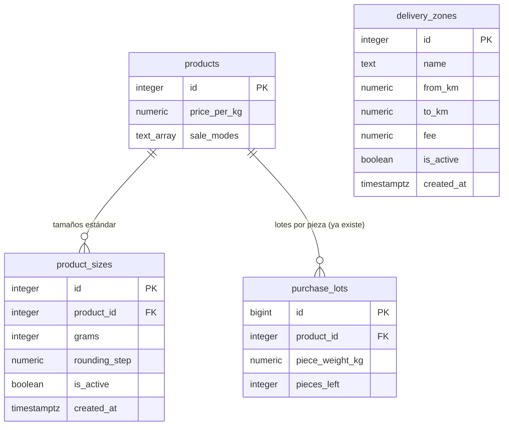

# Contrato de precios estándar y envío por zonas (T7a, datos)

Cubre S13 de `odd/tasks/rediseno-moderno.md`; S11 (pago completo) es el consumidor: T9 calcula el total en el servidor con estas funciones. Es la mitad de datos de T7a: modelos, migración escrita para revisión y funciones puras. La pantalla de configuración (panel) es de `frontend`, después.

Cita de Eduardo (2026-11-23, Engram #3362): "se estandarizan precios por piezas y gramaje: una pieza de tal gramaje cuesta tanto. Eso es el pedido por pieza; de ahí el pedido por precio; por peso".

**Estado:** la migración `supabase/migrations/20261124000001_precios_estandar_y_envio.sql` está escrita y **no aplicada en ninguna base**. Las funciones puras no consultan la base, así que el código puede desplegarse antes que la migración; el panel y T9 sí necesitan las tablas.

## 1. Qué ya existía y se reusa (no se duplica)

| Dato | Dónde vive | Evidencia |
|---|---|---|
| $/kg del producto | `products.price_per_kg` | `backend/inventory/models.py:151` |
| Modos de venta (`money`, `weight`, `pieces`) | `products.sale_modes` | `backend/inventory/models.py:202`, `backend/ventas/catalog.py:31` |
| Piezas enteras con su peso real | `purchase_lots.piece_weight_kg` y `pieces_left` | `supabase/migrations/20261119000001_lotes_por_pieza.sql:19-20` |
| Precio de una pieza entera | `piece_price`, ahora en `backend/inventory/pricing.py:130`; `panel/views_compras.py:21` la importa con el mismo nombre y contrato | `backend/inventory/test_pricing.py` (`PiecePriceTests`) |
| Redondeo | centavos, `ROUND_HALF_UP`, igual que `price_per_kg_from` | `backend/inventory/models.py:38-48` |

Lo nuevo son dos tablas de configuración: `product_sizes` y `delivery_zones`.

## 2. Modelo



Diagrama de flujo anotado con patrones y archivo:línea: `docs/diagramas/t7a-precios-er.html` (4 compuertas de Archify en `pass`; sin revisión visual humana).

Decisiones de diseño:

- **El precio de un tamaño no se guarda.** Se calcula `gramos × $/kg` y se redondea. Cambiar el $/kg del producto reprecia todos sus tamaños y ninguno queda viejo. (`size_price`, `pricing.py:145`.)
- **El redondeo es una configuración por tamaño** (`rounding_step`: 0.01, 0.10, 0.50 o 1.00). Ver la decisión 1.
- **Dinero:** `numeric(10,2)` y `numeric(5,2)` en Postgres, `DecimalField` en Django. Ningún float en ninguna ruta; un float o un booleano en la entrada se rechaza.
- **Claves:** `GENERATED BY DEFAULT AS IDENTITY`; `UNIQUE (product_id, grams)` (un producto tiene un tamaño por peso) y sirve de índice de la clave foránea.
- **Zonas:** una zona cubre `(from_km, to_km]`. La restricción `EXCLUDE USING gist (numrange(from_km, to_km, '(]') WITH &&) WHERE (is_active)` impide dos zonas activas que se traslapen, sin `btree_gist`. La distancia exacta 0 cae en la zona que empieza en 0. Fuera de la última zona no hay envío a domicilio.
- **Los modelos de Django** (`ventas/models.py:81` `ProductSize`, `:143` `DeliveryZone`) son espejos `managed = False`: Django no emite DDL. Viven en `ventas`, que no tiene carpeta de migraciones, así que `makemigrations --check --dry-run` sigue en "No changes detected". Las CHECK del modelo solo existen para que las pruebas (SQLite) rechacen lo mismo que Postgres.
- `ProductSize.clean()` (`models.py:129`) exige un producto con precio por kilo y con "Se vende por pieza" activo, la misma regla que ya usa el lote por pieza (`views_compras.py:181`). `DeliveryZone.clean()` (`:173`) explica el traslape antes de que Postgres lo rechace.

## 3. Contrato de funciones (puras: sin base, sin red)

Todas lanzan `PricingError` con `.code` de los que la tienda ya habla (`ventas/domain.py:45`): `invalid_amount`, `invalid_items`, `sale_mode_not_allowed`, `too_many_lines`.

### Pedido por pieza, por precio y por peso: `inventory.pricing.close_price`

```python
close_price(product, line, *, sizes=(), whole_pieces=(), price_per_kg=None) -> ClosedPrice
```

`product` es la fila (`id`, `price_per_kg`, `price_unit`, `sale_modes`, `stock`, `stock_unit`, `min_quantity_kg`). `sizes` son las filas de `ProductSize` del producto; `whole_pieces` son `PieceVariant(piece_weight_kg, pieces_left)` de los lotes por pieza abiertos. `price_per_kg` reemplaza el de lista cuando aplica una promoción (`Promotion.price_for`). `line` es lo que mandó el cliente:

| Modo (`mode`) | Se pide | Qué cierra |
|---|---|---|
| `pieces` (por pieza) | `quantity` (entero 1 a 10 000) y `size_id` **o** `piece_weight_kg` | precio de una pieza × cantidad |
| `money` (por precio) | `amount` ("200.00", hasta 2 decimales, hasta 1 000 000) | el cliente paga exactamente el monto; el carnicero corta `monto / $/kg` kilos, al gramo |
| `weight` (por peso) | `grams` (entero 1 a 1 000 000) | `gramos / 1000 × $/kg`, al centavo |

Cualquier otro campo (`total`, `unit_price`, `price_per_kg`, `currency`...) se rechaza con `invalid_items`: el servidor es el único que pone precio (`_ALLOWED_FIELDS`, `pricing.py:59`). `product_id`, si viene, debe ser el del producto.

El texto numérico es estricto y solo de dígitos ASCII (`[0-9]`): los dígitos de otros alfabetos (`"٥٠٠"`, `"５００"`) se rechazan con `invalid_amount`, igual que la función SQL `quote_line` (F-29). Un `size_id` solo vale si el tamaño es del producto (`size.product_id == product.id`) y está activo; uno de otro producto da `sale_mode_not_allowed` y `size_listing` no lo lista, así que la función no depende de que quien la llame pase solo `product.sizes` (F-30).

Forma JSON (`ClosedPrice.as_json()`; dinero y pesos como cadenas, nunca float):

```json
{
  "product_id": 7,
  "mode": "pieces",
  "source": "standard_size",
  "size_id": 1,
  "quantity": 2,
  "unit_price": "265.00",
  "price_per_kg": "779.00",
  "weight_kg": "0.680",
  "total": "530.00",
  "currency": "MXN",
  "warnings": []
}
```

`source` es `standard_size`, `whole_piece`, `amount` o `weight`. `unit_price` y `quantity` son `null` en `money` y `weight`. Avisos (`warnings`): `low_stock` y `below_minimum_quantity`, que solo avisan, como `quote_line`.

Ejemplos con Rib Eye CAB a $779/kg (los de Grill House, Engram #3277):

| Pedido | Resultado |
|---|---|
| `pieces`, 340 g × 1 | `265.00` |
| `pieces`, 500 g × 1 | `390.00` (389.50 redondeado hacia arriba) |
| `pieces`, 700 g × 1 | `545.00` |
| `pieces`, 500 g × 3 | `1170.00` (3 × 390, no 1168.50) |
| `money`, `200.00` | total `200.00`, `weight_kg` `0.257` |
| `weight`, 850 g | `662.15`, `weight_kg` `0.850` |
| `pieces`, pieza entera de 7.3 kg a $185/kg | `1350.50` |

### Listado de tamaños: `size_listing(product, sizes, price_per_kg=None)`

Devuelve, del más ligero al más pesado, solo los activos, y `[]` si el producto no tiene precio por kilo o no se vende por pieza: `[{"id": 1, "grams": 340, "weight_kg": "0.340", "price": "265.00"}, ...]`.

### Envío: `ventas.shipping.delivery_quote(zones, km)` y `delivery_fee`

`km` es un `Decimal` (o `int`) que mide el servidor, nunca un costo que mande el cliente.

```json
{"deliverable": true, "km": "7.20", "fee": "90.00", "zone": {"id": 2, "name": "Zona 2"}, "currency": "MXN", "reason": null}
{"deliverable": false, "km": "30.00", "fee": null, "zone": null, "currency": "MXN", "reason": "out_of_range"}
```

Con las zonas del ejemplo de Carnívoros (#3277): 0 a 5.5 km $50, 5.5 a 11 $90, 11 a 16 $160, 16 a 22 $210. Esas son filas editables, no código; la migración no siembra nada.

Una zona con `from_km`, `to_km` o `fee` que no sea un número finito (en Postgres `numeric` acepta `NaN`, que es mayor que todo número) se ignora: nunca cubre una distancia ni imprime `"fee": "NaN"`, y las demás zonas siguen sirviendo (`shipping.py:_is_usable`). La migración además lo rechaza al escribir (`<> 'NaN'` en los tres CHECK). `fee` no tiene tope: es una decisión de producto (§8).

### Total del pedido: `order_total(lines, delivery_fee)`

Suma las líneas cerradas más el envío (`None` si es recogida), de 1 a 50 líneas; un envío negativo o un pedido vacío se rechaza.

## 4. Cómo lo usa T9 y el panel

1. T9 carga las filas (`product.sizes.filter(is_active=True)`, los lotes por pieza abiertos, las zonas activas), llama `close_price` por línea y `order_total`, y manda a Stripe **ese** monto. Nada del cliente entra al total.
2. **No mandar líneas de tamaño al `quote_line` del SQL**: no conoce los tamaños. Para dinero y peso, `ventas/tests/test_contract_precios.py` (`GoldenCaseParityTests`) fija que la función da lo mismo que el SQL en los casos compartidos de `supabase/tests/cotizacion-casos.json`, para que las dos rutas no se separen.
3. `ventas/catalog.py:37` solo ofrece "pieces" si el corte tiene `avg_piece_weight_kg`. Un producto con tamaños pero sin ese peso no ofrecería piezas en el catálogo. Pendiente de T9/T4 (el archivo es de `backend-datos`, fuera de esta superficie).
4. La vista que reciba la línea debe aplicar CSRF, el límite de `ventas/throttle.py` y autenticación o la excepción documentada del invitado, igual que el carrito.
5. El panel (frontend, después) escribe `product_sizes` y `delivery_zones` con el rol `django`, llamando a `full_clean()` para que los mensajes de `clean()` lleguen a la persona.
6. **Requisitos de entrada de T9 (F-32).** `close_price` y `order_total` hoy aceptan lo que el SQL de la tienda acepta por línea, y T9 cobra de verdad, así que T9 debe decidir y poner antes de crear la sesión de pago:
   - **Mínimo y máximo del total del pedido.** Hoy el modo dinero acepta $0.39 y 10 000 piezas de 340 g dan $2 650 000.00; Stripe rechaza importes menores al mínimo de la moneda y mayores a su tope. Los valores son de Eduardo (§8).
   - **Tope de peso por línea de piezas.** Solo el modo dinero tiene tope de peso (`pricing.py:271-272`, 1000 kg); una línea de piezas enteras no (10 000 piezas de 7.3 kg son 73 000 kg).
   - **Política de `low_stock`.** La advertencia no bloquea nada: 10 000 piezas con 1 en el estante se aceptan. T9 decide si `low_stock` impide el pago o si se reserva la existencia al crear el pedido.
   Además: acotar a `MAX_ORDER_LINES` antes de consultar productos, y pasar a `close_price` solo `mode`, `product_id` y los campos permitidos del modo (el detalle por vista está en `docs/auditoria/rediseno-seguridad.md`, sección 9, (f)).

## 5. Matriz de RLS (rol × tabla × operación)

RLS activo en las dos tablas (`migración:62` y `:105`). Las dos siguen el patrón de `product_promotions` (`20261113000001_comercio_v1_esquema.sql:397-408`).

| Rol | `product_sizes` | `delivery_zones` |
|---|---|---|
| `anon` | SELECT solo filas con `is_active` | SELECT solo filas con `is_active` |
| `authenticated` no admin | SELECT solo activas; INSERT, UPDATE, DELETE rechazados por la política | igual |
| `authenticated` con `is_admin()` | todo | todo |
| `django` | todo | todo |
| `PUBLIC` | sin permisos (`REVOKE ALL`) | sin permisos |

Residual conocido: `anon` puede leer los tamaños activos de un producto desactivado. No es dato sensible (el precio sale de un $/kg ya público).

### Pruebas de RLS (escritas, no corridas)

La versión ejecutable, con 83 aserciones pgTAP (68 de la primera versión y 15 que cierran los huecos de la auditoría: UPDATE y DELETE cruzados de un cliente ajeno con 0 filas, los mismos de `anon` con `42501`, `nextval` de las dos secuencias, y `NaN` en `fee`, `from_km` y `to_km` con `23514`) y los ayudantes de `ayudas.sql`, es `supabase/tests/precios_estandar_y_envio.sql`: la recoge `correr.sh` (que nombra la prueba de una migración sin su sello de tiempo) en la base de trabajo `comercio_v1_test`, nunca con datos de clientes. El bloque de abajo es la versión corta para psql en una base local o de pruebas. Variables de psql: `:product_id` (un producto cualquiera), `:admin_uuid` (un usuario con `is_admin()` verdadero) y `:user_uuid` (uno sin rol de admin).

```sql
BEGIN;
INSERT INTO public.product_sizes (product_id, grams, is_active) VALUES (:product_id, 340, true), (:product_id, 500, false);
INSERT INTO public.delivery_zones (name, from_km, to_km, fee, is_active) VALUES ('A', 0, 5.5, 50, true), ('B', 5.5, 11, 90, false);

-- anon: solo lo activo, y no escribe
SET LOCAL ROLE anon;
SELECT count(*) AS anon_ve_tamanos_activos FROM public.product_sizes;            -- esperado 1
SELECT count(*) AS anon_ve_zonas_activas   FROM public.delivery_zones;           -- esperado 1
SAVEPOINT s1; INSERT INTO public.product_sizes (product_id, grams) VALUES (:product_id, 700);  -- esperado: permission denied
ROLLBACK TO s1;
SAVEPOINT s1b; UPDATE public.delivery_zones SET fee = 1;                       -- esperado: permission denied
ROLLBACK TO s1b;
SAVEPOINT s1c; DELETE FROM public.product_sizes;                                -- esperado: permission denied
ROLLBACK TO s1c;
SAVEPOINT s1d; SELECT nextval('public.product_sizes_id_seq');                   -- esperado: permission denied (F-28)
ROLLBACK TO s1d;
RESET ROLE;

-- usuario ajeno (authenticated sin admin): lee lo activo, no escribe
SET LOCAL ROLE authenticated;
SELECT set_config('request.jwt.claims', json_build_object('sub', :'user_uuid', 'role', 'authenticated')::text, true);
SELECT count(*) AS ajeno_ve FROM public.delivery_zones;                          -- esperado 1
SAVEPOINT s2; INSERT INTO public.delivery_zones (name, from_km, to_km, fee) VALUES ('C', 11, 16, 160);  -- esperado: viola la politica de seguridad
ROLLBACK TO s2;
UPDATE public.delivery_zones SET fee = 1;                                        -- esperado: UPDATE 0 (sin error)
DELETE FROM public.product_sizes;                                                -- esperado: DELETE 0 (sin error)
RESET ROLE;

-- admin: lee y escribe todo
SET LOCAL ROLE authenticated;
SELECT set_config('request.jwt.claims', json_build_object('sub', :'admin_uuid', 'role', 'authenticated')::text, true);
SELECT count(*) AS admin_ve FROM public.delivery_zones;                          -- esperado 2
INSERT INTO public.delivery_zones (name, from_km, to_km, fee) VALUES ('C', 11, 16, 160);          -- esperado: ok
RESET ROLE;

-- django: todo
SET LOCAL ROLE django;
SELECT count(*) AS django_ve FROM public.product_sizes;                          -- esperado 2
RESET ROLE;

-- restricciones (como django)
SET LOCAL ROLE django;
SAVEPOINT c1; INSERT INTO public.product_sizes (product_id, grams) VALUES (:product_id, 340);                    -- esperado: unique violation
ROLLBACK TO c1;
SAVEPOINT c2; INSERT INTO public.product_sizes (product_id, grams) VALUES (:product_id, 0);                      -- esperado: check violation
ROLLBACK TO c2;
SAVEPOINT c3; INSERT INTO public.product_sizes (product_id, grams, rounding_step) VALUES (:product_id, 900, 0.25);  -- esperado: check violation
ROLLBACK TO c3;
SAVEPOINT c4; INSERT INTO public.delivery_zones (name, from_km, to_km, fee) VALUES ('D', 5, 8, 100);              -- esperado: exclusion violation (traslapa con A)
ROLLBACK TO c4;
SAVEPOINT c5; INSERT INTO public.delivery_zones (name, from_km, to_km, fee) VALUES ('E', 8, 8, 100);             -- esperado: check violation
ROLLBACK TO c5;
SAVEPOINT c6; INSERT INTO public.delivery_zones (name, from_km, to_km, fee) VALUES ('F', 50, 55, 'NaN');         -- esperado: check violation (F-31)
ROLLBACK TO c6;
SAVEPOINT c7; INSERT INTO public.delivery_zones (name, from_km, to_km, fee) VALUES ('G', 'NaN', 60, 10);        -- esperado: check violation (F-31)
ROLLBACK TO c7;
SAVEPOINT c8; INSERT INTO public.delivery_zones (name, from_km, to_km, fee) VALUES ('H', 60, 'NaN', 10);        -- esperado: check violation (F-31)
ROLLBACK TO c8;
RESET ROLE;
ROLLBACK;
```

## 6. Índices y consultas

No se propone ningún índice más: las tablas son de decenas de filas y nada se midió lento.

| Consulta | Índice que la sirve |
|---|---|
| tamaños activos de un producto por gramos | `UNIQUE (product_id, grams)` (también cubre la clave foránea) |
| zona que cubre una distancia | la tabla es de unas 5 filas; la exclusión GiST ya existe |

## 7. Plan de migración (expansión sin contracción)

| Paso | Qué | Bloqueo | Reversa |
|---|---|---|---|
| 1 | `CREATE TABLE product_sizes` con RLS, GRANT y políticas | `SHARE ROW EXCLUSIVE` sobre `products` unos milisegundos (la clave foránea); sin reescritura | `DROP TABLE public.product_sizes` (pierde la configuración; confirmar antes) |
| 2 | `CREATE TABLE delivery_zones` con RLS, GRANT y políticas | ninguno sobre tablas existentes | `DROP TABLE public.delivery_zones` (igual) |
| 3 | Desplegar el panel (frontend) y T9 | n/a | revertir el despliegue; las tablas pueden quedar |

Orden de aplicación: después de `20261119000003`. `claude-db lint-migration.mjs`: 23 sentencias, 0 destructivas, nivel de bloqueo "none", 0 reescrituras. `lint-missing-fk-index.mjs` y `lint-antipatterns.mjs`: sin hallazgos. Django 5.2.19 (`backend/uv.lock`), no 6.0: https://docs.djangoproject.com/en/5.2/topics/migrations/.

## 8. Suposiciones y decisiones para Eduardo

1. **Redondeo (conflicto entre dos instrucciones).** El encargo pedía "centavos, ROUND_HALF_UP" y también 340 g = $265, 500 g = $390, 700 g = $545 a $779/kg. Con centavos, 340 g × $779/kg = $264.86, 500 g = $389.50, 700 g = $545.30 (prueba `test_with_a_cents_step_the_same_sizes_are_not_the_published_prices`). Los $265, $390 y $545 de Grill House son pesos enteros. Se resolvió con `rounding_step` por tamaño, con **1.00 (peso) por defecto**, que es lo que reproduce los precios literales; el redondeo sigue siendo mitad hacia arriba. Las piezas enteras (`piece_price`) siguen en centavos, como antes. Si Eduardo prefiere centavos para los tamaños, basta cambiar el valor por defecto.
2. **SUPOSICIÓN:** el borde superior de una zona es inclusivo (5.5 km cuesta $50; 5.51 km, $90). La fuente solo dice "0-5.5 km" y "5.5-11 km".
3. **Una sola fuente de precios.** Hoy hay dos implementaciones de la regla para dinero y peso: el `quote_line` del SQL y `close_price`. Las une un archivo de casos compartido. Recomendación: que T9 use `close_price` para toda línea de la web y deje `quote_line` al personal del panel; la alternativa es agregar `p_size_id` al SQL (más superficie de riesgo 1).
4. **Promociones sobre tamaños:** `close_price` acepta el `price_per_kg` ya con la promoción; la decisión de aplicarla es de T9 (recomendado, como `quote_line`).
5. **No modelado:** envío gratis desde un monto (Grill House, $1,899), precio fijo que reemplace al calculado, y entrega express. Se pueden agregar sin cambiar lo escrito.
6. **Sin semilla:** ni los tamaños ni las zonas de la competencia se siembran; los pone el dueño desde el panel.
7. **Tope de `fee` (F-31), decisión de producto, sin cambio.** La migración rechaza `NaN` pero no pone un máximo al costo de envío: un error de teclado ($1 000 000) pasaría. Si Eduardo quiere un tope, se agrega un CHECK y una validación en `DeliveryZone`; mientras la migración no esté aplicada no cuesta nada.
8. **Mínimo y máximo del total, tope de peso por línea de piezas y política de `low_stock` (F-32):** valores de Eduardo antes de T9 (ver §4, punto 6).
