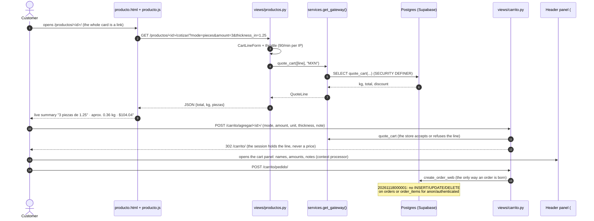
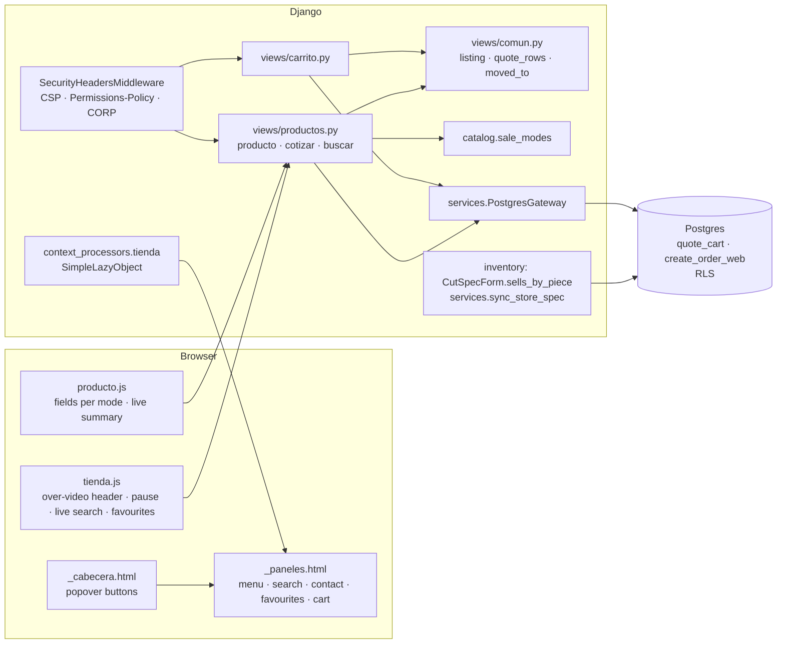

# The Django store: header, product configuration and order safety

This document describes the public store as it lives in Django (`backend/ventas`), with the design patterns the code actually uses. Every pattern points to the file and line that implement it.

## 1. From the product to the order (sequence)

## 2. Components and patterns

| Pattern | Where | What it does here |
|---|---|---|
| **Gateway** | `backend/ventas/services.py:167` (`PostgresGateway`), `:350` (`get_gateway`) | Every price and every order goes through the Postgres functions. Views never compute a total. |
| **Test double: Fake** | `backend/ventas/tests/support.py:76` (`FakeGateway`) | It applies the same cases file as the SQL tests, so a number the double gives is a number the database gives. |
| **Chain of Responsibility (middleware)** | `backend/config/middleware.py:72` (`SecurityHeadersMiddleware`), `:7` (`RequestBodyLimitMiddleware`) | Each middleware handles one concern and passes the request on. |
| **Lazy proxy** | `backend/ventas/context_processors.py:52` (`SimpleLazyObject`) | The cart panel and the menu categories query the database only when a template uses them. |
| **Adapter** | `backend/ventas/views/carrito.py:56` (`_PublicSlot`) | It exposes the public session key with the interface `ventas.cart` expects, so one set of cart rules serves both the counter and the store. |
| **Template partial (Composite)** | `backend/ventas/templates/ventas/tienda/_tarjeta_producto.html`, included at `productos.html:44`, `_landing_productos.html:14`, `producto.html:118` | One product card everywhere, so the "the whole card opens the configuration" rule cannot drift. |
| **Factory function** | `backend/ventas/views/comun.py:34` (`moved_to`) | It builds the 301 views of the old addresses `index.html`, `products.html` and `accessweb.html`. |
| **Progressive enhancement** | `backend/ventas/templates/ventas/tienda/_paneles.html:9`, `:85` (native `popover`) and `backend/static/tienda/tienda.js:41` | The panels open without JavaScript; the script only adds live search, favourites and the header over the video. |
| **Strategy (by mode)** | `backend/static/tienda/producto.js` (`WAYS`) and `backend/ventas/catalog.py:26` (`sale_modes`) | Weight, money and pieces each set their own fields, step and help text. The server decides which modes a product allows. |
| **Policy as data (owner's choice)** | `backend/inventory/forms.py:204` (`sells_by_piece`), `backend/inventory/services.py:157` (`sync_store_spec`) | The owner says whether a product sells by pieces. Nothing is inferred from the weight. |
| **Least privilege (database)** | `supabase/migrations/20261118000001_cerrar_pedidos_directos.sql:14-24` | Customers read their own orders; only the functions of the store write them. |
| **Rate limiting (token count in cache)** | `backend/ventas/views/productos.py:77` (`_too_many_quotes`) | It caps the live quotes per client address. |

## 3. Evidence

- Django: `uv run python manage.py test` gives "Ran 974 tests … OK". The new tests are `ventas/tests/test_header.py`, `test_producto.py` and `config/test_security_headers.py`.
- SQL: `bash supabase/tests/correr.sh` gives "TOTAL: 784 pruebas, 0 fallas", with every DOWN block proven to leave the schema identical.
- Browser, against the real data:
  - the live search returns eight products;
  - the quotes are 0.5 kg = $144.50 and 3 pieces of 1.25" = $104.04;
  - a note travels with its line;
  - the page behind the open cart panel still scrolls;
  - at 375 px the page has no horizontal overflow.
